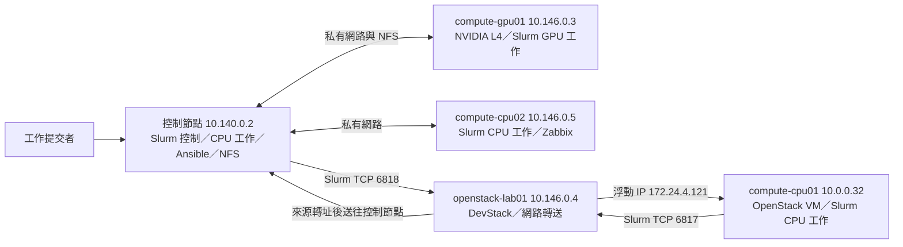

# HPC 叢集建置與維運作品

在 GCP 與 DevStack 環境建立四節點 Slurm 叢集：一台控制節點、
一台 NVIDIA L4 運算節點，以及兩台獨立 CPU 運算節點。
使用 Ansible 部署節點設定，接通 NFS 與 OpenStack 客體的網路路徑，
以 CPU／GPU 工作結果和 Zabbix 故障事件核對派工與復原。

## 系統架構

Slurm 的四個節點是控制節點、`compute-gpu01`、`compute-cpu02` 和
`compute-cpu01`；`openstack-lab01` 承載 OpenStack 客體並處理網路轉送。
控制節點提供的 NFS 由 GPU 節點掛載。
更完整的位址、資源與路徑可看[拓撲](project/docs/cluster-topology.md)和
[四節點設定](project/slurm/four-node-slurm.conf)。

## 實作內容

| 項目 | 實際結果 | 相關內容 |
|---|---|---|
| L4 熱擴散計算 | Slurm 配置一張 NVIDIA L4，在 `compute-gpu01` 執行 `1024×1024` 網格、200 步；CPU 與 GPU 答案逐格比對，`validation=PASS` | [程式](project/workloads/heat2d.cu)、[工作輸出](curriculum/module-05.md) |
| 兩台 CPU 節點的相同工作 | `compute-cpu01` 與 `compute-cpu02` 以相同的 1 CPU、512 MiB 請求完成熱擴散工作，總和均為 `65535.998004`、`validation=PASS` | [程式](project/workloads/heat2d_cpu.cpp)、[工作輸出](curriculum/module-06.md) |
| 監控與故障復原 | Zabbix 記錄 `slurmd` 停止告警；節點隔離期間，未指定節點的新工作由 `compute-cpu01` 完成並回報 `validation=PASS` | [故障與工作結果](curriculum/module-06.md) |
| 跨 VM MPI 與共享資料 | 控制節點與 GPU VM 各執行一個 CPU rank，使用共享執行檔計算 `15+40=55` | [程式](project/workloads/sum_mpi.c)、[跨節點結果](curriculum/module-04.md) |

## 作品呈現的能力

| 能力 | 作品中的實作 | 相關內容 |
|---|---|---|
| HPC 叢集架構與資源規劃 | 規劃控制、GPU 與兩台 CPU 節點的角色、分區及資源配置 | [拓撲](project/docs/cluster-topology.md)、[Slurm 設定](project/slurm/four-node-slurm.conf) |
| Slurm 與 Linux 服務管理 | 設定 MUNGE、`slurmctld`、`slurmd`，判讀節點狀態與工作結果，處理節點故障及恢復 | [服務與工作結果](curriculum/module-06.md) |
| 網路與共享資料路徑 | 接通 GCP 私有網路、NFS、OpenStack 客體的 SSH 管理與 Slurm 雙向通路，配置 SNAT／DNAT | [跨節點資料路徑](curriculum/module-04.md)、[客體網路](curriculum/module-05.md) |
| 叢集部署自動化 | 使用 Ansible 部署 NFS、MUNGE 及 Slurm 設定，將 OpenStack CPU 客體納入排程 | [Playbooks](project/ansible/)、[部署結果](curriculum/module-05.md) |
| Python、C/C++ 與平行程式 | 編寫提交前健檢工具、C/C++ 與 MPI 工作，並以 CPU／CUDA 熱擴散程式核對答案 | [Python](curriculum/module-02.md)、[C/C++ 與 MPI](curriculum/module-03.md)、[CPU](curriculum/module-06.md)／[L4](curriculum/module-05.md)工作 |
| GPU 資源管理 | 以 Slurm GRES 配置 NVIDIA L4，提交 GPU 熱擴散工作並取得 `validation=PASS` | [設定與工作結果](curriculum/module-05.md) |
| 監控與故障復原 | 使用 Zabbix 捕捉 `slurmd` 停止告警，核對節點隔離、工作轉移及恢復後的答案 | [告警與復原結果](curriculum/module-06.md) |
| OpenStack 客體納管 | 在 DevStack 供給 CPU VM、建立管理與 Slurm 網路通路，並完成指定客體的 Slurm 工作 | [供給與工作結果](curriculum/module-05.md) |
