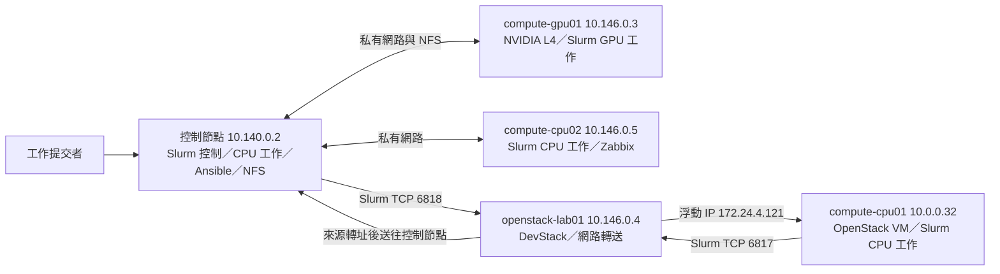

# HPC 叢集建置與維運作品

在 GCP 與 DevStack 環境建立四節點 Slurm 叢集：一台控制節點、
一台 NVIDIA L4 運算節點，以及兩台獨立 CPU 運算節點。
使用 Ansible 部署節點設定，接通 NFS 與 OpenStack 客體的網路路徑，
以 CPU／GPU 工作結果和 Zabbix 故障事件核對派工與復原。

## 系統架構

Slurm 的四個節點是控制節點、`compute-gpu01`、`compute-cpu02` 和
`compute-cpu01`；`openstack-lab01` 承載 OpenStack 客體並處理網路轉送。
控制節點提供的 NFS 由 GPU 節點掛載。
更完整的位址、資源與路徑可看[拓撲](project/docs/cluster-topology.md)和
[四節點設定](project/slurm/four-node-slurm.conf)。

## 實作內容

| 項目 | 實際結果 | 相關內容 |
|---|---|---|
| L4 熱擴散計算 | Slurm 配置一張 NVIDIA L4，在 `compute-gpu01` 執行 `1024×1024` 網格、200 步；CPU 與 GPU 答案逐格比對，`validation=PASS` | [程式](project/workloads/heat2d.cu)、[工作輸出](curriculum/module-05.md) |
| 兩台 CPU 節點的相同工作 | `compute-cpu01` 與 `compute-cpu02` 以相同的 1 CPU、512 MiB 請求完成熱擴散工作，總和均為 `65535.998004`、`validation=PASS` | [程式](project/workloads/heat2d_cpu.cpp)、[工作輸出](curriculum/module-06.md) |
| 監控與故障復原 | Zabbix 記錄 `slurmd` 停止告警；節點隔離期間，未指定節點的新工作由 `compute-cpu01` 完成並回報 `validation=PASS` | [故障與工作結果](curriculum/module-06.md) |
| 跨 VM MPI 與共享資料 | 控制節點與 GPU VM 各執行一個 CPU rank，使用共享執行檔計算 `15+40=55` | [程式](project/workloads/sum_mpi.c)、[跨節點結果](curriculum/module-04.md) |

## 作品呈現的能力

- **叢集與排程：** 規劃四節點角色與分區，設定 MUNGE、Slurm 及 GPU GRES。
- **部署與網路：** 使用 Ansible 部署叢集服務，接通 NFS、GCP 私有網路及 OpenStack 客體的 Slurm 通路。
- **計算與驗證：** 編寫 Python 健檢工具，以及 C/C++、MPI、CUDA 工作負載，核對跨節點與 CPU／GPU 計算結果。
- **監控與復原：** 使用 Zabbix 告警、Slurm 節點隔離與工作結果確認故障處理。
