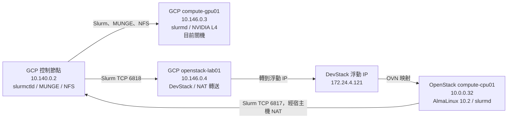

# 模組 05：HPC 叢集建置與管理自動化

[能力路線](ROADMAP.md)｜職缺核心：叢集建置與管理自動化。

## 要解決的問題與交付物

**目標：** 用 Ansible 管理原有的 GPU 運算節點，並將 OpenStack 建立的
`compute-cpu01` 加入 Slurm，供模組 06 使用兩台獨立運算節點。
本模組的 CPU 節點驗收範圍是能註冊並接到基本 Slurm 工作；
模組 06 再驗證監控、故障復原和工作結果。

## 目前叢集架構



| 節點 | 角色與資源 | 模組 05 的實際結果 |
|---|---|---|
| 控制節點 `10.140.0.2` | `slurmctld`、MUNGE、NFS 伺服器；`debug` 分區 | 管理兩個運算節點的 Slurm 設定與工作提交 |
| `compute-gpu01` `10.146.0.3` | GCP 運算 VM；4 邏輯 CPU、1 張 NVIDIA L4；`gpu` 分區 | 曾透過 Slurm 完成 L4 熱擴散工作；目前關機 |
| `openstack-lab01` `10.146.0.4` | GCP VM，執行 DevStack 與 CPU 客體；提供 NAT 轉送 | 將控制節點連向 `10.146.0.4:6818` 的流量轉入 CPU 客體 |
| `compute-cpu01` `10.0.0.32` | OpenStack VM；AlmaLinux 10.2、1 vCPU、2 GiB RAM、20 GiB 磁碟；`cpu` 分區 | MUNGE 與 Slurm 以套件安裝；最後一次 Slurm 核對為 `IDLE`、1 CPU、1400 MiB；`srun hostname` 回報 `compute-cpu01.novalocal` |

**網路關係：** `172.24.4.121` 是 DevStack 分配給 CPU 客體的浮動 IP，
不是另一台 VM。控制節點到 CPU 客體的 Slurm TCP `6818`
先到 OpenStack 宿主機，再經浮動 IP 映射到客體 `10.0.0.32`；
客體連回控制節點 TCP `6817` 則經宿主機 NAT。
控制節點對 GPU 節點提供 NFS 共享路徑；本次 CPU 客體沒有掛載 NFS。

**目前狀態：** CPU 客體的 Slurm 工作已驗證；GPU 節點目前關機。
表中的 `IDLE` 是最後一次實測，並非即時狀態。

下文依序保留原有 GCP 節點的 Ansible 部署與 GPU 工作結果、
OpenStack CPU VM 的建立，以及 CPU 節點加入 Slurm 的實際指令與輸出。

## 管理位置與本次部署範圍

**執行位置：** 所有 Ansible 指令都在**控制節點**的
`/root/hpc-arch/project/ansible` 目錄以 root 執行。
[ansible.cfg](../project/ansible/ansible.cfg) 指向
[hosts.yml](../project/ansible/inventory/hosts.yml)，
其中 `controller` 是控制節點本機，`gpu_compute` 是透過既有 SSH 金鑰
連到私有 IP `10.146.0.3` 的 `compute-gpu01`；`cpu_compute`
透過 `openstack-lab01` 的 OVN 命名空間連到 `10.0.0.32` 的
`compute-cpu01`。
Inventory 只列出已存在的 VM，不會建立雲端資源。

**閱讀順序：** 下方先交代已建立的管理通路、NFS 和 MUNGE 設定及執行結果。
**本次兩節點 Slurm 部署的步驟從「1. 核對資源與帳號」開始：**
先核對 GPU VM 與兩台 VM 的帳號空間，
再執行 `slurm-identity.yml`，最後才執行 `slurm-two-node.yml`。
每個步驟都把指令、執行的檔案、檔案內的任務和實際結果放在一起。

**檔案位置：** 工作樹中的 `project/` 檔案是**部署來源**；
`/etc/` 下的檔案才是各 VM 服務實際讀取的檔案。
相同路徑出現在兩台 VM 時，各自是本機磁碟上的一份，並非同一個檔案。
下方每個步驟分別說明來源、目標及服務何時讀取。

## 已建立的 Ansible 管理通路

**管理通路：** Ansible 沿用模組 04 已驗證的 SSH 管理通路。
**Inventory** 列目標主機；**playbook** 描述檔案、掛載和服務應有的狀態；
**handler** 在任務真的變更時才由 `notify` 觸發。
正式執行的 `changed` 表示已改動受管狀態；`changed=0` 表示重跑沒有額外變更。
`--syntax-check` 只解析 playbook，`--check --diff` 只預演，
都不能當成檔案已複製或服務已啟動。

### 核對 Ansible 管理清單

在控制節點執行下列指令。它先讀取目前目錄的
[ansible.cfg](../project/ansible/ansible.cfg)，再依設定讀取
[hosts.yml](../project/ansible/inventory/hosts.yml) 並列出群組與主機；
這裡沒有執行 playbook，也不連線或修改任何 VM：

**已執行指令：**

```bash
ansible-inventory --graph
```

**實際輸出：**

```text
@all:
  |--@ungrouped:
  |--@controller:
  |  |--instance-20260923-104239
  |--@gpu_compute:
  |  |--compute-gpu01
  |--@cpu_compute:
  |  |--compute-cpu01
```

**判讀：** 目前 inventory 中的 `controller`、`gpu_compute`、`cpu_compute`
三個群組各列出預期的節點；清單顯示節點名稱，不代表 VM 當下在線。
下方保留先前以 `hosts.yml` 選 `gpu_compute`，透過 SSH 在 GPU VM
執行 Ansible `ping` 模組的實測。這個 `ping` 不是 ICMP，
回傳 `pong` 才代表遠端模組可執行：

**已執行指令：**

```bash
ansible -i /root/hpc-arch/project/ansible/inventory/hosts.yml gpu_compute -m ansible.builtin.ping
```

**實際輸出：**

```text
compute-gpu01 | SUCCESS => {
    "ansible_facts": {"discovered_interpreter_python": "/usr/bin/python3"},
    "changed": false,
    "ping": "pong"
}
```

## 已完成的 NFS 自動化

**已有能力：** 模組 04 已手動驗證兩台 VM 對 `/srv/hpc-share` 的雙向讀寫。
第一條指令執行
[nfs-controller.yml](../project/ansible/nfs-controller.yml)。
該檔在**控制節點**依序確認 `nfs-utils`、核對 `/srv/hpc-share`
的擁有者和權限、把工作樹中的
[hpc-share.exports](../project/nfs/hpc-share.exports) 複製到
控制節點自己的 `/etc/exports.d/hpc-share.exports`，
最後確認 `nfs-server` 正在運行。
匯出檔真的改動時，handler 才執行 `exportfs -ra` 重新讀取分享清單。

**已執行指令：**

```bash
ansible-playbook -i /root/hpc-arch/project/ansible/inventory/hosts.yml /root/hpc-arch/project/ansible/nfs-controller.yml
```

**實際輸出：**

```text
PLAY RECAP
instance-20260923-104239 : ok=5 changed=0 unreachable=0 failed=0 skipped=0 rescued=0 ignored=0
```

### 部署 GPU 節點的 NFS 掛載

[nfs-gpu-client.yml](../project/ansible/nfs-gpu-client.yml)
由下一條指令執行。它在 **GPU VM** 先確認 `nfs-utils`，
再把控制節點 `10.140.0.2:/srv/hpc-share` 接到**GPU VM 自己的**
`/srv/hpc-share`，同時核對 GPU VM 的 `/etc/fstab` 項目與掛載狀態。
`ansible.posix.mount` 來自
[requirements.yml](../project/ansible/requirements.yml) 固定的
`ansible.posix:2.2.2`；實際已安裝該版本。
掛載選項為 `rw,vers=4.2,_netdev,nofail,x-systemd.automount`，
用途與副作用寫在 playbook 中文註解中。
正式執行與重跑都沒有改動既有掛載：

**已執行指令：**

```bash
ansible-playbook nfs-gpu-client.yml
```

**實際輸出：**

```text
PLAY RECAP
compute-gpu01 : ok=3 changed=0 unreachable=0 failed=0 skipped=0 rescued=0 ignored=0
```

**判讀：** 同一指令重跑的結果也為 `ok=3 changed=0 failed=0`；
既有兩台 VM 的 NFS 狀態符合 playbook。

## 已完成的 MUNGE 跨節點身分驗證

**新增能力的原因：** 模組 04 的 MPI 工作由 SSH 啟動，不需要 GPU VM 的 Slurm 服務。
要由 Slurm 控制端分配工作，GPU VM 的 `slurmd` 必須能用 MUNGE
驗證同一叢集的請求。兩台 VM 使用控制節點既有的 MUNGE 金鑰；
金鑰內容只留在 VM 的 `/etc/munge/munge.key`，不存入專案或輸出。

**已安裝套件：** GPU VM 已安裝與控制節點同版的運算端套件：

| 套件 | 已安裝版本 | 用途 |
|---|---|---|
| `munge`、`munge-libs` | `0.5.15-11.el10_1.x86_64` | 產生與驗證憑證 |
| `slurm`、`slurm-slurmd` | `26.05.4-1.el10.x86_64` | 運算節點的 Slurm 元件與服務 |

同一筆安裝交易另帶入 `bash-completion`、`mariadb-connector-c`、
`mariadb-connector-c-config`；套件準備不是本模組的操作重點。

### 部署 GPU 節點的 MUNGE

下列指令執行 [munge-gpu.yml](../project/ansible/munge-gpu.yml)。
該檔在 **GPU VM** 依序核對 MUNGE 目錄權限、
從**控制節點的** `/etc/munge/munge.key` 複製金鑰到
**GPU VM 自己的**同名路徑、設為 `munge:munge` 與 `0600`，
最後啟用 GPU VM 的 `munge` 服務。
金鑰真的改動時，handler 才重啟 GPU VM 的 MUNGE；
Ansible 不顯示金鑰內容或差異。

**已執行指令：**

```bash
ansible-playbook munge-gpu.yml
```

**實際輸出：**

```text
TASK [部署叢集共用的 MUNGE 金鑰]           changed: [compute-gpu01]
TASK [確保 GPU VM 的 MUNGE 已啟動]         changed: [compute-gpu01]
RUNNING HANDLER [重新啟動 GPU VM 的 MUNGE] changed: [compute-gpu01]
PLAY RECAP
compute-gpu01 : ok=5 changed=3 unreachable=0 failed=0 skipped=0 rescued=0 ignored=0
```

**驗證目的：** 在控制節點以 `a2264` 產生短效憑證，經既有 SSH 金鑰交給 GPU VM 的
`unmunge` 解碼；左側 `munge -n` 不把金鑰輸出，管線只傳短效憑證。
`-i` 選 SSH 私鑰，`IdentitiesOnly=yes` 限定使用該金鑰，
`BatchMode=yes` 不互動詢問，`ConnectTimeout=5` 限制連線等待。
這只檢查驗證通路，不提交 Slurm 工作或改動服務：

**已執行指令：**

```bash
sudo -u a2264 -- munge -n | sudo -u a2264 -- ssh -i /home/a2264/.ssh/hpc_gpu_ed25519 -o IdentitiesOnly=yes -o BatchMode=yes -o ConnectTimeout=5 a2264@10.146.0.3 unmunge
```

**實際輸出：**

```text
STATUS:          Success (0)
ENCODE_HOST:     instance-20260923-104239.asia-east1-b.c.project-78b8a95c-a2c0-461f-a08.internal (10.140.0.2)
UID:             a2264 (1000)
GID:             a2264 (1005)
```

**判讀：** GPU VM 成功解碼控制節點的憑證，跨 VM 的 MUNGE 驗證通路可用。
重跑 `ansible-playbook munge-gpu.yml` 得到 `ok=4 changed=0 failed=0`，
沒有重新複製金鑰或重啟服務。

## 1. 核對 GPU VM 資源與帳號空間

### 量測 GPU 節點資源

Slurm 按節點宣告的 CPU、記憶體和 **GRES**（通用資源）分配工作；
GPU 是本叢集的 GRES。先在 GPU VM 以 `a2264` 執行 `slurmd -C`，
直接讀取本機硬體並列出建議節點設定；
這條指令不執行 playbook，也不啟動服務：

**已執行指令：**

```bash
slurmd -C
```

**實際輸出：**

```text
NodeName=compute-gpu01 CPUs=4 Boards=1 SocketsPerBoard=1 CoresPerSocket=2 ThreadsPerCore=2 RealMemory=15983 Gres=gpu:nvidia_l4:1
Found gpu:nvidia_l4:1 with Autodetect=nvidia (Substring of gpu name may be used instead)
```

**判讀：** GPU VM 有 4 個邏輯 CPU、15,983 MiB 記憶體和一張 NVIDIA L4。
兩節點設定只宣告 14,000 MiB 給工作，保留其餘容量給系統與服務。
`slurmd -C` 是硬體探測，不能當成 GPU 已交由 Slurm 分配。

### 為何要統一帳號編號

**概念：** Linux 帳號除了名稱，還有數字身分：**UID** 是使用者編號，
**GID** 是群組編號；檔案擁有權和服務身分會用到它們。
`800:800` 表示 UID 800 的使用者，其主要群組是 GID 800。
兩台 VM 即使都有叫 `slurm` 的帳號，也要核對數字身分。

**現有帳號：** 控制節點的 `slurm` 在[模組 01 的單節點建置](module-01.md#驗證身分與服務)
由 `useradd -r -M -U -s /sbin/nologin slurm` 建立；
當時 `id slurm` 回報 `uid=994(slurm) gid=994(slurm)`。
GPU VM 的 `994:994` 已屬於 `munge`，不能照搬控制節點的數字。
改號前要找出兩台 VM 都沒有占用的
使用者編號和群組編號。在控制節點的 Ansible 目錄以 root 執行
兩條只讀查詢，**不執行 playbook 檔案**：第一條查兩台 VM 的 UID 800，
第二條查 GID 800。
`ansible all` 選兩台 VM；`getent` 讀帳號資料庫；
`fail_key=false` 讓查無資料回傳空值。查詢不建立帳號或群組。

**已執行指令：**

```bash
ansible all -m ansible.builtin.getent -a 'database=passwd key=800 fail_key=false'
ansible all -m ansible.builtin.getent -a 'database=group key=800 fail_key=false'
```

`getent_passwd["800"]`、`getent_group["800"]` 是輸出中的
使用者與群組查詢欄位，**不是指令**。實際結果如下；
`null` 表示該 VM 找不到這個編號：

| 查詢 | 控制節點 | GPU VM |
|---|---|---|
| `getent_passwd["800"]` | `null` | `null` |
| `getent_group["800"]` | `null` | `null` |

**判讀：** 兩台 VM 的 UID 與 GID 800 都未占用，因此選 `800:800`。

**改號影響：** 控制節點的 `/var/spool/slurmctld` 保存排程狀態，
原本由 UID/GID `994:994` 的 `slurm` 帳號持有。
只改帳號編號，舊狀態檔不會自動變成新帳號的檔案；
因此下方 playbook 也把這個目錄及其內容交給新的 `800:800` 帳號。

## 2. 執行 slurm-identity.yml：統一服務帳號

**目的與執行位置：** 在控制節點的 Ansible 目錄以 root **正式執行**：

**已執行指令：**

```bash
ansible-playbook slurm-identity.yml
```

這條指令執行的是
[slurm-identity.yml](../project/ansible/slurm-identity.yml)。
檔案中的任務依序處理：

1. 在 **GPU VM** 建立不能互動登入、沒有家目錄的 `slurm` 群組與使用者，
   UID/GID 固定為 `800:800`，再用 `id slurm` 核對。
2. 在**控制節點**確認原帳號是 `994:994` 或已改為 `800:800`；
   第一次改號時先確認沒有工作，再停止 `slurmctld`。
3. 將控制節點的 `slurm` 群組和使用者改為 `800:800`，
   並把 `/var/spool/slurmctld` 及其中排程狀態交給新帳號。
4. 啟動控制節點的 `slurmctld`，用 `id slurm` 與 `scontrol ping` 核對。
   重跑時若已是 `800:800`，跳過停機及改號。

若控制端遷移途中失敗，檔案中的救援任務會嘗試恢復原本的
`994:994` 與服務；若連線中斷，仍需依實際狀態人工核對。
這一步會變更兩台 VM 的系統帳號，並短暫中斷控制端排程服務；
不建立 VM、不安裝套件。

**實際輸出：** 下列是這次指令的實際關鍵輸出：

```text
PLAY [建立 GPU VM 的 Slurm 服務帳號]
TASK [備妥 GPU VM 的 slurm 群組]           changed: [compute-gpu01]
TASK [備妥 GPU VM 的 slurm 使用者]         changed: [compute-gpu01]
"gpu_slurm_id.stdout": "uid=800(slurm) gid=800(slurm) groups=800(slurm)"
PLAY [將控制節點的 Slurm 服務帳號遷移到相同身分數字]
TASK [變更身分前確認 Slurm 沒有工作]       ok: [instance-20260923-104239]
TASK [暫停控制節點的 slurmctld]           changed: [instance-20260923-104239]
TASK [將控制節點的 slurm 群組改為 GID 800] changed: [instance-20260923-104239]
TASK [將控制節點的 slurm 使用者改為 UID 800] changed: [instance-20260923-104239]
TASK [讓遷移後的帳號持有控制節點排程狀態] changed: [instance-20260923-104239]
TASK [恢復控制節點的 slurmctld]           changed: [instance-20260923-104239]
"controller_slurm_id.stdout": "uid=800(slurm) gid=800(slurm) groups=800(slurm)"
"controller_slurm_ping.stdout": "Slurmctld(primary) at instance-20260923-104239 is UP"
PLAY RECAP
compute-gpu01            : ok=5 changed=2 unreachable=0 failed=0 skipped=0 rescued=0 ignored=0
instance-20260923-104239 : ok=14 changed=5 unreachable=0 failed=0 skipped=0 rescued=0 ignored=0
```

**判讀：** 兩台 VM 都實際回報 `800:800`；控制服務在遷移後回應 `UP`。
在控制節點同一目錄以 root 重跑，核對帳號設定不再改動；
如果實際狀態已偏移，playbook 仍可能修正帳號或服務：

**已執行指令：**

```bash
ansible-playbook slurm-identity.yml
```

**實際輸出：**

```text
TASK [備妥 GPU VM 的 slurm 群組]   ok: [compute-gpu01]
TASK [備妥 GPU VM 的 slurm 使用者] ok: [compute-gpu01]
"gpu_slurm_id.stdout": "uid=800(slurm) gid=800(slurm) groups=800(slurm)"
TASK [確認控制節點的原身分或目標身分完整] ok: [instance-20260923-104239]
TASK [變更身分前確認 Slurm 沒有工作] skipping: [instance-20260923-104239]
TASK [暫停控制節點的 slurmctld] skipping: [instance-20260923-104239]
TASK [將控制節點的 slurm 群組改為 GID 800] skipping: [instance-20260923-104239]
TASK [將控制節點的 slurm 使用者改為 UID 800] skipping: [instance-20260923-104239]
TASK [讓遷移後的帳號持有控制節點排程狀態] skipping: [instance-20260923-104239]
TASK [恢復控制節點的 slurmctld] skipping: [instance-20260923-104239]
TASK [核對控制節點排程服務已回應] skipping: [instance-20260923-104239]
PLAY RECAP
compute-gpu01            : ok=5 changed=0 unreachable=0 failed=0 skipped=0 rescued=0 ignored=0
instance-20260923-104239 : ok=4 changed=0 unreachable=0 failed=0 skipped=10 rescued=0 ignored=0
```

**重跑判讀：** 跳過的 10 個任務是首次遷移用的工作檢查、停機、改號與服務核對；
重跑沒有再次停止服務。重跑本身沒有重新 ping 控制服務，
`UP` 是首次正式執行的驗證結果。

## 3. 執行 slurm-two-node.yml：部署排程設定

**修改前核對：** 修改控制端排程設定前，在控制節點以 root 查工作佇列；
`-h` 不顯示標題，`-o` 列出 ID、狀態、使用者和名稱。
這只讀取當下狀態，不提交或取消工作：

**已執行指令：**

```bash
squeue -h -o '%i %T %u %j'
```

**結果：** 命令正常返回、沒有輸出；查詢當下沒有執行中或等待中的工作。

在控制節點的 Ansible 目錄以 root **正式執行**：

**已執行指令：**

```bash
ansible-playbook slurm-two-node.yml
```

**檔案與任務：** 這條指令執行的是
[slurm-two-node.yml](../project/ansible/slurm-two-node.yml)。
檔案中的任務依序處理：

1. 在 **GPU VM** 建立或核對 `/etc/slurm` 和 `/var/spool/slurmd`。
   從**控制節點工作樹**的
   [two-node-slurm.conf](../project/slurm/two-node-slurm.conf)
   複製到 GPU VM 自己的 `/etc/slurm/slurm.conf`。
   這份設定保留控制節點的 `debug` 分區，新增只含 GPU VM 的 `gpu` 分區，
   向 Slurm 宣告 GPU VM 可排程 4 個邏輯 CPU、14,000 MiB 記憶體和一張 L4。
2. 從控制節點工作樹的
   [gpu-gres.conf](../project/slurm/gpu-gres.conf)
   複製到 GPU VM 自己的 `/etc/slurm/gres.conf`。
   它指定 `AutoDetect=nvidia`。
   **執行 `slurmd -G` 的目的是確認 Slurm 設定宣告的 GPU 型號，
   跟 GPU VM 實際偵測到的裝置對得上。**
   接著 playbook 在 GPU VM 執行 `slurmd -G`，讀取剛收到的兩份設定，
   列出這台 VM 的 GPU 資源與本機裝置路徑如何對應。
   Ansible 收集指令輸出，要求指令成功、結果包含 `nvidia_l4`
   且沒有 `error:`；基本檢查失敗就停止，不更新控制節點。
   緊接的「顯示 GPU VM 的 GRES 檢查結果」任務在控制節點終端顯示
   收集的結果，供核對 GPU 數量與裝置路徑；本次顯示
   `Count=1`、`File=/dev/nvidia0`。自動條件沒有逐項驗證這兩個欄位。
3. GPU 檢查通過後，才把控制節點工作樹中同一份
   `two-node-slurm.conf` 複製到**控制節點自己**的
   `/etc/slurm/slurm.conf`，取代模組 01 建立的單節點內容。
   檔案真的改動時，handler 執行 `scontrol reconfigure`，
   讓現有 `slurmctld` 重新讀取，不重啟控制服務。
4. 最後啟動 GPU VM 的 `slurmd` 並設為開機啟動；
   重跑且設定未變時不會無故重啟服務。

複製任務改動檔案時，會在各 VM 留下舊版備份。
**實際輸出：** 下列是這次指令的實際關鍵輸出；
`顯示 GPU VM 的 GRES 檢查結果` 把前一任務收集的資料印回控制節點，
供核對 GPU 數量與裝置路徑：

**實際輸出：**

```text
PLAY [備妥 GPU VM 的 Slurm 設定並檢查 GPU 對應]
TASK [部署 GPU VM 的共用 Slurm 設定] changed: [compute-gpu01]
TASK [部署 GPU VM 的 GPU 資源設定] changed: [compute-gpu01]
TASK [核對 GPU VM 的 GRES 設定] ok: [compute-gpu01]
TASK [顯示 GPU VM 的 GRES 檢查結果] ok: [compute-gpu01] => {
    "gpu_gres_probe": {
        "changed": false,
        "cmd": ["slurmd", "-G"],
        "rc": 0,
        "stderr_lines": [
            "[2026-10-09T06:49:39.018] _read_slurm_cgroup_conf: No cgroup.conf file (/etc/slurm/cgroup.conf), using defaults",
            "[2026-10-09T06:49:39.052] Gres Name=gpu Type=nvidia_l4 Count=1 Index=0 ID=7696487 File=/dev/nvidia0 Cores=0-1 CoreCnt=4 Links=(null) Flags=HAS_FILE,HAS_TYPE,ENV_NVML"
        ],
        "stdout": ""
    }
}
PLAY [讓控制節點認得 GPU VM]
TASK [部署控制節點的共用 Slurm 設定] changed: [instance-20260923-104239]
RUNNING HANDLER [重新讀取 Slurm 設定] changed: [instance-20260923-104239]
PLAY [啟動 GPU VM 的 Slurm 運算服務]
TASK [設定有變更時重啟 GPU VM 的 slurmd] changed: [compute-gpu01]
TASK [確保 GPU VM 的 slurmd 已啟動] changed: [compute-gpu01]
PLAY RECAP
compute-gpu01            : ok=10 changed=4 unreachable=0 failed=0 skipped=0 rescued=0 ignored=0
instance-20260923-104239 : ok=3 changed=2 unreachable=0 failed=0 skipped=0 rescued=0 ignored=0
```

**判讀：** `rc=0` 是 `slurmd -G` 的結束代碼，表示這條檢查指令正常結束。
`stderr_lines` 的第二行顯示一張 `nvidia_l4` 對應 `/dev/nvidia0`；
第一行表示沒有額外的 `cgroup.conf`，這次檢查使用預設值。
控制節點設定已取代原單節點內容並由 `scontrol reconfigure` 重新讀取；
GPU VM 的 `slurmd` 已啟動並設為開機啟動。

## 4. 從控制節點查 GPU 節點是否註冊

### 確認 GPU 節點已註冊

上一步已啟動 GPU VM 的 `slurmd`；這一步查控制端看到的節點狀態。
在**控制節點**以 root 執行下列只讀命令。
`scontrol` 向正在運行的 `slurmctld` 查詢名為 `compute-gpu01` 的節點；
這條指令不執行 playbook，不提交工作，也不改動檔案或服務。

**已執行指令：**

```bash
scontrol show node compute-gpu01
```

**核對欄位：** 結果要核對 `NodeName` 是 `compute-gpu01`、`NodeAddr` 是 GPU VM 的
私有 IP `10.146.0.3`、`Gres` 宣告一張 `nvidia_l4`，
並看 `State` 判斷控制端是否認為節點可接工作。
下一節由實際 Slurm 工作讀取 GPU 裝置。

**實際輸出：**

```text
NodeName=compute-gpu01 Arch=x86_64 CoresPerSocket=2
   CPUAlloc=0 CPUEfctv=4 CPUTot=4 CPULoad=0.00
   Gres=gpu:nvidia_l4:1(S:0)
   NodeAddr=10.146.0.3 NodeHostName=compute-gpu01 Version=26.05.4
   RealMemory=14000 AllocMem=0 FreeMem=14239 Sockets=1 Boards=1
   State=IDLE ThreadsPerCore=2 TmpDisk=0 Weight=1 Owner=N/A MCS_label=N/A
   Partitions=gpu
   BootTime=2026-10-09T05:28:30 SlurmdStartTime=2026-10-09T06:49:45
```

**判讀：** 控制服務已記錄 GPU VM 的私有 IP、4 個可用邏輯 CPU、
14,000 MiB 可排程記憶體和一張 `nvidia_l4`。
`State=IDLE`、`CPUAlloc=0`、`AllocMem=0` 表示查詢時節點可接新工作且未分配資源；
`SlurmdStartTime` 顯示運算服務已啟動。

## 5. 用 Slurm 請求一張 GPU 的通路驗證

### 提交 GPU 分區工作

控制端已將 `compute-gpu01` 列為 `IDLE`，接著要確認一般帳號能透過
Slurm 的 `gpu` 分區請求一張 GPU，並在該分區唯一的 GPU VM 啟動程序。
此處先用驅動提供的 `nvidia-smi -L` 讀取裝置清單，
核對排程請求和 GPU 裝置通路；代表性計算工作在下一節執行。

**執行位置與影響：** 在**控制節點**以 root 執行下列一條指令。
`sudo -iu a2264` 改用一般工作帳號；`srun` 向 Slurm 提交同步工作；
`--partition=gpu` 選 GPU 分區，`--nodes=1 --ntasks=1` 請求一個節點、
一個行程，`--gres=gpu:1` 請求一張 GPU，`--time=00:02:00` 限制最多兩分鐘。
Slurm 在分配的節點執行 `nvidia-smi -L` 並把輸出帶回控制節點。
這條命令不執行 playbook，也不改服務設定或建立雲端資源；
預期輸出列出一張 NVIDIA L4，若工作無法分配或啟動，依實際訊息排查。

**已執行指令：**

```bash
sudo -iu a2264 srun --partition=gpu --nodes=1 --ntasks=1 --gres=gpu:1 --time=00:02:00 nvidia-smi -L
```

**實際輸出：**

```text
GPU 0: NVIDIA L4 (UUID: GPU-60db0aa8-3f64-a75a-bd6f-cf44fe764b36)
```

**判讀：** Slurm 接受一張 GPU 的請求，並在 `gpu` 分區啟動了 `a2264` 的程序；
程序能透過 NVIDIA 驅動讀到一張 L4；下一節執行二維熱擴散工作。

## GPU 計算工具準備

### 準備 GPU 計算工具

下一步要用有已知答案的 GPU 計算工作，核對 Slurm 分配的裝置能否真的執行計算。
GPU VM 原有的 NVIDIA 驅動能執行 `nvidia-smi`，但尚缺編譯 CUDA 程式的工具。
從 GPU VM 已啟用的 AlmaLinux NVIDIA 套件庫安裝 CUDA 13.4 編譯器與
CUDA 執行階段開發檔；安裝交易新增下列套件，沒有升級 NVIDIA 驅動或 Slurm：

| GPU VM 新增套件 | 版本 |
|---|---|
| `cuda-nvcc-13-4` | `13.4.59-1` |
| `cuda-cudart-devel-13-4` | `13.4.49-1` |
| `cuda-crt-13-4` | `13.4.59-1` |
| `cuda-cudart-13-4`、`cuda-culibos-devel-13-4` | `13.4.49-1` |
| `cuda-toolkit-13-4-config-common`、`cuda-toolkit-13-config-common`、`cuda-toolkit-config-common` | `13.4.49-1` |
| `cccl-13-4` | `13.3.4.2.1-1` |
| `libnvptxcompiler-13-4`、`libnvvm-13-4` | `13.4.59-1` |
| `gcc-c++`、`libstdc++-devel` | `14.3.1-4.4.el10.alma.2` |

**驗證目的：** 從控制節點透過 Ansible 在 GPU VM 查詢編譯器版本；套件將它放在
`/usr/local/cuda-13.4/bin/nvcc`，因此使用絕對路徑，不假定它在登入環境的 `PATH` 中。
這條查詢不編譯程式，也不修改服務：

**已執行指令：**

```bash
ansible -i /root/hpc-arch/project/ansible/inventory/hosts.yml gpu_compute -m ansible.builtin.command -a '/usr/local/cuda-13.4/bin/nvcc --version'
```

**實際輸出：**

```text
compute-gpu01 | CHANGED | rc=0 >>
nvcc: NVIDIA (R) Cuda compiler driver
Cuda compilation tools, release 13.4, V13.4.59
```

**判讀：** 版本查詢成功；Ansible 的 `CHANGED` 是此一次性 `command` 任務的預設標記，
不代表查詢改動了檔案。安裝後 GPU VM 的 `nvidia-smi -L` 仍辨認一張 L4。

## 6. 用熱擴散工作核對 GPU 計算

### 執行 L4 熱擴散工作

驅動可見與 GPU 分配已驗證，下一步要確認分配到的 L4 真的完成計算。
[heat2d.cu](../project/workloads/heat2d.cu) 實作二維熱擴散：
在 `1024 × 1024` 網格中心放一個熱源，每輪用上下左右格點更新溫度，
共執行 200 輪。CPU 與 GPU 使用相同初始條件和更新式，
最後逐格比較，最大絕對誤差不超過 `0.0001` 才輸出 `validation=PASS`。
程式也列出執行主機與 GPU 名稱，供核對工作實際執行的位置和裝置。

**步驟 1｜放置原始碼：** 從**控制節點**把工作樹中的原始碼複製到控制節點自己的
`/srv/hpc-share/heat2d.cu`，設為 `a2264` 可讀寫。
這個路徑已由模組 04 建立並由 `nfs-gpu-client.yml` 核對掛載；
GPU VM 的同一路徑是 NFS 掛載，讀到的是控制節點提供的檔案。
下面的 Ansible `copy` 只更新這份共享原始碼，沒有複製到 GPU VM 的 `/etc/`：

**已執行指令：**

```bash
ansible -i /root/hpc-arch/project/ansible/inventory/hosts.yml controller -b -m ansible.builtin.copy -a 'src=/root/hpc-arch/project/workloads/heat2d.cu dest=/srv/hpc-share/heat2d.cu owner=a2264 group=a2264 mode=0644'
```

**實際輸出：**

```text
instance-20260923-104239 | CHANGED => {
    "changed": true,
    "dest": "/srv/hpc-share/heat2d.cu",
    "owner": "a2264",
    "group": "a2264",
    "mode": "0644",
    "size": 6778
}
```

**結果：** 共享原始碼已在控制節點建立，屬於 `a2264`；GPU VM 由既有 NFS 掛載讀取它。

**步驟 2｜編譯程式：** 複製完成後，從**控制節點**透過 Ansible 以 `a2264` 在 **GPU VM**
執行下列 `nvcc` 命令，讀取 GPU VM 掛載的原始碼，
編譯成同一共享目錄內的 `heat2d` 執行檔。
`-O2` 啟用編譯最佳化，`-std=c++17` 指定 C++ 語言版本；
`-arch=sm_89` 產生對應 L4 運算能力 8.9 的 GPU 程式碼。
這一步會建立或覆寫 `/srv/hpc-share/heat2d`，不改 Slurm 設定或服務：

**已執行指令：**

```bash
ansible -i /root/hpc-arch/project/ansible/inventory/hosts.yml gpu_compute -b --become-user a2264 -m ansible.builtin.command -a '/usr/local/cuda-13.4/bin/nvcc -O2 -std=c++17 -arch=sm_89 -o /srv/hpc-share/heat2d /srv/hpc-share/heat2d.cu'
```

**實際輸出：**

```text
compute-gpu01 | CHANGED | rc=0 >>
```

**結果：** GPU VM 編譯成功，終端沒有其他輸出；執行檔已寫入共享目錄。

**步驟 3｜執行工作：** 在**控制節點**以 `a2264` 提交同步 Slurm 工作，
請求 `gpu` 分區的一個節點、一個 task、一張 GPU、512 MiB 記憶體，
並限制最長五分鐘。`srun` 在分配的 GPU VM 執行共享目錄中的程式，
輸出直接回到控制節點終端；程式不讀寫資料檔或改動服務。
要同時核對 `host=compute-gpu01`、`device=NVIDIA L4`、
`validation=PASS` 和工作正常返回，才能確認本次 GPU 計算通路：

**已執行指令：**

```bash
sudo -iu a2264 srun --partition=gpu --nodes=1 --ntasks=1 --cpus-per-task=1 --gres=gpu:1 --mem=512M --time=00:05:00 /srv/hpc-share/heat2d 1024 200
```

**實際輸出：**

```text
host=compute-gpu01 device_index=0 device=NVIDIA L4 grid=1024x1024 steps=200
cpu_sum=65535.998004 gpu_sum=65535.998004 max_abs_error=0.00000000
cpu_ms=504.605 gpu_kernel_ms=1.894 validation=PASS
```

**結果與判讀：** 工作在 `compute-gpu01` 使用 NVIDIA L4 完成 200 輪計算；CPU 與 GPU
結果逐格比對通過，輸出後返回控制節點提示字元。

## 7. 建立 OpenStack CPU VM 並納入叢集

**目標與架構：** GCP 的 `openstack-lab01` 承載 DevStack；
DevStack 的 OpenStack 在這台主機內建立一台乾淨 CPU VM，
先驗證 VM 供給與管理連線，再接通與 GCP 控制節點的工作通路，
由 Ansible 配置 Slurm 運算服務。Nova 建 VM，Glance 提供映像，
Neutron 提供網路；Ansible 不負責建立 VM。

**為何不能建 GPU VM：** `openstack-lab01` 沒有 GPU，
因此**這套 OpenStack 沒有 GPU 可分配給內層 VM**。
現有 GCP GPU VM `compute-gpu01` 不屬於這套 OpenStack，
也沒有 IOMMU／DMAR，不能用作 OpenStack GPU 運算主機。
這次只建 CPU VM；先前在 GCP 執行的 GPU 工作是另一項成果。

### 建立 DevStack 練習環境

**DevStack** 是 OpenStack 官方提供的安裝腳本集合，用來快速建立
單機開發／練習環境；它不是 OpenStack 的另一個服務，也不代表生產部署。
做法依[官方單機 VM 指南](https://docs.openstack.org/devstack/latest/guides/single-vm.html)。

#### 建立 OpenStack 宿主機

下列指令由控制節點向 GCP 建立專用
`openstack-lab01`，將控制節點 `/tmp/compute-gpu01-a2264-ssh-keys-20261003`
中的 `a2264` 公鑰送入新 VM 的 SSH 中繼資料；該檔案不是私鑰。
VM 不設定自動停止時間，之後由使用者決定何時停止；開機磁碟仍會持續計費。

**已執行指令：**

```bash
gcloud compute instances create openstack-lab01 \
  --project=project-78b8a95c-a2c0-461f-a08 \
  --zone=asia-northeast1-c \
  --machine-type=e2-standard-2 \
  --image-project=ubuntu-os-cloud \
  --image=ubuntu-2404-noble-amd64-v20260918 \
  --boot-disk-type=pd-standard \
  --boot-disk-size=40GB \
  --network=default \
  --subnet=default \
  --no-address \
  --no-service-account \
  --no-scopes \
  --metadata-from-file=ssh-keys=/tmp/compute-gpu01-a2264-ssh-keys-20261003 \
  --quiet
```

**實際結果：** `openstack-lab01` 建立成功，位於 `asia-northeast1-c`，
機型 `e2-standard-2`，內網 IP `10.146.0.4`，無外部 IP，狀態 `RUNNING`。
沒有設定自動停止；40 GiB 磁碟低於 GCP 提醒的 200 GiB 效能門檻。
主機使用 Ubuntu 24.04、2 vCPU 與 8 GiB 記憶體；內層 VM 使用這台主機的資源。

**網路結果：** 東京既有 Cloud NAT 涵蓋這台 VM 使用的 `default` 子網。
新 VM 已實測能連線並解析 DNS，HTTPS 取得 Ubuntu 索引回傳 `200`；
`apt-get update` 從東京 Ubuntu 鏡像站與安全更新站成功下載 `37.8 MB`
套件索引，退出碼 0。套件來源可用。

#### 確認宿主機的虛擬化能力

確認這台 GCP E2 宿主機是否提供 KVM 裝置，決定 DevStack
內層 VM 使用的虛擬化方式。指令只查裝置，不修改主機。

**已執行指令｜在 `openstack-lab01`：**

```bash
ls -l /dev/kvm
```

**實際輸出：**

```text
ls: cannot access '/dev/kvm': No such file or directory
```

**判讀：** 這台宿主機沒有 KVM 裝置，因此 `local.conf` 選用 QEMU
執行內層 CPU VM。

#### 準備 DevStack 安裝來源

GCP 提供練習用主機，OpenStack API 由 DevStack 安裝。
DevStack 會在這台專用 VM 安裝並啟動 Keystone、Nova、Neutron 等服務，
讓後續能用 OpenStack 建立與管理 VM；首次下載先用 VM 已有的 Git
從 OpenStack 官方程式庫取得安裝腳本。下列指令由控制節點連到新 VM，
只新增 `/home/a2264/devstack`，尚不安裝或啟動服務：

**已執行指令：**

```bash
sudo -u a2264 -- ssh -i /home/a2264/.ssh/hpc_gpu_ed25519 -o IdentitiesOnly=yes -o BatchMode=yes -o StrictHostKeyChecking=accept-new -o ConnectTimeout=10 a2264@10.146.0.4 'git clone https://opendev.org/openstack/devstack /home/a2264/devstack'
```

**實際結果：** 退出碼 0，官方 DevStack 程式庫已下載到新 VM；
修訂版 `64d59574473c148c3d855124ae5f79681854cd0a`。

**安裝檔案：** 下載的 [stack.sh（官方版本）](https://opendev.org/openstack/devstack/src/commit/64d59574473c148c3d855124ae5f79681854cd0a/stack.sh)
在新 VM 的 `/home/a2264/devstack/stack.sh`，執行時讀取同目錄的 `local.conf`。
#### 產生 DevStack 設定

控制節點把
[設定產生程式](../project/openstack/write_local_conf.py) 經 SSH 傳給新 VM 的 Python；
程式在**新 VM**建立 `/home/a2264/devstack/local.conf`，設定服務 IP
`10.146.0.4`、QEMU 虛擬化與隨機服務密碼。`python3 -` 從標準輸入讀程式，
`<` 讀控制節點工作樹中的來源檔；密碼只在新 VM 產生，程式遇到既有設定檔會停止而不覆寫。

**已執行指令｜在控制節點的工作樹：**

```bash
sudo -u a2264 -- ssh -i /home/a2264/.ssh/hpc_gpu_ed25519 -o IdentitiesOnly=yes -o BatchMode=yes -o StrictHostKeyChecking=accept-new -o ConnectTimeout=10 a2264@10.146.0.4 'python3 - /home/a2264/devstack 10.146.0.4' < project/openstack/write_local_conf.py
```

**實際結果：** `created /home/a2264/devstack/local.conf (mode 600)`，退出碼 0。

**判讀：** `stack.sh` 將讀取新 VM 上這份設定；
[遮蔽副本](../project/openstack/local.conf.redacted)保留非機密設定供核對。
`ADMIN_PASSWORD` 用於管理登入，另外三個密碼欄位供 OpenStack 內部服務驗證。

#### 安裝 DevStack 服務

接著由新 VM 的一般使用者執行 `/home/a2264/devstack/stack.sh`。
它會從官方來源下載並安裝 OpenStack 與相依套件，修改這台專用 VM 的
`/opt/stack`、`/etc` 服務設定並啟動服務；安裝輸出保存在 VM 上權限受限的
`stack-install.log`。

**已執行指令：**

```bash
sudo -u a2264 -- ssh -i /home/a2264/.ssh/hpc_gpu_ed25519 -o IdentitiesOnly=yes -o BatchMode=yes -o StrictHostKeyChecking=accept-new -o ConnectTimeout=10 -o ServerAliveInterval=30 -o ServerAliveCountMax=10 a2264@10.146.0.4 'umask 077; cd /home/a2264/devstack && ./stack.sh > stack-install.log 2>&1'
```

**實際結果：** 終端沒有輸出，安裝日誌留在新 VM 的
`/home/a2264/devstack/stack-install.log`；`stack.sh` 退出碼 0。
安裝程序完成；後續接著操作 OpenStack API 建立 VM。

#### 進入 OpenStack 宿主機

**進入操作主機：** 後續從控制節點 `instance-20260923-104239`
開啟互動 shell 時，使用下列已實測的 SSH 指令進入 `openstack-lab01`。
它透過 GCP IAP 連到沒有公網 IP 的 VM，只建立連線，
不修改 VM 檔案或 OpenStack 資源。上面的安裝命令則是從控制節點遠端執行，
無須先進入互動 shell。

**已執行指令｜控制節點：**

```bash
gcloud compute ssh a2264@openstack-lab01 --project=project-78b8a95c-a2c0-461f-a08 --zone=asia-northeast1-c --tunnel-through-iap
```

**實際結果與判讀：** 出現 `a2264@openstack-lab01:~$` 提示字元，
表示已進入目標 VM；尚未載入這個 shell 的 OpenStack 登入環境。

#### 載入 OpenStack 管理環境

在 `openstack-lab01` 使用 DevStack 附的 `openrc`。
它把 OpenStack API 位址與管理員登入資訊載入目前的 shell，
讓稍後的 `openstack` 指令能向 API 驗證；`admin admin` 分別是使用者
與專案名稱。每次開新的 SSH shell 都要重新執行；`source` 只影響目前的 shell，
不會變更服務或建立資源。

**已執行指令：**

```bash
source ~/devstack/openrc admin admin
```

**實際結果與判讀：** 初次及後續重新登入時執行均無終端輸出，
shell 返回提示字元；登入環境已載入目前 shell。

**工具與目的：** `openstack` 是操作 OpenStack API 的命令列工具。
在同一個 shell 列出 Keystone 登錄的服務名稱與類型，
用來確認管理員憑證能向 API 查詢服務目錄；這是唯讀操作，
後續再由各服務執行實際資源操作。

**已執行指令：**

```bash
openstack service list -f table -c Name -c Type
```

**實際輸出：**

```text
+-------------+----------------+
| Name        | Type           |
+-------------+----------------+
| keystone    | identity       |
| nova        | compute        |
| cinder      | block-storage  |
| placement   | placement      |
| glance      | image          |
| nova_legacy | compute_legacy |
| neutron     | network        |
+-------------+----------------+
```

**判讀：** 管理員憑證可查詢 Keystone API 的服務目錄。

#### 查看可用開機映像

查 Glance 的映像名稱與狀態，確認是否已有可供建立 VM 的映像。
`image list` 是唯讀查詢；`-c` 只保留本次要核對的兩欄。

**已執行指令：**

```bash
openstack image list -f table -c Name -c Status
```

**實際輸出：**

```text
+--------------------------+--------+
| Name                     | Status |
+--------------------------+--------+
| cirros-0.6.3-x86_64-disk | active |
+--------------------------+--------+
```

**判讀：** CirrOS 映像已登錄且狀態為 `active`。

### Neutron 網路：先分清網路、子網與路由

**這次要核對的問題：** 建立 VM 前須知道它能接哪個網路、
從哪個子網取得 IP，以及路由器如何連接該子網。
以下查詢確認現有 DevStack 網路設定。

**概念：** 在 GCP 建 VM 時會選 VPC 與子網；在 OpenStack，Nova 建 VM 時把
虛擬網卡接到 Neutron 的 **port**，port 屬於某個 **network**。
**subnet** 定義該網路可分配的 IP 範圍、閘道與 DHCP；
**router** 才負責讓不同網路互通或連往外部網路；
**security group** 控制進出 VM 網卡的流量。
這些是不同資源，查到 network 不等於 VM 已取得 IP 或能上網。
[Neutron 官方網路概念](https://docs.openstack.org/neutron/latest/admin/intro-os-networking.html)
說明了這些資源的關係。

#### 盤點 Neutron 網路

先找出目前有哪些網路物件。
`-f table` 使用表格；
`-c Name -c Status` 原本想只看名稱與狀態，但這個清單輸出
沒有提供 `Status` 欄。指令是唯讀查詢，不建立網路或 VM。

**已執行指令：**

```bash
openstack network list -f table -c Name -c Status
```

**實際輸出：**

```text
+---------+
| Name    |
+---------+
| public  |
| shared  |
| private |
+---------+
```

**判讀：** 輸出只有 `Name` 欄，列出 `public`、`shared`、`private`。
Neutron API 回傳三個網路物件；後續讀取 `private` 的實際設定。

**從自己電腦開啟 Horizon：** `10.146.0.4` 是 GCP 私有 IP，
外部瀏覽器無法直接連入。從自己電腦的終端建立 SSH 轉接後，
在瀏覽器開啟 `http://127.0.0.1:18080/dashboard`。
`-L` 讓自己電腦的 `127.0.0.1:18080` 經 SSH 連到
`openstack-lab01` 的 `127.0.0.1:80`；`-N` 不開遠端 shell，
終端保持執行時轉接才會持續。`--tunnel-through-iap` 用於連接
沒有公網 IP 的 GCP VM。這不會新增 VM 或公開 HTTP 入站規則；
若本機尚無 gcloud SSH 金鑰，工具可能建立金鑰並更新登入資訊。

**歷史紀錄中的待執行指令｜自己電腦的終端：**

```bash
gcloud compute ssh a2264@openstack-lab01 --project=project-78b8a95c-a2c0-461f-a08 --zone=asia-northeast1-c --tunnel-through-iap --ssh-flag="-N" --ssh-flag="-L 127.0.0.1:18080:127.0.0.1:80"
```

**Horizon 畫面與判讀：** [實際截圖](../project/openstack/openstack.png)
顯示瀏覽器曾開啟 `127.0.0.1:18080` 上的頁面，列出
`public`、`shared`、`private`；`private` 顯示 `10.0.0.0/26`。
Horizon 是操作同一套 OpenStack 資源的網頁介面。
沒有保留上方完整轉接指令的終端輸出，因此指令仍標為待執行，
不把截圖當作其執行證據。


#### 核對 private 網路

查 `private` 的屬性，是要知道這個網路是否啟用、
是否只供目前專案使用，以及它連著哪些子網；建立 VM 時會指定網路，
而子網決定 VM 可能拿到哪段 IP。
`network show` 只向 Neutron 讀取設定；`-f yaml` 讓欄位逐行顯示。
這一步核對 `status`、`admin_state_up`、`router:external`、`shared` 和 `subnets`。

**已執行指令：**

```bash
openstack network show private -f yaml
```

**實際輸出（保留判讀所需欄位）：**

```yaml
admin_state_up: true
id: fb5be63d-7658-453d-9c6d-66243bce244c
name: private
router:external: false
shared: false
status: ACTIVE
subnets:
- 3c7f8b05-10e3-4434-a346-98d7c868fd1d
- c5eaf368-96f1-4c2c-aa82-1de2dd011270
```

**判讀：** `status: ACTIVE` 表示這個 Neutron 網路物件處於啟用狀態；
`admin_state_up: true` 表示管理設定允許使用。
`router:external: false` 表示它不是外部網路，`shared: false` 表示未共享給其他專案。
`subnets` 列出兩個關聯子網 ID；下一條查詢讀取子網範圍。

#### 核對 private 子網

列出 `private` 的子網，辨認 CPU VM 可使用的 IPv4 範圍。
這是 `openstack-lab01` 上的唯讀查詢，不建立或修改網路。

**已執行指令：**

```bash
openstack subnet list --network private -f table
```

**實際輸出重點：**

| 子網名稱 | IP 範圍 |
|---|---|
| `ipv6-private-subnet` | `fdfa:e16c:8d73::/64` |
| `private-subnet` | `10.0.0.0/26` |

**判讀：** `private-subnet` 是 `10.0.0.0/26` IPv4 子網。
下一條在 `openstack-lab01` 讀取它的閘道、DHCP 與 DNS 設定：

**已執行指令：**

```bash
openstack subnet show private-subnet -f yaml
```

**實際輸出與意思：**

| 欄位與實際值 | 白話意思與對 CPU VM 的影響 |
|---|---|
| `cidr: 10.0.0.0/26` | `CIDR` 定義整個子網。IPv4 共 32 位元，`/26` 表示前 26 位是網路部分，剩 6 位可變，所以共有 `2^6 = 64` 個位址：`10.0.0.0–10.0.0.63`。`.0` 是網路位址，`.63` 是廣播位址，不分配給 VM。 |
| `allocation_pools: 10.0.0.2–10.0.0.62` | **位址池**是 Neutron 可自動分給新 VM 網卡的範圍；建一台 VM 時會從中取得一個可用位址，不是每台 VM 都拿到整段。 |
| `gateway_ip: 10.0.0.1` | 這是子網的閘道；VM 要連往子網以外時，封包先送到這個位址。 |
| `enable_dhcp: true` | 啟用 DHCP，讓 VM 開機時取得網路設定。 |
| `dns_nameservers: []` | 建立 VM 前，子網沒有指定 DNS 伺服器。 |

### 準備 AlmaLinux 10 VM 開機映像

#### 下載 AlmaLinux 開機映像

Glance 是 OpenStack 保存 VM 開機映像的服務。
目前 `openstack-lab01` 的 `/home/a2264/` 已保留一份
AlmaLinux 10.2 x86_64 Generic Cloud QCOW2 檔案；
匯入前 Glance 尚無這份 AlmaLinux 映像，目前沒有 OpenStack CPU 客體。
宿主機上的下載檔與 Glance 映像是兩份不同資源。

**已執行指令｜在 `openstack-lab01`：**
`curl -fL` 從官方儲存庫下載固定版本；`--output` 指定宿主機來源檔。

```bash
curl -fL --output /home/a2264/AlmaLinux-10-GenericCloud-10.2-20260817.0.x86_64.qcow2 https://repo.almalinux.org/almalinux/10/cloud/x86_64/images/AlmaLinux-10-GenericCloud-10.2-20260817.0.x86_64.qcow2
```

**實際結果與判讀：** 終端回報 `100 473M`、退出碼 0；
QCOW2 檔案已留在 `openstack-lab01`，尚未匯入 Glance。

#### 匯入 AlmaLinux 映像

在 `openstack-lab01` 載入 DevStack
`admin` 使用者與 `admin` 專案的 API 登入環境，
再讓 Glance 從本機 QCOW2 讀取資料，新增約 497 MB 映像。
`--file` 只讀取原檔，不刪除或搬走它；
`--disk-format qcow2` 指定磁碟格式，
`--container-format bare` 表示沒有外層容器，
`--private` 限定映像先由所屬專案使用。
這一步不建立或修改 VM；若需撤銷，確認無 VM 使用後
依新映像 ID 刪除 Glance 紀錄，宿主機原檔仍保留。

**已執行指令｜在 `openstack-lab01`：**

```bash
source /home/a2264/devstack/openrc admin admin
openstack image create almalinux-10.2-genericcloud-20260817 --file /home/a2264/AlmaLinux-10-GenericCloud-10.2-20260817.0.x86_64.qcow2 --disk-format qcow2 --container-format bare --private
```

在同一個 `openstack-lab01` shell 先載入 `admin` 專案環境；
後續在此專案的 OpenStack 指令沿用該環境。`image create` 上傳映像。

**實際結果與判讀：** Glance 建立映像
`43ccad43-f0cd-433a-9e5e-2370682f58ee`，狀態 `active`，
虛擬磁碟容量 10 GiB。宿主機的 QCOW2 仍是另一份檔案；本步沒有建立 VM。

#### 選擇 VM 規格

查 Nova 目前提供的 VM 規格（flavor）：
每種規格決定 vCPU、RAM 與開機磁碟容量。
剛匯入的 AlmaLinux 映像虛擬容量為 10 GiB；
先找能容納它、又適合 2 vCPU／8 GiB DevStack 宿主機的規格。
這是唯讀 API 查詢，不新增資源；欄位只顯示名稱與三項容量。

**已執行指令｜在 `openstack-lab01`：**

```bash
openstack flavor list -f table -c Name -c VCPUs -c RAM -c Disk
```

**實際輸出重點：** `RAM` 單位為 MiB，`Disk` 單位為 GiB；
完整清單另有較大及較小規格，下表保留影響本次選擇的項目。

| 規格 | vCPU | RAM | 開機磁碟 |
|---|---:|---:|---:|
| `m1.tiny` | 1 | 512 MiB | 1 GiB |
| `ds1G` | 1 | 1024 MiB | 10 GiB |
| `m1.small` | 1 | 2048 MiB | 20 GiB |
| `ds2G` | 2 | 2048 MiB | 10 GiB |
| `m1.medium` | 2 | 4096 MiB | 40 GiB |

**判讀：** 清單表示這些規格可被目前專案看見，
不保證當下的配額或主機剩餘資源足以建立 VM。
`m1.tiny` 的 1 GiB 磁碟小於 AlmaLinux 映像的 10 GiB 虛擬容量；
`ds1G` 的磁碟剛好 10 GiB、RAM 只有 1 GiB。
`m1.small` 的 1 vCPU、2 GiB RAM 與 20 GiB 磁碟是 CPU VM 的候選規格。
規格可選不代表資源足夠、客體能開機或能接受 Slurm 工作。

#### 核對宿主機資源

`flavor list` 只列出可選的 VM 規格；
建立 `m1.small` 前，向 Nova 查目前運算主機回報的 vCPU、記憶體和本機磁碟總量及已用量。
這些是 OpenStack 的資源統計，不等於 VM 一定能排進主機，
但可先判斷是否明顯沒有餘量。這是唯讀 API 查詢，不修改 VM 或服務。

**已執行指令｜在 `openstack-lab01`：**

```bash
openstack hypervisor stats show
```

**實際輸出重點：** 命令先提示 `This command is deprecated.`，
接著回報一台運算主機：`vcpus=2`、`vcpus_used=0`、
`memory_mb=7934`、`free_ram_mb=7422`、`free_disk_gb=37`、
`disk_available_least=20` GiB、`local_gb_used=0`、`running_vms=0`。

**判讀：** Nova 回報的可配置磁碟下限剛好是 `m1.small` 所需的
20 GiB，vCPU 與 RAM 也有餘量；仍須由建機實際結果確認可否排入。
舊命令雖有停用警告，本次仍成功返回資料。

#### 開放映像給 demo 專案

AlmaLinux 映像是 `admin` 專案的私有映像；
已核對的 `private` 網路屬於 `demo` 專案，且 `shared: false`。
CPU VM 要接上這個網路，需在 `demo` 專案建機，
因此先讓這份 AlmaLinux 映像對本套 OpenStack 的其他專案可見。
`--public` 只改 Glance 映像的專案可見範圍，不會公開 GCP VM 的網路入口，
不複製映像或建立 VM；日後可改回 `--private`。
指令依 [OpenStack CLI 的 image set 說明](https://docs.openstack.org/python-openstackclient/latest/cli/command-objects/image/v2/index.html)。

**已執行指令｜在 `openstack-lab01` 的 admin 專案 shell：**

```bash
openstack image set --public 43ccad43-f0cd-433a-9e5e-2370682f58ee
```

**實際結果與判讀：** 沒有終端輸出，退出碼為 0；
Glance 已接受可見範圍變更。

**金鑰如何進入新 VM：** `cloud-init` 是 AlmaLinux Generic Cloud 映像內的開機設定工具。
新 VM 第一次啟動時，它會讀取 OpenStack 提供的設定資料，
把指定的 SSH 公鑰放進 VM 登入帳號的 `authorized_keys`。
**本次流程：控制節點持有私鑰 → OpenStack 保存對應公鑰 →
新 VM 開機時由 `cloud-init` 安裝公鑰 → 控制節點才能嘗試 SSH 登入。**
建 VM 時指定已登錄的金鑰名稱，OpenStack 才知道要提供哪一把公鑰；
VM 用已安裝的公鑰核對控制節點持有的私鑰。
Ansible 將沿用這條 SSH 通路；
能否實際登入仍須等 VM 建立後驗證。

#### 切換到 demo 專案並查金鑰

切換同一個 shell 到 `admin` 使用者的
`demo` 專案環境，讓後續 key pair、安全群組與 VM 操作都屬於
已有 `private` 網路的專案。用 `openstack keypair list` 查已有的
金鑰名稱，避免重複登錄；查詢不顯示私鑰，也不修改 VM。

**已執行指令｜在 `openstack-lab01`：**

```bash
source /home/a2264/devstack/openrc admin demo
openstack keypair list
```

**實際結果與判讀：** 沒有列出任何 key pair，
目前需先向 OpenStack 登錄公鑰，之後才能指定它供新 VM 開機時使用。

#### 核對控制節點公鑰

控制節點已用 `/home/a2264/.ssh/hpc_gpu_ed25519`
登入其他叢集節點。
在 `openstack-lab01` 查看 `a2264` 帳號允許登入的公鑰指紋，
確認其中是否正是控制節點這把金鑰；若相同，後續只需將該公鑰登錄到
OpenStack，不必複製或另建私鑰。`ssh-keygen -lf` 只讀公鑰並顯示指紋，
不顯示私鑰或修改檔案。

**已執行指令｜在 `openstack-lab01`：**

```bash
ssh-keygen -lf /home/a2264/.ssh/authorized_keys
```

**實際輸出重點：** `authorized_keys` 有三把公鑰；
其中 `a2264@instance-20260923-104239` 的指紋為
`SHA256:AMM2zBstxpEzT/150e/m12tGzgOEC6dt+pQ51rgWpWw`，
與控制節點的既有公鑰一致。

**判讀：** 這把公鑰可供新 VM 登錄，對應私鑰仍只留在控制節點。
另外兩把屬於其他登入來源，不一併匯入 OpenStack。

#### 擷取要登錄的公鑰

從 `openstack-lab01` 自己的
`/home/a2264/.ssh/authorized_keys` 擷取含控制節點註記的那一行，
寫成同一台主機的 `/home/a2264/.ssh/openstack-cpu-controller.pub`。
`grep -F` 以固定字串比對註記，`>` 將匹配的公鑰寫入目標檔；
只新增或取代這份公鑰檔，不變更 `authorized_keys`、私鑰或 OpenStack 資源。

**已執行指令｜在 `openstack-lab01`：**

```bash
grep -F 'a2264@instance-20260923-104239' /home/a2264/.ssh/authorized_keys > /home/a2264/.ssh/openstack-cpu-controller.pub
```

**實際結果與判讀：** 指令沒有終端輸出並返回提示字元；
符合已找到匹配公鑰並寫入新檔的情況。OpenStack 尚未登錄這把金鑰。

#### 登錄 OpenStack key pair

在目前 `admin` 使用者、`demo` 專案的 shell，
由 Nova 讀取 `openstack-lab01` 上的
`/home/a2264/.ssh/openstack-cpu-controller.pub`，
登錄名為 `openstack-cpu-controller` 的 key pair。
`--public-key` 指定只匯入公鑰；Nova 不會取得控制節點的私鑰。
這會新增 OpenStack 金鑰紀錄，但尚不建 VM、也不改 GCP 資源。
指令依 [OpenStack CLI 的 keypair create 說明](https://docs.openstack.org/python-openstackclient/latest/cli/command-objects/compute/v2/index.html)。

**已執行指令｜在 `openstack-lab01`：**

```bash
openstack keypair create --public-key /home/a2264/.ssh/openstack-cpu-controller.pub openstack-cpu-controller
```

**實際輸出重點：** `name` 與 `id` 都是 `openstack-cpu-controller`，
`type=ssh`，OpenStack 回報指紋
`5a:2a:a3:fa:f2:1e:79:1b:b7:e1:d6:0d:f9:a0:d1:c8`。

**判讀：** Nova 已登錄這份公鑰；指紋顯示格式與前面
`ssh-keygen` 的 SHA-256 格式不同，兩者來自同一份已核對的公鑰檔。
目前尚未將 key pair 指定給任何新 VM。

#### 找出 demo 專案安全群組

新 VM 即使有登入金鑰，若網卡的安全群組
沒有允許 SSH 入站，控制節點仍無法登入。安全群組是套用在 VM 網卡上的
封包規則集合。不同專案可以各有一個同名 `default` 群組，
先用 `--project demo` 找出這次應使用的群組 ID，
再依 ID 讀取入站與出站規則。這一步是唯讀查詢，不改動防火牆。

**已執行指令｜在 `openstack-lab01`：**

```bash
openstack security group list --project demo
```

**實際輸出重點：** `demo` 專案 ID 為
`4be84dab90684063847d60ee97acca4e`；其 `default` 安全群組 ID 為
`859e6514-e673-47df-aacc-7f10e3ee13b5`，`Shared=False`。

**判讀：** 已辨認這次 VM 要用的群組，後續用 ID 指定，
避免和其他專案的同名群組混淆；目前還沒確認群組內的規則。

#### 核對安全群組入站規則

讀取這個 `demo` 專案群組的規則，
核對 TCP 22 入站設定。
這是唯讀 API 查詢，不建立或修改規則。

**已執行指令｜在 `openstack-lab01`：**

```bash
openstack security group rule list 859e6514-e673-47df-aacc-7f10e3ee13b5
```

**實際輸出重點：** IPv4 出站規則允許 `0.0.0.0/0`，
協定未限制；IPv4 入站規則的來源安全群組為
`859e6514-e673-47df-aacc-7f10e3ee13b5`，協定未限制。
另有同樣模式的 IPv6 出站與群組內入站規則；沒有明列 TCP 22 入站。

**判讀：** 既有 IPv4 入站規則只讓同群組的 VM 互通。

#### 確認 Nova compute 實際讀取的設定

`cpu_models` 決定 Nova 透過 QEMU 呈現給 VM 的虛擬 CPU
指令集。標準 AlmaLinux 10 `x86_64` 映像需要 `x86-64-v3`；
原本的 `Nehalem` 缺少 AVX2，改用支援 AVX2 的 `Haswell`。
先確認 `devstack@n-cpu.service` 實際讀哪份設定檔，避免改到未使用的檔案。
以下查詢不修改服務或 VM。

**已執行查詢｜在 `openstack-lab01`：**

```bash
systemctl show devstack@n-cpu.service -p ExecStart --value
sudo awk '/^\[libvirt\]/{p=1;next} /^\[/{p=0} p && /^(cpu_models|cpu_mode|virt_type) ?=/{print}' /etc/nova/nova-cpu.conf
```

**實際結果與判讀：** `ExecStart` 指定
`nova-compute --config-file /etc/nova/nova-cpu.conf`；
該檔的 `[libvirt]` 區段是 `cpu_models = Nehalem`、
`cpu_mode = custom`、`virt_type = qemu`。
因此要修改的是 Nova compute 真正讀取的 `nova-cpu.conf`。

#### 設定 Haswell 虛擬 CPU

將宿主機 `/etc/nova/nova-cpu.conf` 的 CPU 模型改為
`Haswell`。這會修改設定檔，重啟 `devstack@n-cpu.service` 後才影響新建 VM；
既有 VM 的 CPU 模型不會隨服務重啟改變。復原可把該行改回原值並重啟服務。

**已執行指令｜在 `openstack-lab01`：**

```bash
sudo sed -i 's/^cpu_models = Nehalem$/cpu_models = Haswell/' /etc/nova/nova-cpu.conf
```

**實際結果與判讀：** 沒有終端輸出，退出碼為 0；
實際讀取的設定檔已改為 `cpu_models = Haswell`。

#### 重啟 Nova compute

重啟 Nova compute 讓它重讀設定；重啟期間這台宿主機
暫時無法接受建機工作，不影響已存在 VM 的 CPU 模型。

**已執行指令｜在 `openstack-lab01`：**

```bash
sudo systemctl restart devstack@n-cpu.service
```

**實際結果與判讀：** 沒有終端輸出，退出碼為 0。

**已執行服務核對｜在 `openstack-lab01`：**

```bash
systemctl is-active devstack@n-cpu.service
```

**實際輸出與判讀：** `active`；Nova compute 服務已恢復。

#### 建立 compute-cpu01

在 `demo` 專案以 AlmaLinux 10.2 映像建立
`compute-cpu01`，使用 `m1.small`（1 vCPU、2 GiB RAM、20 GiB 磁碟）、
`private` 網路、已登錄公鑰與既有安全群組。VM 由
`openstack-lab01` 承載，佔用宿主機資源；刪除 VM 會失去其本機磁碟。

**已執行指令｜在 `openstack-lab01` 的 `demo` 專案 shell：**

```bash
openstack server create --flavor m1.small --image 43ccad43-f0cd-433a-9e5e-2370682f58ee --network private --key-name openstack-cpu-controller --security-group 859e6514-e673-47df-aacc-7f10e3ee13b5 --wait compute-cpu01
```

**實際結果與判讀：** 新 VM ID 為
`11a8ac4b-771a-441f-8d35-40c8a003fe9e`，libvirt 名稱
`instance-00000004`，狀態 `ACTIVE`，位於 `openstack-lab01`，
私有 IP `10.0.0.32`。這確認 VM 已建立；客體開機與 CPU 模型由後續
主控台及 libvirt 輸出驗證。

**管理路徑：** `compute-cpu01` 的 `10.0.0.32` 位於 OpenStack 的
`private` 網路。控制節點從承載 VM 的 `openstack-lab01` 進入這個網路。
Linux 網路命名空間是在同一台主機上隔出獨立網卡、IP 與路由的環境；
OVN metadata 服務會為 VM 網路建立 `ovnmeta-<網路 UUID>` 命名空間，
並在其中配置連到該網路的介面。先列出宿主機上的命名空間。
[Neutron metadata 設計](https://docs.openstack.org/neutron/latest/contributor/internals/ovn/metadata_api.html)
說明這個介面的來源。

**已執行指令｜在 `openstack-lab01`：**

```bash
sudo ip netns list
```

**實際輸出：**

```text
ovnmeta-fb5be63d-7658-453d-9c6d-66243bce244c (id: 0)
```

**判讀：** 名稱尾段 `fb5be63d-7658-453d-9c6d-66243bce244c`
與前面查得的 `private` 網路 UUID 相同。
下一條讀取這個命名空間的網卡與 IP；指令不修改網路。

**已執行指令｜在 `openstack-lab01`：**

```bash
sudo ip netns exec ovnmeta-fb5be63d-7658-453d-9c6d-66243bce244c ip -br addr
```

**實際輸出重點：**

```text
tapfb5be63d-71@if8 UP 169.254.169.254/32 10.0.0.2/26
```

**判讀：** `tapfb5be63d-71@if8` 是該空間內已啟用的介面；
`169.254.169.254/32` 是 metadata 服務位址，`10.0.0.2/26` 是
這個空間在 `private` 子網 `10.0.0.0/26` 上實際持有的 IPv4。
從這個空間連向同一子網的 `compute-cpu01`（`10.0.0.32`）時，
連線來源是 `10.0.0.2`。下一步為這個來源新增 TCP 22 入站規則。
若 `private` 網路重建，須重新查詢命名空間名稱及 IP。

#### 允許管理通路的 SSH 入站

在 `demo` 專案的 `default` 安全群組
`859e6514-e673-47df-aacc-7f10e3ee13b5` 新增 IPv4 入站規則，
只允許來源 `10.0.0.2/32` 連到 TCP 22。這是 `ovnmeta` 命名空間
目前的私有 IP；規則會影響使用此安全群組的 VM 網卡，
並不修改 VM、GCP 防火牆或私鑰。`--ingress` 指入站，
`--ethertype IPv4` 限定 IPv4，`--protocol tcp` 和 `--dst-port 22`
限定 SSH 目的埠，`--remote-ip` 限定來源。OpenStack 回報規則 ID 後，
可用該 ID 刪除規則以復原。

**已執行指令｜在 `openstack-lab01` 的 `demo` 專案 shell：**

```bash
openstack security group rule create --ingress --ethertype IPv4 --protocol tcp --dst-port 22 --remote-ip 10.0.0.2/32 859e6514-e673-47df-aacc-7f10e3ee13b5
```

**實際輸出重點：** 新規則 ID 為
`b6f7b2c7-930d-4218-9fbd-36a9039bdf1d`；
`security_group_id=859e6514-e673-47df-aacc-7f10e3ee13b5`、
`direction=ingress`、`ether_type=IPv4`、`protocol=tcp`、
`port_range_min=22`、`port_range_max=22`、
`remote_ip_prefix=10.0.0.2/32`。

**判讀：** `demo` 的 `default` 安全群組已加入限定來源的 SSH 入站規則；
若要撤銷，可依上面的規則 ID 刪除。

#### 查看 AlmaLinux 客體開機畫面

新 VM 首次開機時，SSH 連線尚未回應，無法從網路登入查看客體內的狀態。
此時從承載 VM 的 `openstack-lab01` 接上 `instance-00000004` 的
**序列主控台**，直接看開機訊息，判斷客體是否仍在啟動、卡在錯誤，
以及網路和 SSH 服務是否啟動。接上主控台不會重啟或修改 VM；
按 Enter 只要求畫面更新，用 `Ctrl+]` 退出。

**已執行指令｜在 `openstack-lab01`：**

```bash
sudo virsh console instance-00000004
```

**實際輸出與判讀：** 主控台顯示
`Welcome to AlmaLinux 10.2`，`cloud-init` 回報
`eth0=10.0.0.32/26`、預設閘道 `10.0.0.1`；
隨後 `sshd.service` 與 `serial-getty@ttyS0.service` 啟動，
系統達到 `multi-user.target`，最後出現
`compute-cpu01 login:`。客體已完成開機，
此前 SSH 逾時發生在首次開機尚未完成時。
按 `Ctrl+]` 已退出主控台，沒有在客體內修改設定。

#### 從控制節點登入 CPU 客體

從控制節點以既有私鑰登入 `compute-cpu01`，
驗證管理端到 OpenStack 客體的完整 SSH 通路。
私鑰留在控制節點；`ProxyCommand` 讓 SSH 先連到
`openstack-lab01`，在其 `ovnmeta` 命名空間用 `nc` 將連線送到
`10.0.0.32:22`。這條唯讀指令在客體執行 `id -un`，
核對實際登入帳號，不修改 VM 或網路設定。
`StrictHostKeyChecking=accept-new` 會在首次連線時把新客體的
SSH 主機公鑰記入控制節點 `a2264` 的 `~/.ssh/known_hosts`。

**已執行指令｜在控制節點 `instance-20260923-104239`：**

```bash
sudo -u a2264 -- ssh -i /home/a2264/.ssh/hpc_gpu_ed25519 -o IdentitiesOnly=yes -o BatchMode=yes -o StrictHostKeyChecking=accept-new -o ConnectTimeout=15 -o "ProxyCommand=ssh -i /home/a2264/.ssh/hpc_gpu_ed25519 -o IdentitiesOnly=yes -o BatchMode=yes -o ConnectTimeout=8 a2264@10.146.0.4 sudo ip netns exec ovnmeta-fb5be63d-7658-453d-9c6d-66243bce244c nc %h %p" almalinux@10.0.0.32 id -un
```

**實際輸出與判讀：** 首次連線提示已將 `10.0.0.32` 的
ED25519 主機公鑰加入 `known_hosts`；遠端輸出 `almalinux`，
退出碼為 0。控制節點已能以既有私鑰經宿主機命名空間登入
AlmaLinux 客體，並在客體內執行唯讀命令。

**最後使用的連線路徑：** 控制節點先以 SSH 連到 GCP 私有位址
`10.146.0.4`（`openstack-lab01`）；宿主機上的 `ProxyCommand` 再用
`sudo ip netns exec` 進入 `private` 網路的 `ovnmeta` 命名空間，
由 `nc` 連向 VM 的 `10.0.0.32:22`。這段連線的來源位址是命名空間的
`10.0.0.2`，因此命中安全群組允許 `10.0.0.2/32` 連 TCP 22 的規則；
VM 內已啟動的 `sshd.service` 接受連線，再用已登錄的公鑰核對控制節點私鑰。
本次管理連線使用 VM 的私有 IP。

### CPU 客體到控制節點的網路通路

**要解決的問題：** 控制節點已能透過 OVN 命名空間 SSH **進入**
`compute-cpu01`，但這不能證明客體能主動連到控制節點。
NFS 掛載與 Slurm 節點服務都需要後一個方向。
本節只處理 `compute-cpu01` 到控制節點 `10.140.0.2` 的出站路徑。

客體要跨子網連到控制節點，先經過 OpenStack 的路由器，
再經過承載 DevStack 的宿主機。
**來源轉址（SNAT）**是在封包離開某一層時改寫來源 IP，
讓回覆能沿已建立的連線反向返回。
下列指令與實際輸出先核對各介面與轉送設定，最後再整理完整路徑。

#### 1. 確認 `public` 對應的宿主機橋

[DevStack 官方網路文件](https://docs.openstack.org/devstack/latest/networking.html)
使用 `br-ex` 作為預設外部橋名稱，但名稱並非固定值。
先核對執行中的 OVN 橋接對應，以及 Neutron `public` 網路使用的
實體網路標籤；這些查詢不修改宿主機或客體。

**已執行指令｜控制節點查宿主機的 OVN 橋接對應：**

```bash
sudo -u a2264 -- ssh -i /home/a2264/.ssh/hpc_gpu_ed25519 -o IdentitiesOnly=yes -o BatchMode=yes -o ConnectTimeout=8 a2264@10.146.0.4 'sudo ovs-vsctl get Open_vSwitch . external_ids:ovn-bridge-mappings'
```

**實際輸出：** `"public:br-ex"`。

**判讀：** `public:br-ex` 的意思是「實體網路標籤 `public`
對應宿主機橋 `br-ex`」。這裡的 `public` 是標籤，
不是 Neutron 網路物件的名稱；下一條查 Neutron 網路物件
`public` 的 `provider:physical_network` 欄位是否填了這個標籤。

**已執行指令｜`openstack-lab01`，讀 Neutron 網路：**

```bash
openstack network show public -f yaml
```

**實際輸出重點：**

```yaml
name: public
provider:network_type: flat
provider:physical_network: public
router:external: true
status: ACTIVE
```

**判讀：** `name: public` 是這個 Neutron 網路物件的名稱；
`provider:physical_network: public` 才是它使用的實體網路標籤。
名稱與標籤剛好同字，但可以不同。
此處要對照的是**實體網路標籤**與宿主機 OVN 設定
`public:br-ex` 冒號左邊的 `public`；冒號右邊的 `br-ex`
是對應的宿主機橋。`provider:network_type: flat` 表示不使用 VLAN 標籤，
不負責指定橋。
`router:external: true` 表示此網路可作路由器外部網路，
`status: ACTIVE` 是 Neutron 網路物件狀態；這兩欄也不能單獨證明橋接。
以上證明**設定上的對應**是 Neutron `public` → OVN 實體網路標籤
`public` → 宿主機 `br-ex`：路由器外側送往宿主機的封包，
依此設定會走這座橋。

**已執行指令｜`openstack-lab01`，讀 `public` 的 IPv4 子網：**

```bash
openstack subnet show public-subnet -f yaml
```

**實際輸出重點：**

```yaml
cidr: 172.24.4.0/24
gateway_ip: 172.24.4.1
allocation_pools:
- start: 172.24.4.2
  end: 172.24.4.254
```

**判讀：** `public` 的 IPv4 子網是 `172.24.4.0/24`，
宣告的閘道是 `172.24.4.1`，分配池從 `.2` 開始。
這個 `.1` 是路由器從 `public` 網段繼續往外送時要找的**下一站**，
不是路由器自己的位址，也不是封包最後要到的控制節點。
先前的子網清單也辨認出另一個子網是 IPv6 `2001:db8::/64`。

#### 2. 讓宿主機接上 `public` 子網

`router1` 把客體封包送進 `public` 網段後，要交給下一站
`172.24.4.1`。這個位址須設在宿主機的 `br-ex`，
宿主機才能接手並往 GCP VPC 轉送；封包最後的目的 IP
仍是控制節點 `10.140.0.2`。先查橋是否已有 IPv4 位址。

**已執行指令｜在 `openstack-lab01`：**

```bash
ip -4 addr show dev br-ex
```

**實際結果與判讀：** 沒有輸出；當時 `br-ex` 沒有 IPv4 位址，
因此加上 `public-subnet` 宣告的閘道位址 `172.24.4.1/24`。

**已執行指令｜在 `openstack-lab01`：**

```bash
sudo ip addr add 172.24.4.1/24 dev br-ex
```

**實際結果與判讀：** 沒有終端輸出，退出碼為 0；
宿主機接受了位址設定。這條命令只改 `br-ex` 的位址，
沒有啟用介面或新增 NAT 規則。

**已執行指令｜控制節點經 SSH 在 `openstack-lab01` 啟用介面：**

```bash
sudo -u a2264 -- ssh -i /home/a2264/.ssh/hpc_gpu_ed25519 -o IdentitiesOnly=yes -o BatchMode=yes -o ConnectTimeout=8 a2264@10.146.0.4 'sudo ip link set dev br-ex up'
```

**實際結果與判讀：** 指令沒有終端輸出並返回控制節點提示字元，
沒有回報錯誤。這表示宿主機接受了啟用 `br-ex` 的操作；
此操作不配置 IP、NAT 或更動客體，單靠它也不能證明
客體到 GCP 的通路已接通。接著核對核心是否建立連接路由。

**已執行驗證指令｜在 `openstack-lab01`：**

```bash
ip -4 route show 172.24.4.0/24
```

**實際輸出：**

```text
172.24.4.0/24 dev br-ex proto kernel scope link src 172.24.4.1
```

**判讀：** `172.24.4.0/24` 是 OpenStack 的 `public` 子網；
`dev br-ex` 表示宿主機要送往此子網的位址時，直接從 `br-ex`
找對方，不經另一個 IP 下一跳。`proto kernel` 表示這條路由是
核心因 `br-ex` 設有 `172.24.4.1/24` 而自動建立；`scope link`
表示目的位址在這條直接相連的網段。`src 172.24.4.1` 是**宿主機
自己產生、從這條路由送出的封包**預設選用的來源位址，
不表示經宿主機轉送的客體封包會自動改成 `.1`。

在客體出站方向，客體先把封包交給 Neutron 路由器，路由器再以
`172.24.4.1` 為下一站，經 `br-ex` 交給宿主機。這條路由只證明
宿主機與 `public` 子網直接相連；宿主機接手後送往控制節點
`10.140.0.2`，還要另外查它自己的出口路由、轉送與 NAT。
這次設定的位址與介面狀態尚未持久化。

#### 3. 確認 Neutron 的第一段轉址

路由器清單找到 `router1`，狀態為 `ACTIVE`、`UP`；
下面用它的實際介面和外部閘道判斷客體封包如何走到 `public`。

**已執行指令｜`openstack-lab01`：**

```bash
openstack router show router1 -f yaml
```

**實際輸出重點：**

```yaml
name: router1
status: ACTIVE
enable_snat: true
external_gateway_info:
  enable_snat: true
  external_fixed_ips:
  - ip_address: 172.24.4.9
    subnet_id: de327bb2-f5a7-4d6b-9117-27ef41070574
  network_id: 2ec44f3f-5719-4dab-a1df-0e7b4a1d8aab
interfaces_info:
- ip_address: 10.0.0.1
  subnet_id: c5eaf368-96f1-4c2c-aa82-1de2dd011270
```

**判讀：** `interfaces_info` 明列路由器在客體子網的介面
`10.0.0.1`；`external_gateway_info.external_fixed_ips` 明列外側
`172.24.4.9`。內側的 `subnet_id` 列在前文 `private` 網路的
`subnets` 清單，且前文 `private-subnet` 的 `gateway_ip` 是 `10.0.0.1`；
外側的 `subnet_id` 與上文 `public-subnet` 的 ID 相同。
`enable_snat: true` 表示 Neutron 設定為把客體的來源位址
轉成路由器的外側位址。依此設定，客體 `10.0.0.32` 把封包交給
路由器內側 `10.0.0.1`；路由器把來源改成外側 `172.24.4.9`，
再送給宿主機 `br-ex` 的 `172.24.4.1`。
因此 `.9` 是**路由器自己的外側 IP／第一次 SNAT 後的來源 IP**；
`.1` 是**宿主機在這段網路的 IP／路由器的下一站**。
封包的目的 IP 此時仍是控制節點 `10.140.0.2`。

#### 確認客體出站路由

既有 Neutron 路由器與宿主機轉送設定
仍服務同一個 `private` 網路；現在從新 AlmaLinux 客體查
送往控制節點 `10.140.0.2` 的下一跳與來源 IP。
控制節點沿已驗證的 SSH 路徑執行客體內的 `ip route get`；
這是唯讀查詢，不改網路。

**已執行指令｜在控制節點：**

```bash
sudo -u a2264 -- ssh -i /home/a2264/.ssh/hpc_gpu_ed25519 -o IdentitiesOnly=yes -o BatchMode=yes -o ConnectTimeout=15 -o "ProxyCommand=ssh -i /home/a2264/.ssh/hpc_gpu_ed25519 -o IdentitiesOnly=yes -o BatchMode=yes -o ConnectTimeout=8 a2264@10.146.0.4 sudo ip netns exec ovnmeta-fb5be63d-7658-453d-9c6d-66243bce244c nc %h %p" almalinux@10.0.0.32 ip route get 10.140.0.2
```

**實際輸出與判讀：**

```text
10.140.0.2 via 10.0.0.1 dev eth0 src 10.0.0.32 uid 1000
```

**判讀：** `10.140.0.2` 是最終目的地，也就是控制節點；
`via 10.0.0.1` 指客體先把封包交給同一個 `private` 子網內的
Neutron 路由器，不是直接連到控制節點。`dev eth0` 是客體送出
封包的網卡，`src 10.0.0.32` 是客體選用的來源 IP；`uid 1000`
是執行查詢的客體使用者 ID，不是網路下一站。
這是客體的路由選擇，後續仍須由路由器把封包從 `private`
轉往 `public`，再經宿主機送往 GCP。

#### 4. 宿主機轉到 GCP 並做第二段轉址

宿主機需要知道往控制節點用哪張網卡，並允許 IPv4 轉送。
封包抵達宿主機 `br-ex` 的 `172.24.4.1` 後，
來源是路由器外側 `172.24.4.9`，目的仍是控制節點 `10.140.0.2`。
宿主機要依目的 IP 自己查路由；接著還要讓控制節點的回覆
能經宿主機返回客體。TCP 連線需要請求與回覆都能抵達，
只有去程送出、回程不通，連線仍無法建立。

**已執行指令｜在 `openstack-lab01` 查往控制節點的出口：**

```bash
ip -4 route get 10.140.0.2
```

**實際輸出：**

```text
10.140.0.2 via 10.146.0.1 dev ens4 src 10.146.0.4 uid 1001
```

**判讀：** 封包到達宿主機後，目的地仍是控制節點
`10.140.0.2`。`via 10.146.0.1` 是宿主機在 GCP VPC 的下一站；
`dev ens4` 是送往該下一站的宿主機網卡。`src 10.146.0.4`
是**宿主機自己產生**這類封包時選用的來源位址，並不會自動
改寫從客體轉送來、來源為 `172.24.4.9` 的封包。
`uid 1001` 是執行查詢的宿主機使用者 ID，不是封包的下一站。
這條查詢確定出口與下一站，尚未證明核心允許轉送。

**已執行指令｜在 `openstack-lab01` 查 IPv4 轉送開關：**

```bash
sysctl -n net.ipv4.ip_forward
```

**實際輸出與判讀：** `1` 表示核心允許把從 `br-ex` 收到、
目的地不在本機的 IPv4 封包轉送至 `ens4`；此開關不更改來源 IP。

路由器先把來源 `10.0.0.32` 轉成外側 `172.24.4.9`。
宿主機轉送到 `ens4` 時，須把這個 DevStack 位址轉成
GCP 網卡的位址，讓控制節點能回覆。
Linux 的 NAT 表中，`POSTROUTING` 是**路由已選好出口後、
封包離開網卡前**處理來源轉址的鏈。

**已執行指令｜`openstack-lab01`：**

```bash
sudo iptables -w -t nat -A POSTROUTING -s 172.24.4.9/32 -o ens4 -j MASQUERADE
```

**實際結果與判讀：** 沒有終端輸出，退出碼為 0；
後續從客體測 TCP 通路，核對這條來源轉址在完整路徑中的效果。
若需復原，將同一條規則的 `-A` 換成 `-D` 刪除；
此規則未持久化。

**判讀：** 這條規則**不選擇出口或下一站**。
封包已到宿主機 `172.24.4.1`；宿主機先依目的 IP
`10.140.0.2` 查路由，選好出口 `ens4` 和下一站 `10.146.0.1`。
`-o ens4` 的意思是「出口已選為 `ens4` 才符合此規則」。
`-s 172.24.4.9/32` 限定來源是路由器外側 IP，
`/32` 表示只匹配這一個位址。`-j MASQUERADE` 再把
**去程封包的來源 IP** 從 `172.24.4.9` 改為宿主機 `ens4`
的 `10.146.0.4`；目的 IP 仍是 `10.140.0.2`。
`-t nat` 指定網路位址轉換表，`-w` 等待 iptables 鎖，
`-A POSTROUTING` 在路由決定後的鏈尾新增規則。

這次轉址改的是**去程的來源**，效果是讓**回程有路可走**：
控制節點回覆它看到的來源 `10.146.0.4`，GCP 網路能把回覆
送到持有該位址的宿主機；宿主機再依 NAT 連線紀錄轉回
`172.24.4.9`。若沒有這次來源轉址，宿主機仍會依路由
嘗試從 `ens4` 送出，但來源保持 `172.24.4.9`；
即使控制節點收到請求，它也會回覆給 `.9`，
目前並未配置 GCP 到這個 DevStack 位址的回程路由。
移除規則後的封包未實測，不能斷言未轉址的請求實際停在哪一跳。
由於 `router1` 可能服務其他客體，規則可能影響共用
該路由器外側位址、並從 `ens4` 出去的流量。

#### 5. 從客體驗證整條出站路徑

#### 測試客體到控制節點的 SSH 通路

由已驗證的管理 SSH 在新 AlmaLinux 客體
執行 Python TCP 連線測試，連向控制節點 `10.140.0.2:22`。
這會建立一條短暫 TCP 連線，不修改 VM、服務或設定檔；
輸出用來確認請求與回覆已能完成握手。

**已執行指令｜在控制節點：**

```bash
sudo -u a2264 -- ssh -i /home/a2264/.ssh/hpc_gpu_ed25519 -o IdentitiesOnly=yes -o BatchMode=yes -o ConnectTimeout=15 -o "ProxyCommand=ssh -i /home/a2264/.ssh/hpc_gpu_ed25519 -o IdentitiesOnly=yes -o BatchMode=yes -o ConnectTimeout=8 a2264@10.146.0.4 sudo ip netns exec ovnmeta-fb5be63d-7658-453d-9c6d-66243bce244c nc %h %p" almalinux@10.0.0.32 "python3 -c \"import socket; socket.create_connection(('10.140.0.2', 22), 5); print('TCP 22 connected')\""
```

**實際輸出與判讀：** `TCP 22 connected`，退出碼為 0。
新客體 `10.0.0.32` 連到控制節點 `10.140.0.2:22`，
並收到回覆完成 TCP 握手；已驗證這個方向的基本網路通路。

**依已核對的設定，推演這次成功 TCP 連線的去程與 SNAT：**

| 誰送給誰（下一站） | 封包來源 IP | 封包目的 IP | 這一站做什麼 |
|---|---|---|---|
| `compute-cpu01` → `router1` 內側 `10.0.0.1` | `10.0.0.32` | `10.140.0.2` | 客體把跨子網封包交給自己的閘道。 |
| `router1` 外側 `172.24.4.9` → 宿主機 `br-ex` `172.24.4.1` | **`172.24.4.9`** | `10.140.0.2` | Neutron 第一次 SNAT：來源從客體 `.32` 改成路由器外側 `.9`；`.1` 是下一站，不是封包目的 IP。 |
| 宿主機 `ens4` `10.146.0.4` → GCP 下一跳 `10.146.0.1` → 控制節點 | **`10.146.0.4`** | `10.140.0.2` | 宿主機第二次 SNAT：來源從路由器外側 `.9` 改成宿主機 GCP 位址 `.4`。 |
| 控制節點 `10.140.0.2:22` 接收 | `10.146.0.4` | `10.140.0.2` | 依宿主機 SNAT 設定，控制節點收到時的來源是宿主機位址。 |

**回程依同一筆連線的 NAT 紀錄反向轉送：**

| 誰送給誰 | 回覆來源 IP | 回覆目的 IP | 這一站做什麼 |
|---|---|---|---|
| 控制節點 → 宿主機 `ens4` | `10.140.0.2` | `10.146.0.4` | 控制節點回覆去程看到的來源，也就是宿主機的 GCP 位址。 |
| 宿主機 `br-ex` → `router1` 外側 | `10.140.0.2` | `172.24.4.9` | 宿主機依 NAT 紀錄，把回覆目的從 `.4` 還原為路由器外側 `.9`。 |
| `router1` → `compute-cpu01` | `10.140.0.2` | `10.0.0.32` | Neutron 依第一次 SNAT 的紀錄，把回覆目的從 `.9` 還原為客體 `.32`。 |

`172.24.4.9` 是 `router1` 外側介面的 IP，
`172.24.4.1` 是宿主機 `br-ex` 的 IP；兩者不是同一台設備。
**下一站的 IP**只決定封包先交給誰，
**封包目的 IP**在整個出站過程都維持 `10.140.0.2`。
本次 TCP 測試證明客體到控制節點的往返可通；
兩次來源改寫的逐段封包未另行擷取。

### 由 Ansible 管理 CPU 客體

**現有能力與缺口：** 控制節點對 GPU VM 的 NFS、MUNGE 與 Slurm
已有 Ansible 管理成果；CPU 客體的雙向網路基礎已驗證。
現在修正 Ansible 管理清單中的舊 Ubuntu 位址與帳號，再沿用成功的 SSH 金鑰
與 OVN 命名空間通路驗證 Ansible，再處理客體服務。

**設定來源與影響：** 控制節點工作樹的
[hosts.yml](../project/ansible/inventory/hosts.yml) 中既有
`cpu_compute` 群組與 `compute-cpu01` 主機已改為
`10.0.0.32`、登入帳號 `almalinux`，使用控制節點既有私鑰。
`ProxyCommand` 先連 `openstack-lab01`，在其 OVN 命名空間
用 `nc` 接到客體 TCP 22；這只定義管理連線，不建立 VM、
不開新埠，也不部署 NFS、MUNGE 或 Slurm。
[ansible.cfg](../project/ansible/ansible.cfg) 仍指向這份 inventory。
若需撤銷，只移除新增的 `cpu_compute` 群組；既有 GPU 群組不變。

#### 驗證 Ansible 可管理 CPU 客體

在控制節點以 root 執行 Ansible 的
`ping` 模組，實際透過上述 SSH 通路在 CPU 客體執行 Python。
這不是 ICMP；輸出若有 `SUCCESS`、`ping: pong`、`changed: false`，
表示 inventory 連線及遠端模組可用。
Ansible 可能建立並清理遠端暫存檔，不修改持久設定或服務。

**已執行指令｜控制節點：**

```bash
ansible -i /root/hpc-arch/project/ansible/inventory/hosts.yml cpu_compute -m ansible.builtin.ping
```

**實際輸出：**

```text
compute-cpu01 | SUCCESS => {
    "ansible_facts": {
        "discovered_interpreter_python": "/usr/bin/python3"
    },
    "changed": false,
    "ping": "pong"
}
```

**判讀：** 控制節點透過更新後的 inventory 連到 AlmaLinux 客體，
在客體 `/usr/bin/python3` 執行 Ansible 模組並收到 `pong`；
`changed: false` 表示這次未修改持久設定。
此時 MUNGE 和 Slurm 尚未部署到 CPU 客體。

### CPU 客體的套件與新增設定

GPU 節點已完成 MUNGE 與 Slurm 部署；CPU 客體沿用相同做法，
客體沒有掛載 NFS，也沒有在 1 vCPU 客體編譯 Slurm。

**本次新增檔案：**

| 檔案 | 用途 |
|---|---|
| [slurm-cpu-packages.yml](../project/ansible/slurm-cpu-packages.yml) | 在 CPU 客體安裝 MUNGE 與 Slurm；下表只記最後安裝版本。 |
| [munge-cpu.yml](../project/ansible/munge-cpu.yml) | 複製 MUNGE 金鑰並啟動客體服務。 |
| [slurm-cpu-identity.yml](../project/ansible/slurm-cpu-identity.yml) | 建立 CPU 客體的 `slurm` 帳號。 |
| [three-node-slurm.conf](../project/slurm/three-node-slurm.conf) | 在原設定加入 CPU 節點與 `cpu` 分區。 |
| [slurm-cpu-node.yml](../project/ansible/slurm-cpu-node.yml) | 將設定放到控制節點與 CPU 客體，並啟動客體 `slurmd`。 |

| 已安裝在 `compute-cpu01` 的套件 | 版本 |
|---|---|
| `munge`、`munge-libs` | `0.5.15-11.el10_1.x86_64` |
| `slurm`、`slurm-slurmd` | `26.05.4-1.el10.x86_64` |

[munge-cpu.yml](../project/ansible/munge-cpu.yml) 將控制節點的
`/etc/munge/munge.key` 複製到 CPU 客體同名路徑，並啟動客體 `munge`。
金鑰內容不進工作樹。

**已執行指令｜在控制節點工作樹：**

```bash
ansible-playbook -i project/ansible/inventory/hosts.yml project/ansible/munge-cpu.yml
```

**實際結果：** `compute-cpu01 : ok=4 changed=3 unreachable=0 failed=0`；
金鑰已複製，客體 `munge` 已啟動。

[slurm-cpu-identity.yml](../project/ansible/slurm-cpu-identity.yml)
在 CPU 客體建立與控制節點相同 UID/GID `800:800` 的 `slurm` 帳號。

**已執行指令｜在控制節點工作樹：**

```bash
ansible-playbook -i project/ansible/inventory/hosts.yml project/ansible/slurm-cpu-identity.yml
```

**實際結果：** `uid=800(slurm) gid=800(slurm) groups=800(slurm)`；
`compute-cpu01 : ok=4 changed=2 unreachable=0 failed=0`。

#### 取得 CPU 客體的節點資源

`slurmd -C` 只讀取 CPU 客體的資源，供後面的 `slurm.conf` 使用。

**已執行指令｜在 CPU 客體，經控制節點 SSH 執行：**

```bash
slurmd -C
```

**實際輸出與判讀：**
`NodeName=compute-cpu01 CPUs=1 Boards=1 SocketsPerBoard=1 CoresPerSocket=1 ThreadsPerCore=1 RealMemory=1961`。
客體有 1 個邏輯 CPU、1961 MiB 記憶體；後面的 Slurm 設定宣告
1400 MiB，留其餘容量給作業系統與服務。

### CPU 客體與控制服務的 TCP 通路

#### 驗證客體到 Slurm 控制埠

控制節點的 `slurmctld` 已在 TCP `6817` 接聽，
而 CPU 客體先前只驗證了到控制節點 TCP `22` 的通路。
`slurmd` 註冊前，先從 CPU 客體直接測到 `10.140.0.2:6817`；
這是唯讀的連線檢查，不安裝套件、不啟動 Slurm 服務。
成功只代表控制端的埠可達，尚不代表客體可被控制端反向連接。

**已執行指令｜在 CPU 客體，經控制節點 SSH 執行：**

```bash
python3 -c "import socket; socket.create_connection(('10.140.0.2', 6817), 5); print('TCP 6817 connected')"
```

Python 的 `socket.create_connection` 只測試 TCP 握手，`5` 是五秒逾時；
成功時印出 `TCP 6817 connected`，用來核對客體能否抵達控制埠。

**實際輸出與判讀：** `TCP 6817 connected`，退出碼為 0。
CPU 客體到控制節點的 Slurm 控制埠可達；仍須核對控制節點到客體
`slurmd` 的反向通路。

### 控制節點連到 CPU 客體的運算服務

**現有通路與缺口：** 前面的 SSH 實測已證明控制節點能登入
`compute-cpu01`：SSH 先到 `openstack-lab01`，再由宿主機的
`ovnmeta` 命名空間連到客體私有 IP `10.0.0.32:22`。
這條管理連線使用 `ProxyCommand`，不需要客體浮動 IP；
控制節點本身仍沒有直達 `10.0.0.32` 的路由。

`slurmctld` 在控制節點 `10.140.0.2:6817` 接聽，CPU 客體已能
連到該埠。Slurm 派送工作時，控制節點也須連到客體的
`slurmd` TCP `6818`；這條服務連線不使用上述 SSH 代理。
配置此通路前，客體尚未關聯浮動 IP，安全群組沒有 TCP `6818`
規則，宿主機也沒有入站轉送規則。因此從既有 DevStack `public`
網路分配浮動 IP，再建立控制節點到客體服務的入站通路。

浮動 IP 是 `openstack-lab01` 內 DevStack 的網路資源，
不建立新 GCP VM；它占用一個本地 `172.24.4.0/24` 位址。
若要復原，先解除客體關聯，再刪除該浮動 IP。

**已執行指令｜在 `openstack-lab01` 的 admin 專案 shell：**

```bash
openstack floating ip create public -f value -c id -c floating_ip_address
```

**實際輸出：** 第一行是浮動 IP，第二行是資源 ID。

```text
172.24.4.121
0a8f438b-0e2f-4851-b50f-ebcabaa00ed0
```

**判讀：** 已從 DevStack `public` 網路分配 `172.24.4.121`，
尚未綁定客體、開防火牆或修改宿主機 NAT。

#### 關聯 CPU 客體浮動 IP

將這個已分配的位址關聯到
`compute-cpu01` 的唯一 IPv4 網卡 `10.0.0.32`；
OpenStack 會更新客體的浮動位址映射，但不改客體作業系統設定。
解除關聯可用 `openstack server remove floating ip` 復原。

**已執行指令｜在 `openstack-lab01` 的 admin 專案 shell：**

```bash
openstack server add floating ip compute-cpu01 172.24.4.121
```

**實際結果與判讀：** 沒有終端輸出，退出碼為 0；接著用
`openstack floating ip show` 核對關聯是否真的生效。

**已執行驗證指令｜在同一個 shell：**

```bash
openstack floating ip show 0a8f438b-0e2f-4851-b50f-ebcabaa00ed0 -f value -c floating_ip_address -c fixed_ip_address -c port_id
```

**實際輸出重點：** 浮動 IP `172.24.4.121` 已指向固定 IP
`10.0.0.32`，port ID 為 `4d7ecf89-6911-49a8-87ce-dc234c451e0b`。
這確認 OpenStack 關聯已建立，不代表宿主機入站通路已打通。

#### 允許 Slurm 運算埠入站

該 port 使用既有安全群組
`859e6514-e673-47df-aacc-7f10e3ee13b5`，目前只明確允許
SSH 入站。新增一條僅允許控制節點 `10.140.0.2/32` 連到
CPU 客體 TCP `6818` 的規則；這會修改 OpenStack 安全群組，
不修改客體內服務。復原可依建立後取得的規則 ID 刪除該條規則。

**已執行指令｜在 `openstack-lab01` 的 admin 專案 shell：**

```bash
openstack security group rule create --ingress --protocol tcp --dst-port 6818 --remote-ip 10.140.0.2/32 859e6514-e673-47df-aacc-7f10e3ee13b5 -f value -c id
```

**實際輸出與判讀：** 新規則 ID 為
`41828a50-90ab-4e6f-bf85-b8ef5676e04a`。隨後查詢該規則，
得到 `ingress`、`tcp`、最小與最大埠皆為 `6818`、
來源 `10.140.0.2/32`。規則限縮到控制節點；宿主機尚未轉送流量。

#### 轉送控制節點到 CPU 客體的流量

控制節點需要連到客體的 `slurmd` TCP `6818`，但不能直接路由到
客體私有 IP `10.0.0.32`。因此後面部署的 Slurm 設定將
`compute-cpu01` 的 `NodeAddr` 寫成宿主機 GCP 位址 `10.146.0.4`。
這個位址是**控制節點送出連線時使用的目的地**，不是客體的位址。

封包沿以下順序前進：

1. 控制節點 `10.140.0.2` 送往 `10.146.0.4:6818`，經 GCP 網路
   到達 `openstack-lab01` 的 `ens4`。
2. 宿主機在 `PREROUTING` 把**目的 IP** 從自己的 `10.146.0.4`
   改成客體浮動 IP `172.24.4.121`，目的埠仍是 `6818`；
   來源仍是控制節點 `10.140.0.2`。宿主機按改寫後的目的位址，
   從 `br-ex` 把封包送入 DevStack 的 `public` 網路。
3. OpenStack 依已建立的浮動 IP 關聯，再把**目的 IP** 從
   `172.24.4.121` 映射成客體私有 IP `10.0.0.32`。
   安全群組允許來源 `10.140.0.2/32` 連到客體 TCP `6818`，
   最後由客體的 `slurmd` 接收。回覆依這兩段轉址的連線紀錄
   沿反方向返回控制節點。

先核對宿主機允許 IPv4 轉送、`FORWARD` 規則及到浮動 IP 的路由，
再加入第一段目的位址轉換。宿主機上的這條 DNAT 規則未持久化。

**已執行核對｜在 `openstack-lab01`：**

```bash
sysctl -n net.ipv4.ip_forward
ip -4 route get 172.24.4.121
sudo iptables -w -S FORWARD
sudo iptables -w -t nat -S PREROUTING
```

**實際輸出與判讀：** `ip_forward=1`；到 `172.24.4.121`
的路由走 `br-ex`、來源 `172.24.4.1`；FORWARD 預設策略為
`ACCEPT`，PREROUTING 只有預設 `ACCEPT`，尚無 TCP `6818` DNAT。
宿主機具備轉送條件，下一條只加入需要的入站轉址。

**已執行指令｜在 `openstack-lab01`：**

```bash
sudo iptables -w -t nat -A PREROUTING -i ens4 -s 10.140.0.2/32 -d 10.146.0.4/32 -p tcp --dport 6818 -j DNAT --to-destination 172.24.4.121:6818
```

`-i ens4` 限定宿主機 GCP 網卡入站，`-s` 與 `-d` 限定控制節點
和宿主機位址，`--dport` 只處理 Slurm 運算服務埠；DNAT 改的是
封包目的位址，回覆由連線追蹤反向處理。這條不啟動客體服務，
也不修改其他埠的轉送。

**實際結果與判讀：** 指令沒有終端輸出，退出碼為 0；
`iptables -w -t nat -S PREROUTING` 顯示一條來源
`10.140.0.2/32`、目的 `10.146.0.4/32`、`ens4`、TCP `6818`
轉向 `172.24.4.121:6818` 的規則。這只確認宿主機規則存在，
尚未證明浮動 IP 映射或 `slurmd` 服務可用。

**已執行映射核對｜在 `openstack-lab01`：**

```bash
sudo ovn-nbctl find NAT external_ip=172.24.4.121
```

**實際輸出重點：** `external_ip="172.24.4.121"`、
`logical_ip="10.0.0.32"`、`type=dnat_and_snat`，
`logical_port` 是 CPU 客體的 port ID
`4d7ecf89-6911-49a8-87ce-dc234c451e0b`。

**判讀：** OVN 已建立浮動位址到 CPU 客體私有位址的轉址項目。
這仍是控制面設定證據；完整 TCP 通路須待 `slurmd` 啟動後，
從規則允許的控制節點來源實際連到 `6818` 才能驗證。

**浮動 IP 的出站來源：** 上述 `dnat_and_snat` 也會使客體往
控制節點的出站流量以 `172.24.4.121` 為來源抵達宿主機。
宿主機原本的 MASQUERADE 只涵蓋 OpenStack 路由器外側
`172.24.4.9/32`；要讓控制節點回覆新來源，需再將浮動 IP
在 `ens4` 出口轉為宿主機的 GCP 私有位址。
這不改入站 `6818` 規則；復原時可把同一條規則的 `-A` 改成 `-D`。

**已執行指令｜在 `openstack-lab01`：**

```bash
sudo iptables -w -t nat -A POSTROUTING -s 172.24.4.121/32 -o ens4 -j MASQUERADE
```

這條只處理來源為 CPU 客體浮動 IP、從宿主機 GCP 網卡出站的封包；
完成後須從 CPU 客體重測控制端 TCP `6817`，才算驗證回程。

**實際結果與判讀：** 規則加入時沒有終端輸出，退出碼為 0；
`iptables -w -t nat -S POSTROUTING` 顯示來源
`172.24.4.121/32`、出口 `ens4` 的 MASQUERADE。
CPU 客體再次執行前述 Python TCP `6817` 檢查，輸出
`TCP 6817 connected`、退出碼為 0；浮動 IP 關聯後的出站回程已通。

### 將 CPU 客體加入 Slurm 設定

[three-node-slurm.conf](../project/slurm/three-node-slurm.conf)
在既有控制與 GPU 節點設定上，新增 `compute-cpu01` 的 1 CPU、
1400 MiB 記憶體及 `cpu` 分區。`NodeAddr=10.146.0.4` 是經宿主機轉送
至客體的入口。

[slurm-cpu-node.yml](../project/ansible/slurm-cpu-node.yml)
從控制節點工作樹複製設定到控制節點與 CPU 客體各自的
`/etc/slurm/slurm.conf`，讓控制服務重讀設定，並啟動客體 `slurmd`。
GPU VM 沒有在這次執行中變更。

**已執行正式指令｜在控制節點工作樹：**

```bash
ansible-playbook -i project/ansible/inventory/hosts.yml project/ansible/slurm-cpu-node.yml
```

**實際結果：** CPU 客體的設定檢查 `rc=0`，控制節點完成
`scontrol reconfigure`，客體 `slurmd` 已啟動；playbook 摘要如下：

```text
compute-cpu01            : ok=7 changed=5 unreachable=0 failed=0
instance-20260923-104239 : ok=2 changed=2 unreachable=0 failed=0
```

**判讀：** 設定已在兩端套用；以下核對節點與工作執行結果。

**已執行節點驗證｜在控制節點：**

```bash
sinfo -N -o '%N %T %c %m %P'
```

**實際輸出與判讀：** `sinfo` 顯示 CPU 客體已註冊，狀態為
`idle`，可排程資源與分區符合設定：

```text
compute-cpu01 idle 1 1400 cpu
```

**已執行初步工作驗證｜在控制節點：**

```bash
sudo -iu a2264 srun --partition=cpu --nodes=1 --ntasks=1 --cpus-per-task=1 --mem=256M --time=00:05:00 --chdir=/tmp /usr/bin/hostname
```

這個工作要求 `cpu` 分區的 1 CPU、256 MiB，並在客體執行
`hostname`；`--chdir=/tmp` 避免進入客體沒有的控制節點家目錄。

**實際輸出與判讀：** `compute-cpu01.novalocal`，退出碼為 0。
工作由控制節點排入 `cpu` 分區，並在 CPU 客體執行；
節點派送、MUNGE 驗證與基本工作啟動通路已通過。
