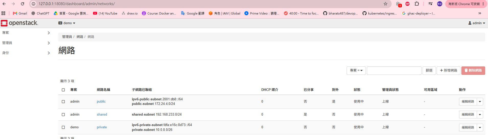

# 模組 05：HPC 叢集建置與管理自動化

[能力路線](ROADMAP.md)｜職缺核心：叢集建置與管理自動化。

## 要解決的問題與交付物

**問題與目標：** 模組 04 已讓控制節點透過 SSH 在 GPU VM 執行 MPI 工作，
兩台 VM 也能讀寫 NFS 共享目錄。計算與資料通路已可用，
但當時 GPU VM 並未接受 Slurm 排程。
本模組把節點設定寫成可重跑的 Ansible playbook，
讓控制端能管理 GPU VM 的身分驗證、Slurm 設定和運算服務。
另由現有 DevStack 的 OpenStack 服務供給一台乾淨 CPU VM，
驗證資源建立、網路與控制節點登入。
既有 GCP VM 的叢集與 GPU 工作結果和 OpenStack 單台 CPU VM 分開列示。

**已完成成果：** 已完成既有兩台 VM 的 NFS、MUNGE、Slurm 服務帳號及兩節點設定部署。
控制端已看到 GPU 節點；一般帳號透過 Slurm 請求一張 GPU，
並在該分區執行二維熱擴散工作，使用 L4 算出與 CPU 一致的結果。
OpenStack 已建立 `compute-cpu01`，Nova 回報 `ACTIVE`，
控制節點也已用 SSH 金鑰登入，完成 OpenStack VM 供給與管理連線驗證。

## 管理位置與本次部署範圍

**執行位置：** 所有 Ansible 指令都在**控制節點**的
`/root/hpc-arch/project/ansible` 目錄以 root 執行。
[ansible.cfg](../project/ansible/ansible.cfg) 指向
[hosts.yml](../project/ansible/inventory/hosts.yml)，
其中 `controller` 是控制節點本機，`gpu_compute` 是透過既有 SSH 金鑰
連到私有 IP `10.146.0.3` 的 `compute-gpu01`。
Inventory 只列出已存在的 VM，不會建立雲端資源。

**閱讀順序：** 下方先交代已建立的管理通路、NFS 和 MUNGE 設定及執行結果。
**本次兩節點 Slurm 部署的步驟從「1. 核對資源與帳號」開始：**
先核對 GPU VM 與兩台 VM 的帳號空間，
再執行 `slurm-identity.yml`，最後才執行 `slurm-two-node.yml`。
每個步驟都把指令、執行的檔案、檔案內的任務和實際結果放在一起。

**檔案位置：** 工作樹中的 `project/` 檔案是**部署來源**；
`/etc/` 下的檔案才是各 VM 服務實際讀取的檔案。
相同路徑出現在兩台 VM 時，各自是本機磁碟上的一份，並非同一個檔案。
下方每個步驟分別說明來源、目標及服務何時讀取。

## 已建立的 Ansible 管理通路

**管理通路：** Ansible 沿用模組 04 已驗證的 SSH 管理通路。
**Inventory** 列目標主機；**playbook** 描述檔案、掛載和服務應有的狀態；
**handler** 在任務真的變更時才由 `notify` 觸發。
正式執行的 `changed` 表示已改動受管狀態；`changed=0` 表示重跑沒有額外變更。
`--syntax-check` 只解析 playbook，`--check --diff` 只預演，
都不能當成檔案已複製或服務已啟動。

**目的與影響：** 在控制節點執行下列指令。它先讀取目前目錄的
[ansible.cfg](../project/ansible/ansible.cfg)，再依設定讀取
[hosts.yml](../project/ansible/inventory/hosts.yml) 並列出群組與主機；
這裡沒有執行 playbook，也不連線或修改 GPU VM：

**已執行指令：**

```bash
ansible-inventory --graph
```

**實際輸出：**

```text
@all:
  |--@ungrouped:
  |--@controller:
  |  |--instance-20260923-104239
  |--@gpu_compute:
  |  |--compute-gpu01
```

**判讀與下一步：** 兩個群組各有預期的 VM。下一條指令仍用 `hosts.yml` 選
`gpu_compute`，再透過 SSH 在 GPU VM 執行 Ansible 的 `ping` 模組。
這裡也沒有執行 playbook；這個 `ping` 不是 ICMP，
回傳 `pong` 才代表遠端模組可執行：

**已執行指令：**

```bash
ansible -i /root/hpc-arch/project/ansible/inventory/hosts.yml gpu_compute -m ansible.builtin.ping
```

**實際輸出：**

```text
compute-gpu01 | SUCCESS => {
    "ansible_facts": {"discovered_interpreter_python": "/usr/bin/python3"},
    "changed": false,
    "ping": "pong"
}
```

## 已完成的 NFS 自動化

**已有能力：** 模組 04 已手動驗證兩台 VM 對 `/srv/hpc-share` 的雙向讀寫。
第一條指令執行
[nfs-controller.yml](../project/ansible/nfs-controller.yml)。
該檔在**控制節點**依序確認 `nfs-utils`、核對 `/srv/hpc-share`
的擁有者和權限、把工作樹中的
[hpc-share.exports](../project/nfs/hpc-share.exports) 複製到
控制節點自己的 `/etc/exports.d/hpc-share.exports`，
最後確認 `nfs-server` 正在運行。
匯出檔真的改動時，handler 才執行 `exportfs -ra` 重新讀取分享清單。

**已執行指令：**

```bash
ansible-playbook -i /root/hpc-arch/project/ansible/inventory/hosts.yml /root/hpc-arch/project/ansible/nfs-controller.yml
```

**實際輸出：**

```text
PLAY RECAP
instance-20260923-104239 : ok=5 changed=0 unreachable=0 failed=0 skipped=0 rescued=0 ignored=0
```

**目的與影響：** [nfs-gpu-client.yml](../project/ansible/nfs-gpu-client.yml)
由下一條指令執行。它在 **GPU VM** 先確認 `nfs-utils`，
再把控制節點 `10.140.0.2:/srv/hpc-share` 接到**GPU VM 自己的**
`/srv/hpc-share`，同時核對 GPU VM 的 `/etc/fstab` 項目與掛載狀態。
`ansible.posix.mount` 來自
[requirements.yml](../project/ansible/requirements.yml) 固定的
`ansible.posix:2.2.2`；實際已安裝該版本。
掛載選項為 `rw,vers=4.2,_netdev,nofail,x-systemd.automount`，
用途與副作用寫在 playbook 中文註解中。
正式執行與重跑都沒有改動既有掛載：

**已執行指令：**

```bash
ansible-playbook nfs-gpu-client.yml
```

**實際輸出：**

```text
PLAY RECAP
compute-gpu01 : ok=3 changed=0 unreachable=0 failed=0 skipped=0 rescued=0 ignored=0
```

**判讀：** 同一指令重跑的結果也為 `ok=3 changed=0 failed=0`；
既有兩台 VM 的 NFS 狀態符合 playbook。

## 已完成的 MUNGE 跨節點身分驗證

**新增能力的原因：** 模組 04 的 MPI 工作由 SSH 啟動，不需要 GPU VM 的 Slurm 服務。
要由 Slurm 控制端分配工作，GPU VM 的 `slurmd` 必須能用 MUNGE
驗證同一叢集的請求。兩台 VM 使用控制節點既有的 MUNGE 金鑰；
金鑰內容只留在 VM 的 `/etc/munge/munge.key`，不存入專案或輸出。

**已安裝套件：** GPU VM 已安裝與控制節點同版的運算端套件：

| 套件 | 已安裝版本 | 用途 |
|---|---|---|
| `munge`、`munge-libs` | `0.5.15-11.el10_1.x86_64` | 產生與驗證憑證 |
| `slurm`、`slurm-slurmd` | `26.05.4-1.el10.x86_64` | 運算節點的 Slurm 元件與服務 |

同一筆安裝交易另帶入 `bash-completion`、`mariadb-connector-c`、
`mariadb-connector-c-config`；套件準備不是本模組的操作重點。

**目的與影響：** 下列指令執行 [munge-gpu.yml](../project/ansible/munge-gpu.yml)。
該檔在 **GPU VM** 依序核對 MUNGE 目錄權限、
從**控制節點的** `/etc/munge/munge.key` 複製金鑰到
**GPU VM 自己的**同名路徑、設為 `munge:munge` 與 `0600`，
最後啟用 GPU VM 的 `munge` 服務。
金鑰真的改動時，handler 才重啟 GPU VM 的 MUNGE；
Ansible 不顯示金鑰內容或差異。

**已執行指令：**

```bash
ansible-playbook munge-gpu.yml
```

**實際輸出：**

```text
TASK [部署叢集共用的 MUNGE 金鑰]           changed: [compute-gpu01]
TASK [確保 GPU VM 的 MUNGE 已啟動]         changed: [compute-gpu01]
RUNNING HANDLER [重新啟動 GPU VM 的 MUNGE] changed: [compute-gpu01]
PLAY RECAP
compute-gpu01 : ok=5 changed=3 unreachable=0 failed=0 skipped=0 rescued=0 ignored=0
```

**驗證目的：** 在控制節點以 `a2264` 產生短效憑證，經既有 SSH 金鑰交給 GPU VM 的
`unmunge` 解碼；左側 `munge -n` 不把金鑰輸出，管線只傳短效憑證。
`-i` 選 SSH 私鑰，`IdentitiesOnly=yes` 限定使用該金鑰，
`BatchMode=yes` 不互動詢問，`ConnectTimeout=5` 限制連線等待。
這只檢查驗證通路，不提交 Slurm 工作或改動服務：

**已執行指令：**

```bash
sudo -u a2264 -- munge -n | sudo -u a2264 -- ssh -i /home/a2264/.ssh/hpc_gpu_ed25519 -o IdentitiesOnly=yes -o BatchMode=yes -o ConnectTimeout=5 a2264@10.146.0.3 unmunge
```

**實際輸出：**

```text
STATUS:          Success (0)
ENCODE_HOST:     instance-20260923-104239.asia-east1-b.c.project-78b8a95c-a2c0-461f-a08.internal (10.140.0.2)
UID:             a2264 (1000)
GID:             a2264 (1005)
```

**判讀：** GPU VM 成功解碼控制節點的憑證，跨 VM 的 MUNGE 驗證通路可用。
重跑 `ansible-playbook munge-gpu.yml` 得到 `ok=4 changed=0 failed=0`，
沒有重新複製金鑰或重啟服務。

## 1. 核對 GPU VM 資源與帳號空間

**目的：** Slurm 按節點宣告的 CPU、記憶體和 **GRES**（通用資源）分配工作；
GPU 是本叢集的 GRES。先在 GPU VM 以 `a2264` 執行 `slurmd -C`，
直接讀取本機硬體並列出建議節點設定；
這條指令不執行 playbook，也不啟動服務：

**已執行指令：**

```bash
slurmd -C
```

**實際輸出：**

```text
NodeName=compute-gpu01 CPUs=4 Boards=1 SocketsPerBoard=1 CoresPerSocket=2 ThreadsPerCore=2 RealMemory=15983 Gres=gpu:nvidia_l4:1
Found gpu:nvidia_l4:1 with Autodetect=nvidia (Substring of gpu name may be used instead)
```

**判讀：** GPU VM 有 4 個邏輯 CPU、15,983 MiB 記憶體和一張 NVIDIA L4。
兩節點設定只宣告 14,000 MiB 給工作，保留其餘容量給系統與服務。
`slurmd -C` 是硬體探測，不能當成 GPU 已交由 Slurm 分配。

### 為何要統一帳號編號

**概念：** Linux 帳號除了名稱，還有數字身分：**UID** 是使用者編號，
**GID** 是群組編號；檔案擁有權和服務身分會用到它們。
`800:800` 表示 UID 800 的使用者，其主要群組是 GID 800。
兩台 VM 即使都有叫 `slurm` 的帳號，也要核對數字身分。

**現有帳號：** 控制節點的 `slurm` 在[模組 01 的單節點建置](module-01.md#驗證身分與服務)
由 `useradd -r -M -U -s /sbin/nologin slurm` 建立；
當時 `id slurm` 回報 `uid=994(slurm) gid=994(slurm)`。
GPU VM 的 `994:994` 已屬於 `munge`，不能照搬控制節點的數字。
改號前要找出兩台 VM 都沒有占用的
使用者編號和群組編號。在控制節點的 Ansible 目錄以 root 執行
兩條只讀查詢，**不執行 playbook 檔案**：第一條查兩台 VM 的 UID 800，
第二條查 GID 800。
`ansible all` 選兩台 VM；`getent` 讀帳號資料庫；
`fail_key=false` 讓查無資料回傳空值。查詢不建立帳號或群組。

**已執行指令：**

```bash
ansible all -m ansible.builtin.getent -a 'database=passwd key=800 fail_key=false'
ansible all -m ansible.builtin.getent -a 'database=group key=800 fail_key=false'
```

`getent_passwd["800"]`、`getent_group["800"]` 是輸出中的
使用者與群組查詢欄位，**不是指令**。實際結果如下；
`null` 表示該 VM 找不到這個編號：

| 查詢 | 控制節點 | GPU VM |
|---|---|---|
| `getent_passwd["800"]` | `null` | `null` |
| `getent_group["800"]` | `null` | `null` |

**判讀：** 兩台 VM 的 UID 與 GID 800 都未占用，因此選 `800:800`。

**改號影響：** 控制節點的 `/var/spool/slurmctld` 保存排程狀態，
原本由 UID/GID `994:994` 的 `slurm` 帳號持有。
只改帳號編號，舊狀態檔不會自動變成新帳號的檔案；
因此下方 playbook 也把這個目錄及其內容交給新的 `800:800` 帳號。

## 2. 執行 slurm-identity.yml：統一服務帳號

**目的與執行位置：** 在控制節點的 Ansible 目錄以 root **正式執行**：

**已執行指令：**

```bash
ansible-playbook slurm-identity.yml
```

這條指令執行的是
[slurm-identity.yml](../project/ansible/slurm-identity.yml)。
檔案中的任務依序處理：

1. 在 **GPU VM** 建立不能互動登入、沒有家目錄的 `slurm` 群組與使用者，
   UID/GID 固定為 `800:800`，再用 `id slurm` 核對。
2. 在**控制節點**確認原帳號是 `994:994` 或已改為 `800:800`；
   第一次改號時先確認沒有工作，再停止 `slurmctld`。
3. 將控制節點的 `slurm` 群組和使用者改為 `800:800`，
   並把 `/var/spool/slurmctld` 及其中排程狀態交給新帳號。
4. 啟動控制節點的 `slurmctld`，用 `id slurm` 與 `scontrol ping` 核對。
   重跑時若已是 `800:800`，跳過停機及改號。

若控制端遷移途中失敗，檔案中的救援任務會嘗試恢復原本的
`994:994` 與服務；若連線中斷，仍需依實際狀態人工核對。
這一步會變更兩台 VM 的系統帳號，並短暫中斷控制端排程服務；
不建立 VM、不安裝套件。

**實際輸出：** 下列是這次指令的實際關鍵輸出：

```text
PLAY [建立 GPU VM 的 Slurm 服務帳號]
TASK [備妥 GPU VM 的 slurm 群組]           changed: [compute-gpu01]
TASK [備妥 GPU VM 的 slurm 使用者]         changed: [compute-gpu01]
"gpu_slurm_id.stdout": "uid=800(slurm) gid=800(slurm) groups=800(slurm)"
PLAY [將控制節點的 Slurm 服務帳號遷移到相同身分數字]
TASK [變更身分前確認 Slurm 沒有工作]       ok: [instance-20260923-104239]
TASK [暫停控制節點的 slurmctld]           changed: [instance-20260923-104239]
TASK [將控制節點的 slurm 群組改為 GID 800] changed: [instance-20260923-104239]
TASK [將控制節點的 slurm 使用者改為 UID 800] changed: [instance-20260923-104239]
TASK [讓遷移後的帳號持有控制節點排程狀態] changed: [instance-20260923-104239]
TASK [恢復控制節點的 slurmctld]           changed: [instance-20260923-104239]
"controller_slurm_id.stdout": "uid=800(slurm) gid=800(slurm) groups=800(slurm)"
"controller_slurm_ping.stdout": "Slurmctld(primary) at instance-20260923-104239 is UP"
PLAY RECAP
compute-gpu01            : ok=5 changed=2 unreachable=0 failed=0 skipped=0 rescued=0 ignored=0
instance-20260923-104239 : ok=14 changed=5 unreachable=0 failed=0 skipped=0 rescued=0 ignored=0
```

**判讀：** 兩台 VM 都實際回報 `800:800`；控制服務在遷移後回應 `UP`。
在控制節點同一目錄以 root 重跑，核對帳號設定不再改動；
如果實際狀態已偏移，playbook 仍可能修正帳號或服務：

**已執行指令：**

```bash
ansible-playbook slurm-identity.yml
```

**實際輸出：**

```text
TASK [備妥 GPU VM 的 slurm 群組]   ok: [compute-gpu01]
TASK [備妥 GPU VM 的 slurm 使用者] ok: [compute-gpu01]
"gpu_slurm_id.stdout": "uid=800(slurm) gid=800(slurm) groups=800(slurm)"
TASK [確認控制節點的原身分或目標身分完整] ok: [instance-20260923-104239]
TASK [變更身分前確認 Slurm 沒有工作] skipping: [instance-20260923-104239]
TASK [暫停控制節點的 slurmctld] skipping: [instance-20260923-104239]
TASK [將控制節點的 slurm 群組改為 GID 800] skipping: [instance-20260923-104239]
TASK [將控制節點的 slurm 使用者改為 UID 800] skipping: [instance-20260923-104239]
TASK [讓遷移後的帳號持有控制節點排程狀態] skipping: [instance-20260923-104239]
TASK [恢復控制節點的 slurmctld] skipping: [instance-20260923-104239]
TASK [核對控制節點排程服務已回應] skipping: [instance-20260923-104239]
PLAY RECAP
compute-gpu01            : ok=5 changed=0 unreachable=0 failed=0 skipped=0 rescued=0 ignored=0
instance-20260923-104239 : ok=4 changed=0 unreachable=0 failed=0 skipped=10 rescued=0 ignored=0
```

**重跑判讀：** 跳過的 10 個任務是首次遷移用的工作檢查、停機、改號與服務核對；
重跑沒有再次停止服務。重跑本身沒有重新 ping 控制服務，
`UP` 是首次正式執行的驗證結果。

## 3. 執行 slurm-two-node.yml：部署排程設定

**修改前核對：** 修改控制端排程設定前，在控制節點以 root 查工作佇列；
`-h` 不顯示標題，`-o` 列出 ID、狀態、使用者和名稱。
這只讀取當下狀態，不提交或取消工作：

**已執行指令：**

```bash
squeue -h -o '%i %T %u %j'
```

**結果：** 命令正常返回、沒有輸出；查詢當下沒有執行中或等待中的工作。

在控制節點的 Ansible 目錄以 root **正式執行**：

**已執行指令：**

```bash
ansible-playbook slurm-two-node.yml
```

**檔案與任務：** 這條指令執行的是
[slurm-two-node.yml](../project/ansible/slurm-two-node.yml)。
檔案中的任務依序處理：

1. 在 **GPU VM** 建立或核對 `/etc/slurm` 和 `/var/spool/slurmd`。
   從**控制節點工作樹**的
   [two-node-slurm.conf](../project/slurm/two-node-slurm.conf)
   複製到 GPU VM 自己的 `/etc/slurm/slurm.conf`。
   這份設定保留控制節點的 `debug` 分區，新增只含 GPU VM 的 `gpu` 分區，
   向 Slurm 宣告 GPU VM 可排程 4 個邏輯 CPU、14,000 MiB 記憶體和一張 L4。
2. 從控制節點工作樹的
   [gpu-gres.conf](../project/slurm/gpu-gres.conf)
   複製到 GPU VM 自己的 `/etc/slurm/gres.conf`。
   它指定 `AutoDetect=nvidia`。
   **執行 `slurmd -G` 的目的是確認 Slurm 設定宣告的 GPU 型號，
   跟 GPU VM 實際偵測到的裝置對得上。**
   接著 playbook 在 GPU VM 執行 `slurmd -G`，讀取剛收到的兩份設定，
   列出這台 VM 的 GPU 資源與本機裝置路徑如何對應。
   Ansible 收集指令輸出，要求指令成功、結果包含 `nvidia_l4`
   且沒有 `error:`；基本檢查失敗就停止，不更新控制節點。
   緊接的「顯示 GPU VM 的 GRES 檢查結果」任務在控制節點終端顯示
   收集的結果，供核對 GPU 數量與裝置路徑；本次顯示
   `Count=1`、`File=/dev/nvidia0`。自動條件沒有逐項驗證這兩個欄位。
3. GPU 檢查通過後，才把控制節點工作樹中同一份
   `two-node-slurm.conf` 複製到**控制節點自己**的
   `/etc/slurm/slurm.conf`，取代模組 01 建立的單節點內容。
   檔案真的改動時，handler 執行 `scontrol reconfigure`，
   讓現有 `slurmctld` 重新讀取，不重啟控制服務。
4. 最後啟動 GPU VM 的 `slurmd` 並設為開機啟動；
   重跑且設定未變時不會無故重啟服務。

複製任務改動檔案時，會在各 VM 留下舊版備份。
**實際輸出：** 下列是這次指令的實際關鍵輸出；
`顯示 GPU VM 的 GRES 檢查結果` 把前一任務收集的資料印回控制節點，
供核對 GPU 數量與裝置路徑：

**實際輸出：**

```text
PLAY [備妥 GPU VM 的 Slurm 設定並檢查 GPU 對應]
TASK [部署 GPU VM 的共用 Slurm 設定] changed: [compute-gpu01]
TASK [部署 GPU VM 的 GPU 資源設定] changed: [compute-gpu01]
TASK [核對 GPU VM 的 GRES 設定] ok: [compute-gpu01]
TASK [顯示 GPU VM 的 GRES 檢查結果] ok: [compute-gpu01] => {
    "gpu_gres_probe": {
        "changed": false,
        "cmd": ["slurmd", "-G"],
        "rc": 0,
        "stderr_lines": [
            "[2026-10-09T06:49:39.018] _read_slurm_cgroup_conf: No cgroup.conf file (/etc/slurm/cgroup.conf), using defaults",
            "[2026-10-09T06:49:39.052] Gres Name=gpu Type=nvidia_l4 Count=1 Index=0 ID=7696487 File=/dev/nvidia0 Cores=0-1 CoreCnt=4 Links=(null) Flags=HAS_FILE,HAS_TYPE,ENV_NVML"
        ],
        "stdout": ""
    }
}
PLAY [讓控制節點認得 GPU VM]
TASK [部署控制節點的共用 Slurm 設定] changed: [instance-20260923-104239]
RUNNING HANDLER [重新讀取 Slurm 設定] changed: [instance-20260923-104239]
PLAY [啟動 GPU VM 的 Slurm 運算服務]
TASK [設定有變更時重啟 GPU VM 的 slurmd] changed: [compute-gpu01]
TASK [確保 GPU VM 的 slurmd 已啟動] changed: [compute-gpu01]
PLAY RECAP
compute-gpu01            : ok=10 changed=4 unreachable=0 failed=0 skipped=0 rescued=0 ignored=0
instance-20260923-104239 : ok=3 changed=2 unreachable=0 failed=0 skipped=0 rescued=0 ignored=0
```

**判讀：** `rc=0` 是 `slurmd -G` 的結束代碼，表示這條檢查指令正常結束。
`stderr_lines` 的第二行顯示一張 `nvidia_l4` 對應 `/dev/nvidia0`；
第一行表示沒有額外的 `cgroup.conf`，這次檢查使用預設值。
控制節點設定已取代原單節點內容並由 `scontrol reconfigure` 重新讀取；
GPU VM 的 `slurmd` 已啟動並設為開機啟動。

## 4. 從控制節點查 GPU 節點是否註冊

**目的：** 上一步已啟動 GPU VM 的 `slurmd`；這一步查控制端看到的節點狀態。
在**控制節點**以 root 執行下列只讀命令。
`scontrol` 向正在運行的 `slurmctld` 查詢名為 `compute-gpu01` 的節點；
這條指令不執行 playbook，不提交工作，也不改動檔案或服務。

**已執行指令：**

```bash
scontrol show node compute-gpu01
```

**核對欄位：** 結果要核對 `NodeName` 是 `compute-gpu01`、`NodeAddr` 是 GPU VM 的
私有 IP `10.146.0.3`、`Gres` 宣告一張 `nvidia_l4`，
並看 `State` 判斷控制端是否認為節點可接工作。
下一節由實際 Slurm 工作讀取 GPU 裝置。

**實際輸出：**

```text
NodeName=compute-gpu01 Arch=x86_64 CoresPerSocket=2
   CPUAlloc=0 CPUEfctv=4 CPUTot=4 CPULoad=0.00
   Gres=gpu:nvidia_l4:1(S:0)
   NodeAddr=10.146.0.3 NodeHostName=compute-gpu01 Version=26.05.4
   RealMemory=14000 AllocMem=0 FreeMem=14239 Sockets=1 Boards=1
   State=IDLE ThreadsPerCore=2 TmpDisk=0 Weight=1 Owner=N/A MCS_label=N/A
   Partitions=gpu
   BootTime=2026-10-09T05:28:30 SlurmdStartTime=2026-10-09T06:49:45
```

**判讀：** 控制服務已記錄 GPU VM 的私有 IP、4 個可用邏輯 CPU、
14,000 MiB 可排程記憶體和一張 `nvidia_l4`。
`State=IDLE`、`CPUAlloc=0`、`AllocMem=0` 表示查詢時節點可接新工作且未分配資源；
`SlurmdStartTime` 顯示運算服務已啟動。

## 5. 用 Slurm 請求一張 GPU 的通路驗證

**目的：** 控制端已將 `compute-gpu01` 列為 `IDLE`，接著要確認一般帳號能透過
Slurm 的 `gpu` 分區請求一張 GPU，並在該分區唯一的 GPU VM 啟動程序。
此處先用驅動提供的 `nvidia-smi -L` 讀取裝置清單，
核對排程請求和 GPU 裝置通路；代表性計算工作在下一節執行。

**執行位置與影響：** 在**控制節點**以 root 執行下列一條指令。
`sudo -iu a2264` 改用一般工作帳號；`srun` 向 Slurm 提交同步工作；
`--partition=gpu` 選 GPU 分區，`--nodes=1 --ntasks=1` 請求一個節點、
一個行程，`--gres=gpu:1` 請求一張 GPU，`--time=00:02:00` 限制最多兩分鐘。
Slurm 在分配的節點執行 `nvidia-smi -L` 並把輸出帶回控制節點。
這條命令不執行 playbook，也不改服務設定或建立雲端資源；
預期輸出列出一張 NVIDIA L4，若工作無法分配或啟動，依實際訊息排查。

**已執行指令：**

```bash
sudo -iu a2264 srun --partition=gpu --nodes=1 --ntasks=1 --gres=gpu:1 --time=00:02:00 nvidia-smi -L
```

**實際輸出：**

```text
GPU 0: NVIDIA L4 (UUID: GPU-60db0aa8-3f64-a75a-bd6f-cf44fe764b36)
```

**判讀：** Slurm 接受一張 GPU 的請求，並在 `gpu` 分區啟動了 `a2264` 的程序；
程序能透過 NVIDIA 驅動讀到一張 L4；下一節執行二維熱擴散工作。

## GPU 計算工具準備

**目的：** 下一步要用有已知答案的 GPU 計算工作，核對 Slurm 分配的裝置能否真的執行計算。
GPU VM 原有的 NVIDIA 驅動能執行 `nvidia-smi`，但尚缺編譯 CUDA 程式的工具。
從 GPU VM 已啟用的 AlmaLinux NVIDIA 套件庫安裝 CUDA 13.4 編譯器與
CUDA 執行階段開發檔；安裝交易新增下列套件，沒有升級 NVIDIA 驅動或 Slurm：

| GPU VM 新增套件 | 版本 |
|---|---|
| `cuda-nvcc-13-4` | `13.4.59-1` |
| `cuda-cudart-devel-13-4` | `13.4.49-1` |
| `cuda-crt-13-4` | `13.4.59-1` |
| `cuda-cudart-13-4`、`cuda-culibos-devel-13-4` | `13.4.49-1` |
| `cuda-toolkit-13-4-config-common`、`cuda-toolkit-13-config-common`、`cuda-toolkit-config-common` | `13.4.49-1` |
| `cccl-13-4` | `13.3.4.2.1-1` |
| `libnvptxcompiler-13-4`、`libnvvm-13-4` | `13.4.59-1` |
| `gcc-c++`、`libstdc++-devel` | `14.3.1-4.4.el10.alma.2` |

**驗證目的：** 從控制節點透過 Ansible 在 GPU VM 查詢編譯器版本；套件將它放在
`/usr/local/cuda-13.4/bin/nvcc`，因此使用絕對路徑，不假定它在登入環境的 `PATH` 中。
這條查詢不編譯程式，也不修改服務：

**已執行指令：**

```bash
ansible -i /root/hpc-arch/project/ansible/inventory/hosts.yml gpu_compute -m ansible.builtin.command -a '/usr/local/cuda-13.4/bin/nvcc --version'
```

**實際輸出：**

```text
compute-gpu01 | CHANGED | rc=0 >>
nvcc: NVIDIA (R) Cuda compiler driver
Cuda compilation tools, release 13.4, V13.4.59
```

**判讀：** 版本查詢成功；Ansible 的 `CHANGED` 是此一次性 `command` 任務的預設標記，
不代表查詢改動了檔案。安裝後 GPU VM 的 `nvidia-smi -L` 仍辨認一張 L4。

## 6. 用熱擴散工作核對 GPU 計算

**目的：** 驅動可見與 GPU 分配已驗證，下一步要確認分配到的 L4 真的完成計算。
[heat2d.cu](../project/workloads/heat2d.cu) 實作二維熱擴散：
在 `1024 × 1024` 網格中心放一個熱源，每輪用上下左右格點更新溫度，
共執行 200 輪。CPU 與 GPU 使用相同初始條件和更新式，
最後逐格比較，最大絕對誤差不超過 `0.0001` 才輸出 `validation=PASS`。
程式也列出執行主機與 GPU 名稱，供核對工作實際執行的位置和裝置。

**步驟 1｜放置原始碼：** 從**控制節點**把工作樹中的原始碼複製到控制節點自己的
`/srv/hpc-share/heat2d.cu`，設為 `a2264` 可讀寫。
這個路徑已由模組 04 建立並由 `nfs-gpu-client.yml` 核對掛載；
GPU VM 的同一路徑是 NFS 掛載，讀到的是控制節點提供的檔案。
下面的 Ansible `copy` 只更新這份共享原始碼，沒有複製到 GPU VM 的 `/etc/`：

**已執行指令：**

```bash
ansible -i /root/hpc-arch/project/ansible/inventory/hosts.yml controller -b -m ansible.builtin.copy -a 'src=/root/hpc-arch/project/workloads/heat2d.cu dest=/srv/hpc-share/heat2d.cu owner=a2264 group=a2264 mode=0644'
```

**實際輸出：**

```text
instance-20260923-104239 | CHANGED => {
    "changed": true,
    "dest": "/srv/hpc-share/heat2d.cu",
    "owner": "a2264",
    "group": "a2264",
    "mode": "0644",
    "size": 6778
}
```

**結果：** 共享原始碼已在控制節點建立，屬於 `a2264`；GPU VM 由既有 NFS 掛載讀取它。

**步驟 2｜編譯程式：** 複製完成後，從**控制節點**透過 Ansible 以 `a2264` 在 **GPU VM**
執行下列 `nvcc` 命令，讀取 GPU VM 掛載的原始碼，
編譯成同一共享目錄內的 `heat2d` 執行檔。
`-O2` 啟用編譯最佳化，`-std=c++17` 指定 C++ 語言版本；
`-arch=sm_89` 產生對應 L4 運算能力 8.9 的 GPU 程式碼。
這一步會建立或覆寫 `/srv/hpc-share/heat2d`，不改 Slurm 設定或服務：

**已執行指令：**

```bash
ansible -i /root/hpc-arch/project/ansible/inventory/hosts.yml gpu_compute -b --become-user a2264 -m ansible.builtin.command -a '/usr/local/cuda-13.4/bin/nvcc -O2 -std=c++17 -arch=sm_89 -o /srv/hpc-share/heat2d /srv/hpc-share/heat2d.cu'
```

**實際輸出：**

```text
compute-gpu01 | CHANGED | rc=0 >>
```

**結果：** GPU VM 編譯成功，終端沒有其他輸出；執行檔已寫入共享目錄。

**步驟 3｜執行工作：** 在**控制節點**以 `a2264` 提交同步 Slurm 工作，
請求 `gpu` 分區的一個節點、一個 task、一張 GPU、512 MiB 記憶體，
並限制最長五分鐘。`srun` 在分配的 GPU VM 執行共享目錄中的程式，
輸出直接回到控制節點終端；程式不讀寫資料檔或改動服務。
要同時核對 `host=compute-gpu01`、`device=NVIDIA L4`、
`validation=PASS` 和工作正常返回，才能確認本次 GPU 計算通路：

**已執行指令：**

```bash
sudo -iu a2264 srun --partition=gpu --nodes=1 --ntasks=1 --cpus-per-task=1 --gres=gpu:1 --mem=512M --time=00:05:00 /srv/hpc-share/heat2d 1024 200
```

**實際輸出：**

```text
host=compute-gpu01 device_index=0 device=NVIDIA L4 grid=1024x1024 steps=200
cpu_sum=65535.998004 gpu_sum=65535.998004 max_abs_error=0.00000000
cpu_ms=504.605 gpu_kernel_ms=1.894 validation=PASS
```

**結果與判讀：** 工作在 `compute-gpu01` 使用 NVIDIA L4 完成 200 輪計算；CPU 與 GPU
結果逐格比對通過，輸出後返回控制節點提示字元。

## 7. 在現有 OpenStack 建立 CPU VM

**目標與架構：** GCP 的 `openstack-lab01` 承載 DevStack；
DevStack 的 OpenStack 在這台主機內建立一台乾淨 CPU VM，
驗證 VM 供給與管理連線。Nova 建 VM，Glance 提供映像，
Neutron 提供網路；Ansible 不負責建立 VM。

**為何不能建 GPU VM：** `openstack-lab01` 沒有 GPU，
因此**這套 OpenStack 沒有 GPU 可分配給內層 VM**。
現有 GCP GPU VM `compute-gpu01` 不屬於這套 OpenStack，
也沒有 IOMMU／DMAR，不能用作 OpenStack GPU 運算主機。
這次只建 CPU VM；先前在 GCP 執行的 GPU 工作是另一項成果。

### 建立 DevStack 練習環境

**DevStack** 是 OpenStack 官方提供的安裝腳本集合，用來快速建立
單機開發／練習環境；它不是 OpenStack 的另一個服務，也不代表生產部署。
做法依[官方單機 VM 指南](https://docs.openstack.org/devstack/latest/guides/single-vm.html)。

#### 1. 建立練習主機

**目的與影響：** 下列指令由控制節點向 GCP 建立專用
`openstack-lab01`，將控制節點 `/tmp/compute-gpu01-a2264-ssh-keys-20261003`
中的 `a2264` 公鑰送入新 VM 的 SSH 中繼資料；該檔案不是私鑰。
VM 不設定自動停止時間，之後由使用者決定何時停止；開機磁碟仍會持續計費。

**已執行指令：**

```bash
gcloud compute instances create openstack-lab01 \
  --project=project-78b8a95c-a2c0-461f-a08 \
  --zone=asia-northeast1-c \
  --machine-type=e2-standard-2 \
  --image-project=ubuntu-os-cloud \
  --image=ubuntu-2404-noble-amd64-v20260918 \
  --boot-disk-type=pd-standard \
  --boot-disk-size=40GB \
  --network=default \
  --subnet=default \
  --no-address \
  --no-service-account \
  --no-scopes \
  --metadata-from-file=ssh-keys=/tmp/compute-gpu01-a2264-ssh-keys-20261003 \
  --quiet
```

**實際結果：** `openstack-lab01` 建立成功，位於 `asia-northeast1-c`，
機型 `e2-standard-2`，內網 IP `10.146.0.4`，無外部 IP，狀態 `RUNNING`。
沒有設定自動停止；40 GiB 磁碟低於 GCP 提醒的 200 GiB 效能門檻。
主機使用 Ubuntu 24.04、2 vCPU 與 8 GiB 記憶體；內層 VM 使用這台主機的資源。

**網路結果：** 東京既有 Cloud NAT 涵蓋這台 VM 使用的 `default` 子網。
新 VM 已實測能連線並解析 DNS，HTTPS 取得 Ubuntu 索引回傳 `200`；
`apt-get update` 從東京 Ubuntu 鏡像站與安全更新站成功下載 `37.8 MB`
套件索引，退出碼 0。套件來源可用。

**目的：** 確認這台 GCP E2 宿主機是否提供 KVM 裝置，決定 DevStack
內層 VM 使用的虛擬化方式。指令只查裝置，不修改主機。

**已執行指令｜在 `openstack-lab01`：**

```bash
ls -l /dev/kvm
```

**實際輸出：**

```text
ls: cannot access '/dev/kvm': No such file or directory
```

**判讀：** 這台宿主機沒有 KVM 裝置，因此 `local.conf` 選用 QEMU
執行內層 CPU VM。

#### 2. 取得 DevStack 並完成安裝

**目的與影響：** GCP 提供練習用主機，OpenStack API 由 DevStack 安裝。
DevStack 會在這台專用 VM 安裝並啟動 Keystone、Nova、Neutron 等服務，
讓後續能用 OpenStack 建立與管理 VM；首次下載先用 VM 已有的 Git
從 OpenStack 官方程式庫取得安裝腳本。下列指令由控制節點連到新 VM，
只新增 `/home/a2264/devstack`，尚不安裝或啟動服務：

**已執行指令：**

```bash
sudo -u a2264 -- ssh -i /home/a2264/.ssh/hpc_gpu_ed25519 -o IdentitiesOnly=yes -o BatchMode=yes -o StrictHostKeyChecking=accept-new -o ConnectTimeout=10 a2264@10.146.0.4 'git clone https://opendev.org/openstack/devstack /home/a2264/devstack'
```

**實際結果：** 退出碼 0，官方 DevStack 程式庫已下載到新 VM；
修訂版 `64d59574473c148c3d855124ae5f79681854cd0a`。

**安裝檔案：** 下載的 [stack.sh（官方版本）](https://opendev.org/openstack/devstack/src/commit/64d59574473c148c3d855124ae5f79681854cd0a/stack.sh)
在新 VM 的 `/home/a2264/devstack/stack.sh`，執行時讀取同目錄的 `local.conf`。
**目的與影響：** 控制節點把
[設定產生程式](../project/openstack/write_local_conf.py) 經 SSH 傳給新 VM 的 Python；
程式在**新 VM**建立 `/home/a2264/devstack/local.conf`，設定服務 IP
`10.146.0.4`、QEMU 虛擬化與隨機服務密碼。`python3 -` 從標準輸入讀程式，
`<` 讀控制節點工作樹中的來源檔；密碼只在新 VM 產生，程式遇到既有設定檔會停止而不覆寫。

**已執行指令｜在控制節點的工作樹：**

```bash
sudo -u a2264 -- ssh -i /home/a2264/.ssh/hpc_gpu_ed25519 -o IdentitiesOnly=yes -o BatchMode=yes -o StrictHostKeyChecking=accept-new -o ConnectTimeout=10 a2264@10.146.0.4 'python3 - /home/a2264/devstack 10.146.0.4' < project/openstack/write_local_conf.py
```

**實際結果：** `created /home/a2264/devstack/local.conf (mode 600)`，退出碼 0。

**判讀：** `stack.sh` 將讀取新 VM 上這份設定；
[遮蔽副本](../project/openstack/local.conf.redacted)保留非機密設定供核對。
`ADMIN_PASSWORD` 用於管理登入，另外三個密碼欄位供 OpenStack 內部服務驗證。

**目的與影響：** 接著由新 VM 的一般使用者執行 `/home/a2264/devstack/stack.sh`。
它會從官方來源下載並安裝 OpenStack 與相依套件，修改這台專用 VM 的
`/opt/stack`、`/etc` 服務設定並啟動服務；安裝輸出保存在 VM 上權限受限的
`stack-install.log`。

**已執行指令：**

```bash
sudo -u a2264 -- ssh -i /home/a2264/.ssh/hpc_gpu_ed25519 -o IdentitiesOnly=yes -o BatchMode=yes -o StrictHostKeyChecking=accept-new -o ConnectTimeout=10 -o ServerAliveInterval=30 -o ServerAliveCountMax=10 a2264@10.146.0.4 'umask 077; cd /home/a2264/devstack && ./stack.sh > stack-install.log 2>&1'
```

**實際結果：** 終端沒有輸出，安裝日誌留在新 VM 的
`/home/a2264/devstack/stack-install.log`；`stack.sh` 退出碼 0。
安裝程序完成；後續接著操作 OpenStack API 建立 VM。

#### 3. 載入憑證並查詢 API

**進入操作主機：** 後續從控制節點 `instance-20260923-104239`
開啟互動 shell 時，使用下列已實測的 SSH 指令進入 `openstack-lab01`。
它透過 GCP IAP 連到沒有公網 IP 的 VM，只建立連線，
不修改 VM 檔案或 OpenStack 資源。上面的安裝命令則是從控制節點遠端執行，
無須先進入互動 shell。

**已執行指令｜控制節點：**

```bash
gcloud compute ssh a2264@openstack-lab01 --project=project-78b8a95c-a2c0-461f-a08 --zone=asia-northeast1-c --tunnel-through-iap
```

**實際結果與判讀：** 出現 `a2264@openstack-lab01:~$` 提示字元，
表示已進入目標 VM；尚未載入這個 shell 的 OpenStack 登入環境。

**目的與影響：** 在 `openstack-lab01` 使用 DevStack 附的 `openrc`。
它把 OpenStack API 位址與管理員登入資訊載入目前的 shell，
讓稍後的 `openstack` 指令能向 API 驗證；`admin admin` 分別是使用者
與專案名稱。每次開新的 SSH shell 都要重新執行；`source` 只影響目前的 shell，
不會變更服務或建立資源。

**已執行指令：**

```bash
source ~/devstack/openrc admin admin
```

**實際結果與判讀：** 初次及後續重新登入時執行均無終端輸出，
shell 返回提示字元；登入環境已載入目前 shell。

**工具與目的：** `openstack` 是操作 OpenStack API 的命令列工具。
在同一個 shell 列出 Keystone 登錄的服務名稱與類型，
用來確認管理員憑證能向 API 查詢服務目錄；這是唯讀操作，
後續再由各服務執行實際資源操作。

**已執行指令：**

```bash
openstack service list -f table -c Name -c Type
```

**實際輸出：**

```text
+-------------+----------------+
| Name        | Type           |
+-------------+----------------+
| keystone    | identity       |
| nova        | compute        |
| cinder      | block-storage  |
| placement   | placement      |
| glance      | image          |
| nova_legacy | compute_legacy |
| neutron     | network        |
+-------------+----------------+
```

**判讀：** 管理員憑證可查詢 Keystone API 的服務目錄。

**目的：** 查 Glance 的映像名稱與狀態，確認是否已有可供建立 VM 的映像。
`image list` 是唯讀查詢；`-c` 只保留本次要核對的兩欄。

**已執行指令：**

```bash
openstack image list -f table -c Name -c Status
```

**實際輸出：**

```text
+--------------------------+--------+
| Name                     | Status |
+--------------------------+--------+
| cirros-0.6.3-x86_64-disk | active |
+--------------------------+--------+
```

**判讀：** CirrOS 映像已登錄且狀態為 `active`。

### Neutron 網路：先分清網路、子網與路由

**這次要核對的問題：** 建立 VM 前須知道它能接哪個網路、
從哪個子網取得 IP，以及路由器如何連接該子網。
以下查詢確認現有 DevStack 網路設定。

**概念：** 在 GCP 建 VM 時會選 VPC 與子網；在 OpenStack，Nova 建 VM 時把
虛擬網卡接到 Neutron 的 **port**，port 屬於某個 **network**。
**subnet** 定義該網路可分配的 IP 範圍、閘道與 DHCP；
**router** 才負責讓不同網路互通或連往外部網路；
**security group** 控制進出 VM 網卡的流量。
這些是不同資源，查到 network 不等於 VM 已取得 IP 或能上網。
[Neutron 官方網路概念](https://docs.openstack.org/neutron/latest/admin/intro-os-networking.html)
說明了這些資源的關係。

**目的：** 先找出目前有哪些網路物件。
`-f table` 使用表格；
`-c Name -c Status` 原本想只看名稱與狀態，但這個清單輸出
沒有提供 `Status` 欄。指令是唯讀查詢，不建立網路或 VM。

**已執行指令：**

```bash
openstack network list -f table -c Name -c Status
```

**實際輸出：**

```text
+---------+
| Name    |
+---------+
| public  |
| shared  |
| private |
+---------+
```

**判讀：** 輸出只有 `Name` 欄，列出 `public`、`shared`、`private`。
Neutron API 回傳三個網路物件；後續讀取 `private` 的實際設定。

**Horizon 畫面：** [實際截圖](../project/openstack/openstack.png)
也列出 `public`、`shared`、`private`；`private` 顯示 `10.0.0.0/26`。
Horizon 是操作同一套 OpenStack 資源的網頁介面。



**目的：** 查 `private` 的屬性，是要知道這個網路是否啟用、
是否只供目前專案使用，以及它連著哪些子網；建立 VM 時會指定網路，
而子網決定 VM 可能拿到哪段 IP。
`network show` 只向 Neutron 讀取設定；`-f yaml` 讓欄位逐行顯示。
這一步核對 `status`、`admin_state_up`、`router:external`、`shared` 和 `subnets`。

**已執行指令：**

```bash
openstack network show private -f yaml
```

**實際輸出（保留判讀所需欄位）：**

```yaml
admin_state_up: true
id: fb5be63d-7658-453d-9c6d-66243bce244c
name: private
router:external: false
shared: false
status: ACTIVE
subnets:
- 3c7f8b05-10e3-4434-a346-98d7c868fd1d
- c5eaf368-96f1-4c2c-aa82-1de2dd011270
```

**判讀：** `status: ACTIVE` 表示這個 Neutron 網路物件處於啟用狀態；
`admin_state_up: true` 表示管理設定允許使用。
`router:external: false` 表示它不是外部網路，`shared: false` 表示未共享給其他專案。
`subnets` 列出兩個關聯子網 ID；下一條查詢讀取子網範圍。

**目的：** 列出 `private` 的子網，辨認 CPU VM 可使用的 IPv4 範圍。
這是 `openstack-lab01` 上的唯讀查詢，不建立或修改網路。

**已執行指令：**

```bash
openstack subnet list --network private -f table
```

**實際輸出重點：**

| 子網名稱 | IP 範圍 |
|---|---|
| `ipv6-private-subnet` | `fdfa:e16c:8d73::/64` |
| `private-subnet` | `10.0.0.0/26` |

**判讀：** `private-subnet` 是 `10.0.0.0/26` IPv4 子網。
下一條在 `openstack-lab01` 讀取它的閘道、DHCP 與 DNS 設定：

**已執行指令：**

```bash
openstack subnet show private-subnet -f yaml
```

**實際輸出與意思：**

| 欄位與實際值 | 白話意思與對 CPU VM 的影響 |
|---|---|
| `cidr: 10.0.0.0/26` | `CIDR` 定義整個子網。IPv4 共 32 位元，`/26` 表示前 26 位是網路部分，剩 6 位可變，所以共有 `2^6 = 64` 個位址：`10.0.0.0–10.0.0.63`。`.0` 是網路位址，`.63` 是廣播位址，不分配給 VM。 |
| `allocation_pools: 10.0.0.2–10.0.0.62` | **位址池**是 Neutron 可自動分給新 VM 網卡的範圍；建一台 VM 時會從中取得一個可用位址，不是每台 VM 都拿到整段。 |
| `gateway_ip: 10.0.0.1` | 這是子網的閘道；VM 要連往子網以外時，封包先送到這個位址。 |
| `enable_dhcp: true` | 啟用 DHCP，讓 VM 開機時取得網路設定。 |
| `dns_nameservers: []` | 建立 VM 前，子網沒有指定 DNS 伺服器。 |

**下一步目的：** `10.0.0.1` 是否真的由路由器接到外部網路，
要看路由器設定；下列查詢不修改資源：

**已執行指令：**

```bash
openstack router show router1 -f yaml
```

**實際輸出與意思：**

| 欄位與實際值 | 白話意思 |
|---|---|
| `status: ACTIVE` | OpenStack 顯示路由器已啟用；這本身不是上網測試。 |
| `interfaces_info`: `private-subnet` → `10.0.0.1` | `router1` 在 CPU VM 的子網上使用 `10.0.0.1`，所以前一條查到的閘道確實接在此路由器。 |
| `external_gateway_info`: `172.24.4.9` | 路由器在 OpenStack **外部網路這一側**的 IPv4；它不是 GCP 公網 IP。 |
| `enable_snat: true` | **SNAT（來源位址轉換）**已啟用：VM 的 `10.0.0.x` 封包經路由器往外送時，路由器會把來源位址改成 `172.24.4.9`。 |

**封包路徑：** `CPU VM (10.0.0.x) → router1 (10.0.0.1) → SNAT (172.24.4.9) → OpenStack 外部網路`。

**`public` 網路是什麼：** 這套 DevStack 另有一條名為 `public` 的
OpenStack 虛擬網路，使用 `172.24.4.0/24` 這段位址；
也就是 `172.24.4.x` 這批地址，前面查到的路由器外側地址
`172.24.4.9` 就在其中。名稱 `public` 指它在 OpenStack 裡扮演
外部網路，這些私有位址本身不是 GCP 公網 IP。
DevStack 的[預設網路說明](https://static.opendev.org/docs/devstack/latest/networking.html)
也列出此浮動 IP 網段。

### 準備 Ubuntu VM 開機映像

**目的與影響：** Glance 目前只有 CirrOS；它是小型連線測試系統，
本次改用 Ubuntu 映像建立可登入的 CPU VM。
改用 [Ubuntu 官方 Ubuntu Minimal 24.04 x86_64 雲端映像](https://cloud-images.ubuntu.com/minimal/releases/noble/release-20260905/)；
固定 `20260905` 版本，讓日後可找到同一份來源。
下載的 `.img` 是 VM 開機磁碟的 **QCOW2 映像檔**，先存於
`openstack-lab01` 的 `/home/a2264/`，約 252 MB；
這一步只新增主機上的檔案，尚未匯入 Glance，也不會建立 VM。

**已執行指令｜在 `openstack-lab01`：** `curl` 從 Ubuntu 官方下載映像，
`-f` 在 HTTP 錯誤時回報失敗，`-L` 跟隨官方重新導向，
`--output` 指定主機上的目標檔案。

```bash
curl -fL --output /home/a2264/ubuntu-24.04-minimal-cloudimg-amd64-20260905.img https://cloud-images.ubuntu.com/minimal/releases/noble/release-20260905/ubuntu-24.04-minimal-cloudimg-amd64.img
```

**實際輸出：**

```text
100  252M  100  252M    0     0  45.3M      0  0:00:05  0:00:05 --:--:-- 54.6M
```

**判讀：** Ubuntu 映像已下載到 `openstack-lab01`，尚未匯入 Glance。

**下一步目的與影響：** 將下載的 Ubuntu QCOW2 檔案從
`openstack-lab01` 的 `/home/a2264/` 上傳到同一台主機承載的 Glance，
讓後續 OpenStack CPU VM 能選它作開機映像。`--file` 指定來源檔，
`--disk-format qcow2` 指定磁碟格式，`--container-format bare` 表示沒有外層容器，
`--private` 限定目前 `admin` 專案可見。
這會在 Glance 新增約 252 MB 的映像資料，佔用既有 VM 的儲存空間；
原始 `.img` 檔留在宿主機；若不再使用，可刪除這個 Glance 映像。
指令語法依 [OpenStack CLI 的 image create 說明](https://docs.openstack.org/python-openstackclient/latest/cli/command-objects/image/v2/index.html)。

**已執行指令｜在 `openstack-lab01`：**

```bash
openstack image create ubuntu-24.04-minimal-20260905 --file /home/a2264/ubuntu-24.04-minimal-cloudimg-amd64-20260905.img --disk-format qcow2 --container-format bare --private
```

**實際輸出重點：**

| 欄位 | 值 |
|---|---|
| `id` | `8279b5ea-5e41-44a4-8fa9-598ec8d4646f` |
| `name` | `ubuntu-24.04-minimal-20260905` |
| `status` | `active` |
| `disk_format` / `container_format` | `qcow2` / `bare` |
| `visibility` | `private` |
| `size` / `virtual_size` | `264372224` bytes / `3758096384` bytes |

**判讀：** Glance 已接受映像並標為 `active`；`private` 表示僅映像所屬專案可見。
`size` 是上傳檔案實際大小，`virtual_size` 約為 3.5 GiB，
挑選 VM 規格時要給開機磁碟足夠空間。

**下一步目的與影響：** 查 Nova 已提供的 VM 規格（flavor）：
每種規格決定 vCPU、RAM 與開機磁碟容量。先找能容納映像虛擬磁碟、
又適合這台 2 vCPU／8 GiB DevStack 主機的選項，避免直接建立不合適的 VM。
這是唯讀 API 查詢，不新增資源；欄位只顯示名稱與三項容量。

**已執行指令｜在 `openstack-lab01`：**

```bash
openstack flavor list -f table -c Name -c VCPUs -c RAM -c Disk
```

**實際輸出重點：** `RAM` 單位為 MiB，`Disk` 單位為 GiB。

| 規格 | vCPU | RAM | 開機磁碟 |
|---|---:|---:|---:|
| `m1.tiny` | 1 | 512 MiB | 1 GiB |
| `ds1G` | 1 | 1024 MiB | 10 GiB |
| `m1.small` | 1 | 2048 MiB | 20 GiB |
| `ds2G` | 2 | 2048 MiB | 10 GiB |
| `m1.medium` | 2 | 4096 MiB | 40 GiB |

**判讀：** 清單表示這些規格可被目前專案看見，
不保證當下的配額或主機剩餘資源足以建立 VM。
`m1.tiny` 的 1 GiB 磁碟小於映像的約 3.5 GiB 虛擬容量；
`m1.small` 的 1 vCPU、2 GiB RAM 與 20 GiB 磁碟是本次 CPU VM 的候選規格，
建機成功及系統可用仍須實測。

**下一步目的與影響：** `flavor list` 只列出可選的 VM 規格；
建立 `m1.small` 前，向 Nova 查目前運算主機回報的 vCPU、記憶體和本機磁碟總量及已用量。
這些是 OpenStack 的資源統計，不等於 VM 一定能排進主機，
但可先判斷是否明顯沒有餘量。這是唯讀 API 查詢，不修改 VM 或服務。

**已執行指令｜在 `openstack-lab01`：**

```bash
openstack hypervisor stats show
```

**實際輸出重點：** 命令先提示 `This command is deprecated.`，
接著回報一台運算主機：`vcpus=2`、`vcpus_used=0`、
`memory_mb=7934`、`free_ram_mb=7422`、`disk_available_least=28` GiB、
`running_vms=0`。

**判讀：** Nova 的統計有空間安排 1 vCPU、2 GiB RAM、20 GiB 磁碟的
`m1.small`；舊命令雖有停用警告，本次仍成功返回資料。

**下一步目的與影響：** Ubuntu 映像是 `admin` 專案的私有映像；
已核對的 `private` 網路屬於 `demo` 專案，且 `shared: false`。
CPU VM 要接上這個已有路由器和 SNAT 的網路，需在 `demo` 專案建機，
因此先讓官方 Ubuntu 映像對本套 OpenStack 的其他專案可見。
`--public` 只改 Glance 映像的專案可見範圍，不會公開 GCP VM 的網路入口，
不複製映像或建立 VM；日後可改回 `--private`。
指令依 [OpenStack CLI 的 image set 說明](https://docs.openstack.org/python-openstackclient/latest/cli/command-objects/image/v2/index.html)。

**已執行指令｜在 `openstack-lab01` 的 admin 專案 shell：**

```bash
openstack image set --public ubuntu-24.04-minimal-20260905
```

**實際結果與判讀：** 終端沒有輸出，也沒有回報錯誤；
Glance 接受了可見範圍變更請求。是否能從 `demo` 專案讀到映像，
留待切換專案後核對。

**下一步目的與影響：** DevStack 的 `admin` 使用者同時屬於 `admin` 與
`demo` 專案。`openrc` 第一個 `admin` 是登入使用者，第二個 `demo` 是
本次 OpenStack 指令操作的專案；`source` 只改目前 shell 的登入環境變數，
不修改檔案、服務或資源。切換後，後續建機才會歸屬已有 `private` 網路的
`demo` 專案。依 [DevStack 多節點練習文件](https://docs.openstack.org/devstack/latest/guides/multinode-lab.html)
確認使用者與專案關係。

**已執行指令｜在 `openstack-lab01`：**

```bash
source ~/devstack/openrc admin demo
```

**實際結果與判讀：** 沒有終端輸出並返回提示字元；
目前 shell 已載入 `admin` 使用者對 `demo` 專案的登入環境，
仍需用後續 API 操作確認可用。

**金鑰如何進入新 VM：** `cloud-init` 是 Ubuntu 雲端映像內的開機設定工具。
新 VM 第一次啟動時，它會讀取 OpenStack 提供的設定資料，
把指定的 SSH 公鑰放進 VM 登入帳號的 `authorized_keys`。
**本次流程：控制節點持有私鑰 → OpenStack 保存對應公鑰 →
新 VM 開機時由 `cloud-init` 安裝公鑰 → 控制節點才能嘗試 SSH 登入。**
建 VM 時指定已登錄的金鑰名稱，OpenStack 才知道要提供哪一把公鑰；
VM 用已安裝的公鑰核對控制節點持有的私鑰。
Ansible 將沿用這條 SSH 通路；
能否實際登入仍須等 VM 建立後驗證。

**下一步目的與影響：** 先用 `openstack keypair list` 查目前帳號已有的
OpenStack 金鑰名稱，避免重複登錄。這是唯讀查詢，
不顯示私鑰，也不修改 VM。

**已執行指令｜在 `openstack-lab01`：**

```bash
openstack keypair list
```

**實際結果與判讀：** 沒有列出任何 key pair，
目前需先向 OpenStack 登錄公鑰，之後才能指定它供新 VM 開機時使用。

**下一步目的與影響：** 控制節點已用 `/home/a2264/.ssh/hpc_gpu_ed25519`
登入其他叢集節點。
在 `openstack-lab01` 查看 `a2264` 帳號允許登入的公鑰指紋，
確認其中是否正是控制節點這把金鑰；若相同，後續只需將該公鑰登錄到
OpenStack，不必複製或另建私鑰。`ssh-keygen -lf` 只讀公鑰並顯示指紋，
不顯示私鑰或修改檔案。

**已執行指令｜在 `openstack-lab01`：**

```bash
ssh-keygen -lf /home/a2264/.ssh/authorized_keys
```

**實際輸出重點：** `authorized_keys` 有三把公鑰；
其中 `a2264@instance-20260923-104239` 的指紋為
`SHA256:AMM2zBstxpEzT/150e/m12tGzgOEC6dt+pQ51rgWpWw`，
與控制節點的既有公鑰一致。

**判讀：** 這把公鑰可供新 VM 登錄，對應私鑰仍只留在控制節點。
另外兩把屬於其他登入來源，不一併匯入 OpenStack。

**下一步目的與影響：** 從 `openstack-lab01` 自己的
`/home/a2264/.ssh/authorized_keys` 擷取含控制節點註記的那一行，
寫成同一台主機的 `/home/a2264/.ssh/openstack-cpu-controller.pub`。
`grep -F` 以固定字串比對註記，`>` 將匹配的公鑰寫入目標檔；
只新增或取代這份公鑰檔，不變更 `authorized_keys`、私鑰或 OpenStack 資源。

**已執行指令｜在 `openstack-lab01`：**

```bash
grep -F 'a2264@instance-20260923-104239' /home/a2264/.ssh/authorized_keys > /home/a2264/.ssh/openstack-cpu-controller.pub
```

**實際結果與判讀：** 指令沒有終端輸出並返回提示字元；
符合已找到匹配公鑰並寫入新檔的情況。OpenStack 尚未登錄這把金鑰。

**下一步目的與影響：** 在目前 `admin` 使用者、`demo` 專案的 shell，
由 Nova 讀取 `openstack-lab01` 上的
`/home/a2264/.ssh/openstack-cpu-controller.pub`，
登錄名為 `openstack-cpu-controller` 的 key pair。
`--public-key` 指定只匯入公鑰；Nova 不會取得控制節點的私鑰。
這會新增 OpenStack 金鑰紀錄，但尚不建 VM、也不改 GCP 資源。
指令依 [OpenStack CLI 的 keypair create 說明](https://docs.openstack.org/python-openstackclient/latest/cli/command-objects/compute/v2/index.html)。

**已執行指令｜在 `openstack-lab01`：**

```bash
openstack keypair create --public-key /home/a2264/.ssh/openstack-cpu-controller.pub openstack-cpu-controller
```

**實際輸出重點：** `name` 與 `id` 都是 `openstack-cpu-controller`，
`type=ssh`，OpenStack 回報指紋
`5a:2a:a3:fa:f2:1e:79:1b:b7:e1:d6:0d:f9:a0:d1:c8`。

**判讀：** Nova 已登錄這份公鑰；指紋顯示格式與前面
`ssh-keygen` 的 SHA-256 格式不同，兩者來自同一份已核對的公鑰檔。
目前尚未將 key pair 指定給任何新 VM。

**下一步目的與影響：** 新 VM 即使有登入金鑰，若網卡的安全群組
沒有允許 SSH 入站，控制節點仍無法登入。安全群組是套用在 VM 網卡上的
封包規則集合。不同專案可以各有一個同名 `default` 群組，
先用 `--project demo` 找出這次應使用的群組 ID，
再依 ID 讀取入站與出站規則。這一步是唯讀查詢，不改動防火牆。

**已執行指令｜在 `openstack-lab01`：**

```bash
openstack security group list --project demo
```

**實際輸出重點：** `demo` 專案 ID 為
`4be84dab90684063847d60ee97acca4e`；其 `default` 安全群組 ID 為
`859e6514-e673-47df-aacc-7f10e3ee13b5`，`Shared=False`。

**判讀：** 已辨認這次 VM 要用的群組，後續用 ID 指定，
避免和其他專案的同名群組混淆；目前還沒確認群組內的規則。

**下一步目的與影響：** 讀取這個 `demo` 專案群組的規則，
核對 TCP 22 入站設定。
這是唯讀 API 查詢，不建立或修改規則。

**已執行指令｜在 `openstack-lab01`：**

```bash
openstack security group rule list 859e6514-e673-47df-aacc-7f10e3ee13b5
```

**實際輸出重點：** IPv4 出站規則允許 `0.0.0.0/0`，
協定未限制；IPv4 入站規則的來源安全群組為
`859e6514-e673-47df-aacc-7f10e3ee13b5`，協定未限制。
另有同樣模式的 IPv6 出站與群組內入站規則；沒有明列 TCP 22 入站。

**判讀：** 既有 IPv4 入站規則只讓同群組的 VM 互通。

**下一步目的與影響：** 以已匯入的 Ubuntu Minimal 映像建立一台
`compute-cpu01`，採用 `m1.small`（1 vCPU、2048 MiB RAM、20 GiB 磁碟）。
它將接到 `demo` 專案既有的 `private` 網路，使用已登錄的
`openstack-cpu-controller` 公鑰與 `demo` 專案的 `default` 安全群組。
Nova 在 `openstack-lab01` 內配置虛擬磁碟、網卡與 QEMU VM，
運作期間占用這台宿主機的 CPU、記憶體與磁碟容量。
`--wait` 讓 CLI 等待建機結果；如要復原，可按 VM 名稱刪除該 OpenStack VM，
刪除會失去其本機磁碟資料。選項依
[OpenStack CLI server create 說明](https://docs.openstack.org/python-openstackclient/2025.1/cli/command-objects/server.html)。

**已執行指令｜在 `openstack-lab01`：**

```bash
openstack server create --flavor m1.small --image 8279b5ea-5e41-44a4-8fa9-598ec8d4646f --network private --key-name openstack-cpu-controller --security-group 859e6514-e673-47df-aacc-7f10e3ee13b5 --wait compute-cpu01
```

**實際輸出重點：** `name=compute-cpu01`、
`id=24591ad4-7b29-44e2-bed6-3e705714d244`、`status=ACTIVE`、
`power_state=Running`、`host=openstack-lab01`、
`addresses=private=10.0.0.62`（另有 IPv6 位址）。
映像是 `ubuntu-24.04-minimal-20260905`，規格為
1 vCPU、2048 MiB RAM、20 GiB 磁碟；
`key_name=openstack-cpu-controller`、`security_groups=default`、
`project_id=4be84dab90684063847d60ee97acca4e`。

**判讀：** Nova 已在 `openstack-lab01` 建立並啟動這台內層 VM。
`10.0.0.62` 是它在 OpenStack `private` 網路上的固定 IP；
後續從主控台觀察客體開機，並從控制節點測試 SSH 登入。

**目的與影響：** 為了從 `openstack-lab01` 連到 VM，當時先試用
OpenStack `public` 網路的浮動 IP。這個網路使用 `172.24.4.0/24`；
`floating ip create` 由 Neutron 從可用位址中分配一個，不能從網段預先推定尾數。
下列指令在 `demo` 專案新增一個浮動 IP，不修改 GCP 公網 IP。

**已執行指令｜在 `openstack-lab01`：**

```bash
openstack floating ip create public
```

**實際輸出重點：** `floating_ip_address=172.24.4.105`、
`id=02d49408-c90a-42ff-958c-54350d272ad1`、
`fixed_ip_address=None`、`port_id=None`、`status=DOWN`。

**判讀：** Neutron 實際分配的是 `172.24.4.105`；此時還沒綁定 VM。

**目的與影響：** 將浮動 IP 對應到 `compute-cpu01` 的私有位址 `10.0.0.62`。
`--fixed-ip-address` 明確指定 VM 網卡上的 IPv4；不重啟 VM。

**已執行指令｜在 `openstack-lab01`：**

```bash
openstack server add floating ip --fixed-ip-address 10.0.0.62 compute-cpu01 172.24.4.105
```

**實際結果：** 命令沒有終端輸出並返回提示字元；下一條讀取綁定狀態。

**管理路徑檢查：** 讀取剛綁定的浮動 IP `172.24.4.105`，
確認 `fixed_ip_address` 是否為 VM 的 `10.0.0.62`、`port_id` 是否已有
網卡、`router_id` 是否有路由器，以及 `status` 的值。
這是 OpenStack API 的唯讀查詢；不修改 VM、網路或主機檔案。
確認對應關係後，再查宿主機到這個位址的路由。

**已執行指令｜在 `openstack-lab01`：**

```bash
openstack floating ip show 172.24.4.105 -f yaml
```

**實際輸出重點：** `floating_ip_address=172.24.4.105`、
`fixed_ip_address=10.0.0.62`、`status=ACTIVE`；
`port_id=2dec1e5b-37d0-4a1a-89dd-d80b241542dd`，
`port_details.device_id=24591ad4-7b29-44e2-bed6-3e705714d244`，
`port_details.status=ACTIVE`，
`router_id=8f73c572-0cdc-4606-844c-a2b9579fef1e`。

**判讀：** 浮動 IP 已對應到 `compute-cpu01` 的私有 IPv4，
Neutron 也顯示 VM 網卡和路由器關聯。

**下一步目的與影響：** 查看 `openstack-lab01` 若連向
`172.24.4.105`，Linux 會選哪張介面、哪個來源 IP。
`ip route get` 只查本機路由決策，不送封包、不改設定。

**已執行指令｜在 `openstack-lab01`：**

```bash
ip route get 172.24.4.105
```

**實際輸出：**

```text
172.24.4.105 via 10.146.0.1 dev ens4 src 10.146.0.4 uid 1001
    cache
```

**輸出怎麼讀：** `172.24.4.105` 是封包的**目的地**，也就是 VM 的
浮動 IP；`src 10.146.0.4` 是**寄件者** `openstack-lab01` 的 GCP 網卡 IP；
`via 10.146.0.1` 是封包先交給的**下一站路由器**，不是把目的地
改成 `10.146.0.1`；`dev ens4` 表示從 GCP 網卡送出。

**路由判讀：** 依目前路由表，主機連 `172.24.4.105` 時會選
`ens4`，以 `10.146.0.4` 為來源，下一跳為 GCP 閘道 `10.146.0.1`。
`ip route get` 顯示的是核心的路由選擇，沒有實際送出封包。
因此這台主機目前不會經本機 DevStack 的 `public` 網路連到該浮動 IP。

**下一步目的：** 主機連浮動 IP 時選了 GCP 閘道，接著查看主機內是否有
連到 VM 私有網路 `10.0.0.0/26` 的介面。Linux **網路命名空間**
是在同一台主機上隔出獨立網卡、IP 與路由的環境。
OpenStack 的 OVN metadata 服務會為 VM 網路建立名為
`ovnmeta-<網路 UUID>` 的命名空間，供 VM 取得開機設定；
它也有連到該網路的介面。先列出這台主機現有的命名空間。
[Neutron metadata 設計](https://docs.openstack.org/neutron/latest/contributor/internals/ovn/metadata_api.html)
說明了這個介面的來源。

**已執行指令｜在 `openstack-lab01`：**

```bash
sudo ip netns list
```

**實際輸出：**

```text
ovnmeta-fb5be63d-7658-453d-9c6d-66243bce244c (id: 0)
```

**判讀：** 名稱尾段 `fb5be63d-7658-453d-9c6d-66243bce244c`
與前面查得的 `private` 網路 UUID 相同。
下一條讀取這個命名空間的網卡與 IP；指令不修改網路。

**已執行指令｜在 `openstack-lab01`：**

```bash
sudo ip netns exec ovnmeta-fb5be63d-7658-453d-9c6d-66243bce244c ip -br addr
```

**實際輸出重點：**

```text
tapfb5be63d-71@if8 UP 169.254.169.254/32 10.0.0.2/26
```

**判讀：** `tapfb5be63d-71@if8` 是該空間內已啟用的介面；
`169.254.169.254/32` 是 metadata 服務位址，`10.0.0.2/26` 是
這個空間在 `private` 子網 `10.0.0.0/26` 上實際持有的 IPv4。
從這個空間連向同一子網的 `compute-cpu01`（`10.0.0.62`）時，
連線來源是 `10.0.0.2`。下一步為這個來源新增 TCP 22 入站規則。
若 `private` 網路重建，須重新查詢命名空間名稱及 IP。

**下一步目的與影響：** 在 `demo` 專案的 `default` 安全群組
`859e6514-e673-47df-aacc-7f10e3ee13b5` 新增 IPv4 入站規則，
只允許來源 `10.0.0.2/32` 連到 TCP 22。這是 `ovnmeta` 命名空間
目前的私有 IP；規則會影響使用此安全群組的 VM 網卡，
並不修改 VM、GCP 防火牆或私鑰。`--ingress` 指入站，
`--ethertype IPv4` 限定 IPv4，`--protocol tcp` 和 `--dst-port 22`
限定 SSH 目的埠，`--remote-ip` 限定來源。OpenStack 回報規則 ID 後，
可用該 ID 刪除規則以復原。

**已執行指令｜在 `openstack-lab01` 的 `demo` 專案 shell：**

```bash
openstack security group rule create --ingress --ethertype IPv4 --protocol tcp --dst-port 22 --remote-ip 10.0.0.2/32 859e6514-e673-47df-aacc-7f10e3ee13b5
```

**實際輸出重點：** 新規則 ID 為
`b6f7b2c7-930d-4218-9fbd-36a9039bdf1d`；
`security_group_id=859e6514-e673-47df-aacc-7f10e3ee13b5`、
`direction=ingress`、`ether_type=IPv4`、`protocol=tcp`、
`port_range_min=22`、`port_range_max=22`、
`remote_ip_prefix=10.0.0.2/32`。

**判讀：** `demo` 的 `default` 安全群組已加入限定來源的 SSH 入站規則；
若要撤銷，可依上面的規則 ID 刪除。

**安全群組附帶狀態：** 先前為浮動 IP 路徑執行過下列規則建立命令；
它同樣屬於此 `default` 群組，來源範圍是 `172.24.4.0/24`。
最後的 SSH 登入走 `10.0.0.2/32` 規則。

```bash
openstack security group rule create --ingress --ethertype IPv4 --protocol tcp --dst-port 22 --remote-ip 172.24.4.0/24 859e6514-e673-47df-aacc-7f10e3ee13b5
```

**實際輸出重點：** 規則 ID `4b34c6d7-cc7e-4412-8014-789bdaeebe1b`；
`protocol=tcp`、`port_range_min=22`、`port_range_max=22`、
`remote_ip_prefix=172.24.4.0/24`。

**下一步目的與影響：** 在承載 VM 的 `openstack-lab01` 直接列出
libvirt 管理的虛擬機名稱與執行狀態，辨認 `compute-cpu01` 對應的
虛擬機是否仍在運行。`virsh` 是宿主機管理 QEMU VM 的工具；
`list --all` 包含運行中及已停止的虛擬機，只讀取狀態，
不重啟 VM、不更改 OpenStack 資源。結果中的名稱可供下一步
直接查看該 VM 的主控台或執行狀態。

**已執行指令｜在 `openstack-lab01`：**

```bash
sudo virsh list --all
```

**實際輸出：**

```text
 Id   Name                State
-----------------------------------
 1    instance-00000001   running
```

**判讀：** libvirt 回報這台宿主機上的 `instance-00000001` 正在執行。

**下一步目的與影響：** 從 `openstack-lab01` 接上
`instance-00000001` 的序列主控台，直接讀取 VM 當前顯示的畫面，
判斷它是在開機、登入提示或錯誤狀態。`virsh console` 只建立互動
主控台連線，不重啟 VM；按 Enter 只要求畫面更新，按 `Ctrl+]`
離開連線。不要在主控台輸入修改系統的命令。

**已執行指令｜在 `openstack-lab01`：**

```bash
sudo virsh console instance-00000001
```

**實際輸出重點：** 顯示
`Connected to domain 'instance-00000001'`，按 Enter 後出現
`root@compute-cpu01:~#` 提示字元。

**判讀：** 已透過序列主控台進入 `compute-cpu01` 的 root shell；
接著直接查看客體的 SSH 服務狀態。離開主控台用 `Ctrl+]`，不會關閉 VM。

**下一步目的與影響：** 在目前的 `compute-cpu01` root shell
讀取 Ubuntu 的 `ssh` 服務狀態和最近訊息。`systemctl status`
只查服務，不啟動或修改它；`--no-pager` 讓完整結果直接顯示，
避免卡在分頁器。用 `Loaded`、`Active` 與服務訊息判斷
SSH 是否安裝、是否運行及有無啟動錯誤。

**已執行指令｜在 `compute-cpu01` 的 root shell：**

```bash
systemctl status ssh --no-pager
```

**實際輸出重點：** `ssh.service - OpenBSD Secure Shell server`；
`Loaded: loaded (/usr/lib/systemd/system/ssh.service; disabled; preset: enabled)`、
`Active: inactive (dead)`，並顯示 `TriggeredBy: ssh.socket`。

**判讀：** VM 已安裝 SSH 服務，但目前沒有運行，且未設為開機啟動。

**下一步目的與影響：** 在 `compute-cpu01` 的 root shell
啟動 `ssh.service` 並設為開機啟動，讓已存在的 Ubuntu SSH
服務現在和重開機後都能接受連線。`enable` 更新 systemd 的
開機啟動連結，`--now` 同時立即啟動服務；不安裝套件，
不修改 OpenStack 安全群組。前面新增的入站規則允許
`10.0.0.2/32` 來源連 TCP 22。
若需復原，可執行 `systemctl disable --now ssh`，
立即停止服務並取消開機啟動。執行後須再驗證服務狀態及實際登入。

**已執行指令｜在 `compute-cpu01` 的 root shell：**

```bash
systemctl enable --now ssh
```

**實際輸出重點：** systemd 顯示建立
`/etc/systemd/system/sshd.service` 與
`/etc/systemd/system/multi-user.target.wants/ssh.service`
兩個指向 `ssh.service` 的連結。

**判讀：** 開機啟動連結已建立。

**目的與影響：** 從控制節點以既有私鑰登入 `compute-cpu01`，
驗證管理端到 OpenStack 客體的完整 SSH 通路。
私鑰留在控制節點；`ProxyCommand` 讓 SSH 先連到
`openstack-lab01`，在其 `ovnmeta` 命名空間用 `nc` 將連線送到
`10.0.0.62:22`。`ns` 只是目前 shell 的暫時變數；這些命令
不修改 VM 或網路設定。

**已執行指令｜在控制節點 `instance-20260923-104239`：**

```bash
ns=ovnmeta-fb5be63d-7658-453d-9c6d-66243bce244c
sudo -u a2264 -- ssh -i /home/a2264/.ssh/hpc_gpu_ed25519 \
  -o IdentitiesOnly=yes -o BatchMode=yes -o ConnectTimeout=10 \
  -o "ProxyCommand=ssh -i /home/a2264/.ssh/hpc_gpu_ed25519 a2264@10.146.0.4 sudo ip netns exec $ns nc %h %p" \
  ubuntu@10.0.0.62
```

**實際結果：** 出現 `ubuntu@compute-cpu01:~$` 提示字元。

**判讀：** 控制節點已經透過 `openstack-lab01` 的命名空間，
以 `ubuntu` 帳號和既有 SSH 金鑰完整登入 OpenStack CPU VM。

## 成果範圍

- GCP 兩節點：Ansible 管理 NFS、MUNGE 與 Slurm，並由 Slurm 排程 L4 工作。
- OpenStack：DevStack 供給 `compute-cpu01`，控制節點透過 SSH 金鑰登入。
