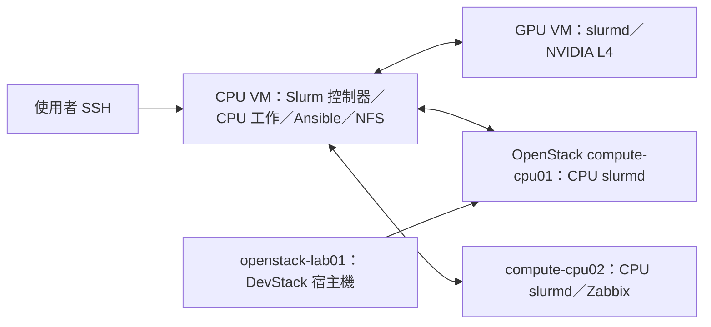

# 面試專案：可查證的迷你 HPC 叢集

狀態：控制節點、L4 GPU VM 與兩台獨立 CPU 運算節點已有 Slurm 工作結果；
OpenStack 供給的 `compute-cpu01` 已納入叢集。
模組 06 已完成 Zabbix 告警、CPU 節點故障隔離、工作轉移與恢復演練。
依[能力路線](../curriculum/ROADMAP.md)逐步完成作品。

目標：由 GCP 控制節點以 Ansible 管理 Slurm 叢集，將 OpenStack CPU 客體
納入獨立運算節點，執行可核對的 CPU／GPU 工作，
配合 Python 健檢、共享儲存與 Zabbix，展示部署、排程、觀測、除錯和
復原能力。OpenStack 依單台 VM 供給與 Slurm 納管證據如實對照。

圖示是已驗證的工作角色，不代表各 VM 在讀取文件當下仍在線。
Slurm 教學叢集的[已驗證拓撲](docs/cluster-topology.md)包含
OpenStack CPU 客體與另一台獨立 CPU VM。
運算節點所需的[Slurm 套件與原始碼](packages/slurm/README.md)已保存在專案中。
CPU VM 兼任多項角色是降低實驗成本的取捨，沒有生產高可用性。
GCP VM 的實體主機配置不確定，OpenStack CPU 客體則運行在
`openstack-lab01` 上；效能報告只針對實測環境。

## 需求對照

| 職缺要求 | 作品證據 |
|---|---|
| HPC 軟硬體集群規劃 | 拓撲、資源估算、假設、限制與擴充設計 |
| 網路設定管理 | 位址與名稱表、連線規則、NFS、網路故障報告 |
| 叢集建置自動化 | inventory、playbook、OpenStack CPU 客體納管及 GPU 節點加入既有控制節點的部署證據 |
| Linux 與程式能力 | Python 健檢工具及測試、C/MPI 程式與正確性驗證 |
| 開源維運經驗 | Slurm 運算節點故障定位、Zabbix 告警與恢復事件、工作復測紀錄 |
| OpenStack | DevStack 的映像、網路及 CPU VM 供給，控制節點 SSH 管理與 Slurm 工作證據 |

## 作品證據狀態

| 項目 | 已有證據與仍待驗收的範圍 |
|---|---|
| 節點與拓撲 | [拓撲文件](docs/cluster-topology.md)列出控制節點、GPU VM、兩台 CPU VM 與 OpenStack 宿主機；節點狀態依[模組 05](../curriculum/module-05.md)及[模組 06](../curriculum/module-06.md)的當時結果，不代表目前在線 |
| 網路與共享資料 | [模組 04](../curriculum/module-04.md)已驗證私有網路、NAT、SSH 及控制節點與 GPU VM 的 NFS 雙向讀寫；[模組 05](../curriculum/module-05.md)已驗證 OpenStack CPU 客體的雙向通路與網路恢復；CPU 客體沒有掛載 NFS |
| Ansible 與 Slurm | [模組 05](../curriculum/module-05.md)有 GPU 節點部署、OpenStack CPU 客體納管及工作證據；[模組 06](../curriculum/module-06.md)有四節點設定部署結果；沒有新環境整套重建實測 |
| 計算工作 | [模組 03](../curriculum/module-03.md)有 C/MPI 正確性結果；[模組 04](../curriculum/module-04.md)有兩台 VM 各一個 CPU rank 的跨節點 MPI；模組 05 有 L4 工作 `validation=PASS`，模組 06 有兩台 CPU VM 的同一份工作與故障期間轉移結果 |
| Python 健檢 | [模組 02](../curriculum/module-02.md)有 help、JSON、逾時與部分失敗的程式及實測案例 |
| 監控與復原 | [模組 06](../curriculum/module-06.md)記錄 Zabbix `slurmd` 告警、恢復、Slurm 隔離及工作復測；這是教學叢集的故障演練證據 |
| 架構量測與供給比較 | 工作輸出已有單次量測；若要主張效能比較，仍需可比輸入、重複量測與原始資料。DevStack 與 GCP 的供給流程對照尚未整理 |
| 模組 07 交付 | [模組 07](../curriculum/module-07.md)已盤點證據與職缺能力，[操作手冊](docs/operations.md)已完成，[十分鐘展示提綱](docs/demo.md)已寫；口頭展示與最後的技術追問尚未演練 |

OpenStack 已供給 `compute-cpu01`，並完成管理連線及 Slurm 工作驗證。
RDMA、Lustre、Slurm accounting 資料庫需有需求與相應環境才展開；
Zabbix 已在模組 06 實作。

## 使用作品

從[操作手冊](docs/operations.md)找到既有環境的前置條件、設定來源、
工作驗證與故障復原入口；[拓撲](docs/cluster-topology.md)說明各節點角色，
[展示提綱](docs/demo.md)串起可向面試官展示的證據。
實際部署結果與完整輸出保留在各模組文件，不以單次量測推稱效能提升。

履歷完成後應依實際證據描述各 VM 的角色、工作與驗證範圍；
`compute-cpu01` 的 Slurm 工作已有實測；GPU 節點加入既有控制節點
的驗證不能寫成整個叢集從零重建。
