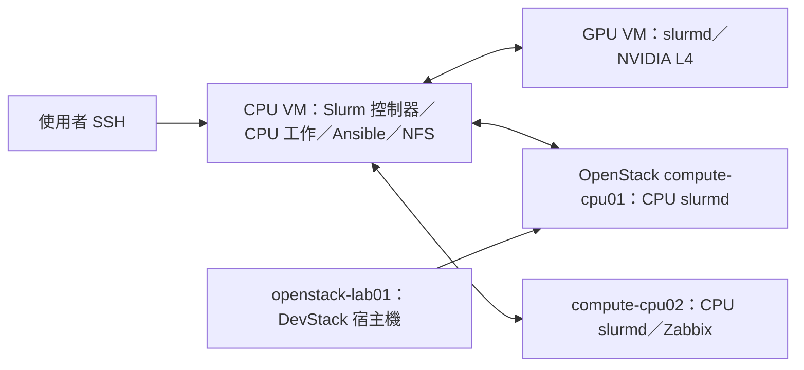

# 面試專案：可查證的迷你 HPC 叢集

在 GCP 與 DevStack 環境建立四節點 Slurm 叢集：控制節點、
NVIDIA L4 運算節點，以及兩台獨立 CPU 運算節點。
使用 Ansible 管理 NFS、MUNGE 與 Slurm 設定，將 OpenStack CPU 客體納入排程，
並以可核對答案的工作與 Zabbix 故障事件驗證資料路徑、派工和復原。

## 主要成果

| 成果 | 可查證的證據 |
|---|---|
| 四節點排程 | [拓撲與資源配置](docs/cluster-topology.md)、[四節點設定](slurm/four-node-slurm.conf)、[Ansible 部署](../curriculum/module-06.md) |
| CPU／GPU 工作 | [L4 熱擴散 `validation=PASS`](../curriculum/module-05.md)；[兩台 CPU VM 的相同工作與故障期間工作轉移](../curriculum/module-06.md) |
| 網路與資料路徑 | [NFS 雙向讀寫與跨 VM MPI](../curriculum/module-04.md)；[OpenStack 客體的管理與 Slurm 雙向通路](../curriculum/module-05.md) |
| 故障定位與恢復 | [Zabbix 告警、Slurm 節點隔離及工作復測](../curriculum/module-06.md)；[操作與復原手冊](docs/operations.md) |

完整的[作品證據索引](../curriculum/module-07.md)依職缺能力串接設定、命令和實際結果。

圖示是已驗證的工作角色，不代表各 VM 在讀取文件當下仍在線。
Slurm 教學叢集的[已驗證拓撲](docs/cluster-topology.md)包含
OpenStack CPU 客體與另一台獨立 CPU VM。
運算節點所需的[Slurm 套件與原始碼](packages/slurm/README.md)已保存在專案中。
控制節點兼任 CPU 與 NFS 服務，是降低實驗成本的取捨；控制服務採單一節點。
GCP VM 的實體主機配置不確定，OpenStack CPU 客體則運行在
`openstack-lab01` 上；效能報告只針對實測環境。

## 需求對照

| 職缺要求 | 作品證據 |
|---|---|
| HPC 軟硬體集群規劃 | 拓撲、資源估算、假設、限制與擴充設計 |
| 網路設定管理 | 位址與名稱表、連線規則、NFS、網路故障報告 |
| 叢集建置自動化 | inventory、playbook、OpenStack CPU 客體納管及 GPU 節點加入既有控制節點的部署證據 |
| Linux 與程式能力 | Python 健檢工具及測試、C/MPI 程式與正確性驗證 |
| 開源維運經驗 | Slurm 運算節點故障定位、Zabbix 告警與恢復事件、工作復測紀錄 |
| OpenStack | DevStack 的映像、網路及 CPU VM 供給，控制節點 SSH 管理與 Slurm 工作證據 |

## 作品證據狀態

| 項目 | 可查證的成果 |
|---|---|
| 節點與拓撲 | [拓撲文件](docs/cluster-topology.md)列出控制節點、GPU VM、兩台 CPU VM 與 OpenStack 宿主機；節點狀態依[模組 05](../curriculum/module-05.md)及[模組 06](../curriculum/module-06.md)的當時結果，不代表目前在線 |
| 網路與共享資料 | [模組 04](../curriculum/module-04.md)已驗證私有網路、NAT、SSH 及控制節點與 GPU VM 的 NFS 雙向讀寫；[模組 05](../curriculum/module-05.md)已驗證 OpenStack CPU 客體的雙向通路與網路恢復 |
| Ansible 與 Slurm | [模組 05](../curriculum/module-05.md)有 GPU 節點部署、OpenStack CPU 客體納管及工作證據；[模組 06](../curriculum/module-06.md)有四節點設定部署結果 |
| 計算工作 | [模組 03](../curriculum/module-03.md)有 C/MPI 正確性結果；[模組 04](../curriculum/module-04.md)有兩台 VM 各一個 CPU rank 的跨節點 MPI；模組 05 有 L4 工作 `validation=PASS`，模組 06 有兩台 CPU VM 的同一份工作與故障期間轉移結果 |
| Python 健檢 | [模組 02](../curriculum/module-02.md)有 help、JSON、逾時與部分失敗的程式及實測案例 |
| 監控與復原 | [模組 06](../curriculum/module-06.md)記錄 Zabbix `slurmd` 告警、Slurm 隔離、工作轉移、服務恢復及工作復測 |
| 作品索引 | [模組 07](../curriculum/module-07.md)對照職缺能力與實際證據；[操作手冊](docs/operations.md)說明使用及復原，[作品展示提綱](docs/demo.md)串起拓撲、工作與故障結果 |

OpenStack 已供給 `compute-cpu01`，並完成管理連線及 Slurm 工作驗證。

## 使用作品

從[操作手冊](docs/operations.md)找到既有環境的前置條件、設定來源、
工作驗證與故障復原入口；[拓撲](docs/cluster-topology.md)說明各節點角色，
[展示提綱](docs/demo.md)串起可向面試官展示的證據。
實際部署結果與完整輸出保留在各模組文件。

履歷可依上述證據描述各 VM 的角色、部署範圍、工作結果及故障處理。
