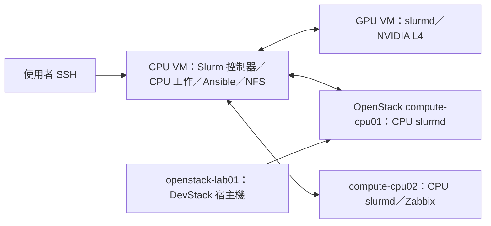

# 面試專案：可重建的迷你 HPC 叢集

狀態：控制節點、L4 GPU VM 與兩台獨立 CPU 運算節點已有 Slurm 工作結果；
OpenStack 供給的 `compute-cpu01` 已納入叢集。
模組 06 已完成 Zabbix 告警、CPU 節點故障隔離、工作轉移與恢復演練。
依[能力路線](../curriculum/ROADMAP.md)逐步完成作品。

目標：由 GCP 控制節點以 Ansible 管理 Slurm 叢集，將 OpenStack CPU 客體
納入獨立運算節點，執行可核對的 CPU／GPU 工作，
配合 Python 健檢、共享儲存與 Zabbix，展示部署、排程、觀測、除錯和
復原能力。OpenStack 依單台 VM 供給與 Slurm 納管證據如實對照。



圖示是已驗證的工作角色，不代表各 VM 在讀取文件當下仍在線。
Slurm 教學叢集的[目標拓撲](docs/cluster-topology.md)包含
OpenStack CPU 客體與另一台獨立 CPU VM。
運算節點所需的[Slurm 套件與原始碼](packages/slurm/README.md)已保存在專案中。
CPU VM 兼任多項角色是降低實驗成本的取捨，沒有生產高可用性。
GCP VM 的實體主機配置不確定，OpenStack CPU 客體則運行在
`openstack-lab01` 上；效能報告只針對實測環境。

## 需求對照

| 職缺要求 | 作品證據 |
|---|---|
| HPC 軟硬體集群規劃 | 拓撲、資源估算、假設、限制與擴充設計 |
| 網路設定管理 | 位址與名稱表、連線規則、NFS、網路故障報告 |
| 叢集建置自動化 | inventory、playbook、OpenStack CPU 客體納管及乾淨 GPU 節點加入既有控制節點的部署證據 |
| Linux 與程式能力 | Python 健檢工具及測試、C/MPI 程式與正確性驗證 |
| 開源維運經驗 | Slurm 運算節點故障定位、Zabbix 告警與恢復事件、工作復測紀錄 |
| OpenStack | DevStack 的映像、網路及 CPU VM 供給，控制節點 SSH 管理與 Slurm 工作證據；不宣稱 OpenStack 叢集自動化 |

## 必做驗收

- [ ] 控制 VM、獨立 CPU 客體及 GPU VM 的版本、資源、位址與角色有文件，敏感資訊不公開。
- [ ] `compute-cpu01` 的雙向通路、身分與共享資料經驗證；Ansible 納管後，Slurm CPU 工作在此客體完成且答案可核對。
- [ ] 從符合文件前置條件的乾淨 GPU VM，以 Ansible 加入既有控制節點；人工步驟與依賴如實列出。
- [ ] 獨立 CPU 客體與 GPU VM 都能接收各自適合的 Slurm 工作；以輸出中的主機名證明執行位置。
- [ ] C/MPI 程式正確處理不可整除工作量，結果與序列版本一致。
- [ ] MPI 工作跨 CPU VM 與 GPU VM 執行，保存 rank／主機名與工作輸出。
- [ ] Python 工具有 help、結構化輸出、逾時及部分失敗處理，保留測試結果。
- [ ] 只做能支持架構決策的量測；保留原始數據、輸入、資源配置、版本與波動，不要求一定加速。
- [ ] Zabbix 持續更新運算節點或 Slurm 服務狀態；同一次故障有 Problem 與 OK 事件，並有 Slurm 定位、修復及已知答案工作的復測結果。跨節點轉移另需兩台獨立運算節點可接同類 CPU 工作的證據。
- [ ] 以已完成的 DevStack CPU VM 供給與 SSH 登入證據，對照現有 GCP VM 供給流程。
- [ ] 一份完整的跨節點故障紀錄，串起監控、告警、原因、修復、恢復事件與工作結果。
- [ ] 在新環境按文件重建並核對工作；README、部署手冊、操作／復原手冊、技術追問與十分鐘展示完整，沒有將規劃寫成完成。

目前 GPU 配額僅允許一張卡；替換節點時先停止舊 GPU VM，並保留回復方式。
OpenStack 已有單台 VM 供給證據，沒有 OpenStack 叢集建置證據。
RDMA、Lustre、Slurm accounting 資料庫需有需求與相應環境才展開；
Zabbix 已在模組 06 實作。

## 建議實作目錄

```text
project/
  README.md
  ansible/              # inventory 範例、playbooks、roles
  healthcheck/          # Python 原始碼、測試、使用說明
  workloads/            # C/MPI、編譯方法、sbatch 腳本
  monitoring/           # 模板與告警定義，排除憑證
  benchmarks/           # 原始 CSV、分析程式、圖表
  docs/                 # 架構、部署、操作手冊、版本紀錄
  incidents/            # 真實演練報告
  demo/                 # 展示腳本、截圖或影片索引
```

這些是預期交付位置，待實作才建立內容。不要在尚未測量前填入重建耗時、效能提升或恢復時間。

## 十分鐘展示順序

1. 交代職缺需求、Slurm 叢集的角色、現有規模及限制。
2. 展示 Ansible 設定來源、實際部署、重跑及必要人工步驟。
3. 核對跨節點工作、CPU 熱擴散與單 GPU 工作的輸入、節點及答案。
4. 用真實事件說明告警、故障定位、恢復與工作驗收。
5. 用必要量測說明架構取捨，指出企業實體叢集仍需驗證的部分。

履歷完成後應依實際證據描述各 VM 的角色、工作與驗證範圍；
`compute-cpu01` 的 Slurm 工作已有實測；乾淨 GPU 節點加入既有控制節點
的驗證不能寫成整個叢集從零重建。
